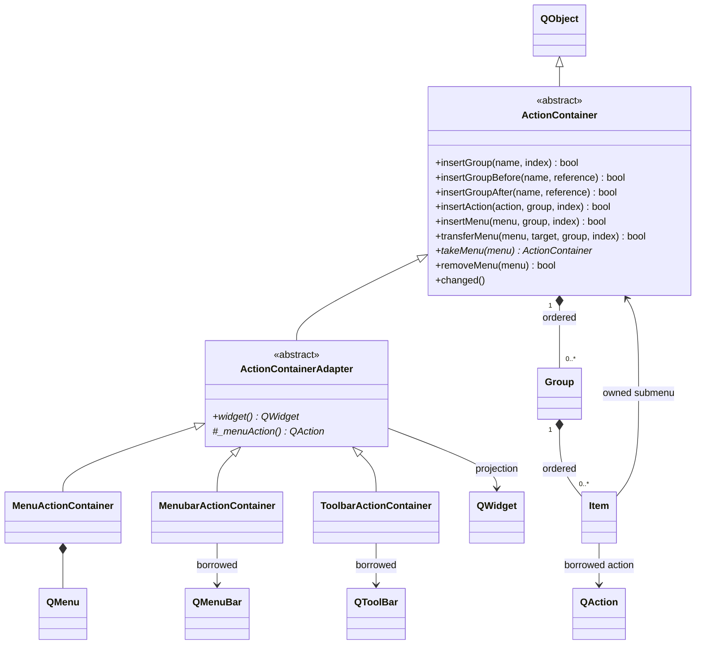

# Action containers

Action containers provide ordered extension points for commands and menu trees in
Qt Widgets. The implementation is in Core: the abstract model is under `src/`,
and native Qt projection is under the module-root `gui/action/` directory. Public
headers use `<Termaster/Core/Header.h>`.

## Structure



`ActionContainer` owns the authoritative ordered hierarchy. A group contains a
single mixed sequence of action and submenu entries, so their relative positions
are unambiguous. It has no dependency on a concrete widget. Backend subclasses
provide availability and insertion eligibility checks.

`ActionContainerAdapter` projects the model into native Qt widgets. It is an
adapter rather than a QWidget subclass. The projection owns its separators and
tracks registered actions through weak pointers. The concrete adapters provide
QMenu, QMenuBar and QToolBar integration. Toolbar menus use QToolButton's
`InstantPopup` mode. Menu bars and toolbars cannot themselves be nested as menus.

The projection preserves unmanaged actions and their relative order. Managed
entries form an ordered block after unmanaged actions. Separators appear only
between nonempty groups. Mutating the managed portion of the native widget
independently is outside the API contract; changes go through the container.
Changing a borrowed QAction's text, icon, enabled state or other properties uses
Qt's normal action propagation and requires no container rebuild.

## Ordering and validation

- Groups support append, indexed insertion, insertion before/after another group,
  indexed movement, movement before/after, rename, clearing and removal.
- Actions and menus support append, indexed insertion, movement within or across
  groups, and removal. A complete prepared menu subtree can be attached at once.
- `transferMenu` validates the destination before moving an owned subtree between
  containers. `takeMenu` detaches a subtree for caller-controlled ownership.
- Insertion indexes range from zero through the current count. Movement indexes
  identify the final position after removal of the source entry. Item indexes
  count mixed logical entries; presentation separators do not count.
- Group names are unique within a container. Empty group names are supported.
  Groups must exist before items can be inserted into them.
- An action may occur once in a container and may be shared across containers.
  Sibling menu names are unique across all groups in the same parent.
- Menu names must be nonempty and cannot be `.`, `..`, or contain `/` or `\`.
  Logical or QObject ownership cycles, duplicate entries, unavailable/incompatible backends, cross-thread
  objects and invalid indexes are rejected without changing the hierarchy.
- Ordinary mutators report success with `bool`. Missing lookups return null or
  empty collections; `groupIndex` returns -1. Cleanup remains available when a
  widget has disappeared, even though insertion and movement are unavailable.

`path()` returns `/` for the root and `/connection/options` for nested menus.
The root's own name is excluded. `findMenu` resolves relative paths, root-relative
paths beginning with `/`, and `.`/`..`; traversing above the root fails. Group
names do not participate in menu paths. Names identify nodes; titles are separate
QString presentation values and preserve Unicode.

## Ownership and lifecycle

Actions are borrowed: registration never reparents them, and removing a group or
container never explicitly deletes them. Their QObject owner remains responsible
for destruction. Destruction of a registered action removes its logical entry
and updates the presentation automatically. An action parented to a menu
container naturally dies with that QObject owner.

Successful menu insertion transfers QObject ownership of the entire subtree to
the parent container. Attached nodes must therefore be heap allocated. Failed
insertion leaves ownership unchanged. `removeMenu`, `clearGroup`, `removeGroup`,
`clear` and parent destruction destroy attached subtrees. `clearGroup` preserves
the group; `clear` removes all groups. `takeMenu` clears both logical parent and
QObject parent and transfers responsibility to the caller.

A MenuActionContainer owns its QMenu. MenubarActionContainer and
ToolbarActionContainer borrow their widgets; their default QObject owner is the
widget unless an explicit owner is supplied. Wrapper destruction removes managed
entries and separators. External widget destruction makes a surviving wrapper
unavailable. Destruction of an attached QMenu removes its owned logical subtree.

All reads, writes and destruction occur on the container's QObject thread; native
adapters require the GUI thread. Borrowed actions must share that thread. Signals
are emitted after the logical state is consistent. Observers must use
`deleteLater()` when deleting the signal sender rather than destroying it inside
a synchronous callback. Reentrant projection changes are reconciled after the
current projection pass; persistent changes yield through a queued continuation.

Plugin shutdown must unregister contributed actions and remove owned submenus or
groups before destroying the objects and unloading executable code. Connections
and action owners remain the contributing component's responsibility.

## Example

```cpp
MenubarActionContainer menus(window.menuBar());
menus.addGroup("application");
menus.addGroup("extensions");
menus.insertGroupBefore("connections", "extensions");

auto connection = std::make_unique<MenuActionContainer>("connection", "Connection");
connection->addGroup("commands");
connection->addAction(connectAction, "commands"); // borrowed QAction
connection->addGroup("settings");

auto options = std::make_unique<MenuActionContainer>("options", "Options");
options->addGroup("commands");
options->addAction(preferencesAction, "commands");
if (connection->addMenu(options.get(), "settings"))
    options.release();

if (menus.insertMenu(connection.get(), "connections", 0))
    connection.release();

// Resolves the attached subtree without knowing its containing group.
auto settingsMenu = menus.findMenu("/connection/options");
```

The example uses `<memory>` for prepared ownership until insertion succeeds.
Production callers handle failed group/action insertion as appropriate for their
command registration policy. Root wrappers must be destroyed before stack-owned
widgets, as in normal Qt object lifetime ordering.

## Verification

The opt-in `TERMASTER_BUILD_ACTION_TESTS` CMake option builds
`ActionContainerTests`. Tests cover group ordering, mixed entries, invalid
operations, cycles, subtree ownership and transfer, paths, shared action
lifetimes, externally destroyed widgets/menus, native action ordering, toolbar
popup mode and Unicode titles. QtTest assertions remain active in Release.

On Windows x64 with MSVC 19.44, Qt 6.12.0 and Ninja Release, the application and
three test executables were built. Native visual fixtures exercise grouped menus,
a nested submenu, a toolbar dropdown and Cyrillic/Japanese labels. Set
`TERMASTER_ACTION_GUI_CAPTURE` to a disposable capture directory to include the
visual fixture; without it only that optional capture case is skipped. Set
`QT_QPA_PLATFORM=windows` for native captures. The regular CTest registrations use
`offscreen` for deterministic lifecycle checks. Existing plugin integration and
plugin-window suites provide regression coverage; no device traffic is used.

Verification completed on 2026-11-08: all three CTest suites passed. The native
action suite passed all 12 cases without skips at scale factors 1 and 2. Window
and menu captures at both scales were visually inspected: Unicode labels,
separators and the toolbar dropdown rendered correctly. Offscreen capture emits
platform/font warnings; visual acceptance uses the native Windows captures.
The main application's experimental terminal entry point remains unchanged;
these fixtures exercise the containers independently of that startup path.
