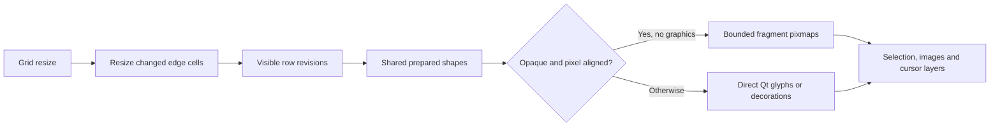

# Application performance investigation

Baseline investigation: 2026-11-10. Remediation and acceptance: 2026-11-11.
The final results are recorded below; baseline sections retain their original scope.
The optional probes live under
[ApplicationProfile](../tools/benchmarks/ApplicationProfile/CMakeLists.txt).
Processing measurements are documented separately in
[processing performance](processing-performance.md).

## Workloads and evidence

The real fixture is a workspace with six disconnected terminals, one external
processor definition and several terminal-local processing diagrams. The three
original files were copied from `G:/TMP/Tmaster` into fresh, isolated directories
on the same G: volume. Source hashes were compared after each run and remained
unchanged. Fixture contents, terminal names and connection targets are not stored
in the report. No restored terminal was connected. Added test terminals use
COM999 and remain disconnected. Only the explicitly enabled physical COM3
loopback probe opens a port.

The host is Windows, Ryzen 9 5900X, Qt 6.12.0 MSVC x64. Both F: and G: are local
NTFS fixed volumes. Measurements use the existing Release `/O2 /Ob2 /DNDEBUG`
and Debug toolchains, native Windows Qt widgets, default display scaling and
normal process scheduling. No affinity, system-wide idle guarantee or fixed
power state was imposed. Results are local observations, not portable targets.

The lifecycle probe uses real App APIs and actual installed project plugins.
Normal operations execute on the GUI thread. Each lifecycle cycle saves, adds
and closes one disconnected terminal, closes the session and restores it. The
six-terminal population is held constant. Window resize alternates 1000x700 and
1160x790 and drains pending Qt events. This includes layout, queued work and
painting, but excludes final compositor presentation and human input latency.
Idle measurement uses a three-second nested event loop, not a polling loop.

[Raw records and aggregates](benchmarks/application-profile/Summary.json):

- `release/`: two fresh processes, five lifecycle cycles each, 40 window resizes.
- `debug/`: one process, five lifecycle cycles, 20 window resizes.
- `instrumented/`: a separate Release diagnostic run with aggregate scope timers.
- `debug-instrumented/`: a separate one-cycle Debug diagnostic run.
- `release-render/`, `debug-render/`, `final-release/`, `final-debug/`: uninstrumented repaint and direct font-metric controls.
- `normal-close/` and `normal-close-stacks/`: bounded loaded-workspace shutdown reproducers.
- `baseline/`: exploratory data, excluded from the main lifecycle comparison;
  terminal counts grew and shutdown immediately called quit. Do not mix it into
  the refined constant-population measurements.

Per-operation records contain wall time, process CPU delta and endpoint private
memory. CPU accounting is coarse (often 15.625 ms increments); a zero CPU delta
is not zero work. Endpoint memory is not peak memory or proof of a leak. The
Release session-open endpoints rose from about 48 to 58 MiB over one five-cycle
run; allocator caches, delayed destruction and live ownership need separation
before diagnosing retention.

WPR CPU recording was attempted and denied by Windows performance-policy error
`0xc5585011`. No elevation or policy change was requested. This investigation
therefore has instrumented spans and a shutdown stack, not a system-wide sampled
CPU flame graph. Scope timers add map/clock overhead and are explanatory only;
all headline lifecycle timings below are from uninstrumented builds. App and
Core are static libraries here and share the trace store. Exclusive scope time
means time excluding *instrumented* descendants, not all callee work.
Instrumentation is applied temporarily with byte-for-byte backups, then restored.
No profiling hooks remain in production sources.

## Lifecycle results

Milliseconds, median; parenthesized number is p95 where repeated samples exist.
Small sample counts make p95 descriptive rather than a reliable population bound.

| Operation | Release | Debug |
| --- | ---: | ---: |
| Workspace open and session restoration | 282.3 (n=2) | 2245.4 (n=1) |
| Reopen six-terminal session | 335.0 (408.8) | 2876.3 (3338.0) |
| Save unchanged session through App | 19.10 (27.72) | 363.97 (423.32) |
| Session::sync alone, unchanged | 0.465 (0.510) | 4.275 (4.361) |
| Save changed session through App | 41.28 (44.33) | 356.17 (446.62) |
| Workspace::sync, unchanged | 33.08 (39.07) | 169.56 (181.83) |
| Add disconnected serial terminal | 44.53 (48.48) | 241.15 (255.29) |
| Close added terminal | 6.43 (7.24) | 29.89 (31.76) |
| Close session | 90.46 (98.29) | 372.92 (398.38) |
| Resize restored empty-terminal window | 16.98 (26.08) | 216.60 (272.62) |
| Close workspace | 87.57 (n=2) | 1342.44 (n=1) |

The Debug run also measured the actual Lineflow menu action: editor opening
median 195.3 ms, closing including deferred deletion 29.8 ms (three samples).
Equivalent Release editor timings are in the diagnostic run; they are not
presented as an uninstrumented comparison.

The unchanged save path is about 41 times the direct clean session sync in
Release and 85 times in Debug. Those are comparisons of measured operations,
not predicted optimization speedups. Debug amplifies the issues substantially;
switching to Release alone does not remove the redundant work.

## Resize and rendering attribution

`TerminalDisplay::resizeEvent()` clears every cached line on every resize.
`_layout()` rebuilds QTextLayouts and its ASCII coalescing predicate calls
`QFontMetricsF::horizontalAdvance()` repeatedly for candidate cells. Ordinary
blank cells contain a space and do coalesce; they must not be described as
creating one layout per empty cell. Actual Unicode/fallback graphemes can still
require individually positioned runs. Paint iterates visible rows regardless of
the event's dirty rows, although Qt clips the actual QPainter drawing.

Uninstrumented cold/warm repaint medians for the standalone widget:

| Content | Release cold / warm, ms | Debug cold / warm, ms |
| --- | ---: | ---: |
| Blank | 9.71 / 1.29 | 233.01 / 5.12 |
| Explicit spaces | 18.86 / 1.41 | 215.59 / 4.16 |
| ASCII x | 22.89 / 4.74 | 263.90 / 51.07 |

Each cell has ten samples from one process per build. Font/shape caches are warm;
"cold" means the application's row cache was invalidated by setAppearance before
an explicitly measured repaint. The appearance call itself is outside that paint
timer. These controls establish cache-rebuild cost, not that blank content is
universally slower than text. Large static Debug ASCII drawing cost also remains.

The final uninstrumented control used Courier New 12 pt, DPR 1, a 120x31 grid.
10,000 calls of horizontalAdvance on the same `x` string took median 15.12 ms
in Release and 403.30 ms in Debug (five samples). All measured advances for M,
x and space were 10 logical pixels. The same final run's blank cold repaint was
7.91 / 176.24 ms respectively. This establishes that repeated single-character
metrics alone are expensive enough to explain a substantial part of cold layout
work; it does not assign every paint instruction to that call. See `final-release/`
and `final-debug/` for the controls and retained metadata.


The Debug diagnostic run attributes 20.39 seconds to `_layout()` out of 23.91
seconds inside paintEvent across 102 paints in its combined rendering workload.
This is an aggregate diagnostic with substantial instrumentation/workload effects,
not a per-frame baseline. Cold versus warm repaint controls and raw results are
retained with the probe.

History resizing is a separate problem. `TerminalScreen::setLimits()` resizes
and repairs every retained line whenever either grid dimension changes. A
height-only resize therefore scans all historical cells. Fresh Release fixtures
with 120 columns, 30 rows and 10,000 history lines measured approximately:

| Grid change | Median, ms |
| --- | ---: |
| No change | 0.001 |
| Height +1 row | 8.5 |
| Width -1 column | 8.6 |
| Width +1 column | 24.9 |

These timings exclude fixture preparation and QWidget painting. Debug's separate
warm/reset fixture measured about 39.6 ms for height and 41.4 ms for narrowing;
its widening samples vary with retained capacity. The warm fixture is not the
same fresh-allocation experiment as Release. Do not use that pair as a compiler
speed ratio. Widget history controls include event draining and painting and
are reported separately in raw records.

## Lifecycle attribution

The Release scope run recorded:

| Instrumented span | Calls | Inclusive time, ms |
| --- | ---: | ---: |
| TerminalController::_materialize | 56 | 1409.7 |
| TerminalProcessingPanel constructor | 56 | 599.3 |
| TerminalController::applySettings | 25 | 425.2 |
| SettingsSchema constructor | 431 | 280.4 |
| TerminalController::_effective | 594 | 280.5 |
| Settings::value | 48,846 | 150.5 |
| Workspace::sync | 17 | 1088.2 |

Counts include startup, editor creation, validation and no-op calls; inclusive
spans nest and must not be added. Totals are not steady-state per-user-operation
latencies. The Debug diagnostic independently shows schema construction,
effective configuration materialization and hidden processing UI as costly paths.

The concrete shared save path is `App::saveSession()` -> `_updateSession()` ->
`TerminalController::applySettings()`. It reapplies appearance to every terminal
even after a clean save. `setAppearance()` has no equality guard: it recolors the
screen/history, drops selection and cached layouts, and schedules another paint.
`_effective()` repeatedly creates schema/default views and converts YAML-backed
settings into QVariant maps. New terminals eagerly construct the hidden processing
panel, three catalogs and operation-property editors.

Workspace::sync validates and prepares the processor catalog and a file
transaction even for unchanged or session-history-only updates. Session open and
close enter this path. Menu refresh also reloads inactive recent sessions merely
to read their names; the six-terminal fixture has only one recent session, so
its worst-case ten-session cost remains a static scaling risk.

## Shutdown finding

A dedicated probe performs App startup, opens the copied workspace and calls
`mainWindow.close()` through the normal queued App close path. It does not call
quit directly. The close handler returns, but the process does not terminate
within the 8/15-second bounds. Two bounded close-only runs reproduce this.
The full workload probe can exit normally, so pending callback timing matters.
This is an integration reproducer using the real App class, not a claim that
every interactive close of the stock executable hangs.

Local non-invasive CDB capture shows the GUI thread waiting in
`QCoreApplication::postEvent` / `QBasicMutex::lockInternal` while
`QCoreApplicationPrivate::cleanupThreadData` destroys queued calls. The matching
linker map resolves project frames to:

```text
ProcessingRouter::_retire queued-call destruction
  -> shared processor Hold destruction
  -> ForwardProcessor destruction
  -> ProcessorRegistry::_create lease deleter
  -> Lineflow::cancel
  -> ProcessorRegistry cancellation acknowledgement
  -> QTimer::singleShot -> postEvent -> mutex wait
```

The acknowledgement in `ProcessorRegistry.cpp` queues deletion, and the router's
retirement callback owns another processor handle. Releasing a queued holder
during Qt queue cleanup can post another deferred deletion under that cleanup.
This is a lifecycle deadlock candidate with captured stack evidence, not merely
slow disk I/O. Preserve plugin leases and cancellation acknowledgements when
fixing it; synchronous destruction inside a processor's active callback is unsafe.
Raw debugger logs remain in local scratch; only
[resolved project frames](benchmarks/application-profile/normal-close-stacks/ResolvedFrames.json)
are checked in. No remote symbols or dependencies were downloaded.

## Physical loopback

COM3 was explicitly exercised at 115200, 8N1 using Qt SerialPort. The probe clears
its queues, sends deterministic binary packets (including NUL), reads until exact
length or a three-second bound, compares every byte and closes the port.
Five repetitions each of 1, 16, 256 and 4096 bytes passed. The 4096-byte roundtrip
was about 370 ms; its ideal one-way UART serialization time alone is 355.6 ms.
Small packets were around a USB latency interval, not a CPU-throughput limit.
Closing the physical port took about 107 ms in this run.

This measures Qt/driver/hardware loopback separately, not the complete App
processing/rendering path. It does not test backpressure at every baud rate,
sustained multiport traffic, device removal or arbitrary real peripherals.
No driver settings, services or installed USB latency settings were changed.

## Prioritized remediation

| Order | Change | Evidence and completion criterion |
| --- | --- | --- |
| P0 | Drain and finish owned processor retirement before QApplication queue destruction | Close-only deadlock and resolved stack. Repeated loaded-session close must exit without pending code/lease destruction; retain cancellation and plugin-unload contracts. |
| P1.1 | Reuse row layouts, cache fixed glyph advances and avoid redundant invalidation | Cold paint dominates Debug; per-cell metric queries and layout reconstruction need reduction. Recheck empty, ASCII, Unicode, style changes, fractional DPI, selection and cursor. |
| P1.2 | Make resize proportional to visible/changed data | Full-history repair on height-only changes. Avoid rewriting historical widths for a height-only change, bound transient memory, preserve cursor/history/alternate-screen behavior. |
| P1.3 | Separate saving from configuration application | Clean save costs 19/364 ms versus direct sync 0.47/4.28 ms. Unchanged save must not recreate settings, clear selection or invalidate terminal layout caches. |
| P1.4 | Cache immutable parsed schemas/default projections and lazily create hidden processing UI | Hundreds of schema constructions and catalogs in restoration. Preserve plugin leases and descriptor invalidation; compare six-terminal restore and add/close latency. |
| P2.1 | Skip unchanged workspace payload work and narrow metadata-only transactions | Clean sync 33/170 ms. Preserve disk-conflict detection, atomicity, unknown fields and recovery. Do not simply bypass transaction validation. |
| P2.2 | Reuse effective setting snapshots within one application pass | 48,846 YAML-backed reads and 594 effective projections. Invalidate on actual scope/schema changes, preserve overlays and borrowed lifetimes. |
| P2.3 | Bound retained partial regex rescanning | 64 KiB bytewise partial pattern takes ~0.995 s versus delimiter ~17 ms. Preserve byte/regex/capture semantics; document or constrain unsupported incremental patterns. |
| P2.4 | Reduce small-packet Lineflow dispatch/allocation overhead | Event-driven one-stage bypass ~15–17 us versus direct ~0.3 us. Preserve packet boundaries, fairness, cancellation and callback reentry. |
| P3 | Improve catalog search, drag validation and batch tab/action refresh | Source audit: full tree recreation, quadratic findData lookup, draft parsing on drag probes and repeated per-tab updates. Large-catalog timing still required before sizing the work. |

Implement one stage at a time and rerun the same uninstrumented fixtures after
each stage. A Release build is useful for normal operation, but is not a substitute
for fixing the repeated work and shutdown contract.

## Verification and remaining scope

The current App/Core sources were restored after both instrumentation passes;
Debug and Release Termaster and profiling targets were rebuilt. Processing
microbenchmarks completed 41 cases with five repetitions and active output/error
checks. All refined lifecycle, render and authorized loopback operations succeeded;
the two close-only timeouts are recorded findings. Python syntax, report links,
JSON records and whitespace checks accompany the tools. No production optimization
or new compatibility behavior was included in the original profiling milestone.

Remaining profiling scope includes allocator stacks, long-duration memory
stability, live multiport backpressure, fractional/high-DPI resize, graphical
terminal payloads and large-catalog scaling. These are not established by the
current fixture. Further system-wide CPU sampling requires an environment where
Windows performance tracing is permitted. Reproduction commands and safe
instrumentation restoration are in the probe README.

## Renderer and resize remediation

Fixed-width ASCII eligibility is cached per font and paint-device DPI/DPR rather
than querying a glyph advance for every cell during row construction. Non-ASCII
and multi-code-point graphemes keep the existing individually positioned shaping
path. Row layouts remain revision-checked and bounded to visible rows; pixel
resizes retain them, and partial paint events only visit intersecting text rows.
Font/device metric changes invalidate the cache, including font, application-font,
screen and DPR notifications without a pixel resize. A normalized unchanged appearance
is a no-op, preserving selection and screen revisions. Grid-size changes retain
the existing selection-clearing behavior; subcell pixel changes preserve selection.

Height-only screen changes retain the cells and revisions of surviving rows.
History trimming, cursor/saved-cursor adjustment, alternate-screen resizing and
resource bounds still execute. Width changes retain the existing resize and
wide-cell repair path, including trimming before widening allocations.

Verification used an isolated Release Qt 6.12/MSVC worktree build and local
vendored sources, without downloads or device connections. All five terminal
suites passed: TerminalDisplayTests, TerminalScreenTests, TerminalInputTests,
TerminalGraphicsTests and VtParserTests. Added regression coverage checks retained
selection/copy output and revisions after unchanged appearance/subcell resize,
partial versus full row pixels containing styled ASCII and Unicode, and retained
wide/styled history plus hidden primary-screen restoration across height changes.
Direct font changes without a pixel resize update the grid and clear selection;
synthetic DPR/screen events preserve selection when the grid is unchanged.
The 16-case display suite also passed on native Windows at scale factors 1 and
1.25. Synthetic native captures were inspected at both scales; the isolated
keyboard/appearance capture matched the pre-change Release executable pixel for
pixel in RGB at each scale when run with the same test sequence. The full-suite
capture additionally exercised the focused cursor. clang-format and whitespace
checks passed.

The integrated Release build passed the same five terminal suites. On the copied
six-terminal workspace, the quick native resize median was 10.39 ms (20 samples),
versus the original 16.98 ms combined baseline. The warm/reset 10,000-history-line
height increment measured 0.0019 ms; the unchanged-grid and width paths remain
separate controls. The repaint probe now changes foreground by one RGB unit to
force a real row-cache rebuild, then reapplies the identical appearance to measure
the no-op path. Blank changed-appearance repaint median was 1.94 ms and its no-op
repaint 0.623 ms (ten samples). Historical cold labels used an unchanged appearance
call and must not be reused as a forced-cold control after this optimization.
Raw records are in `benchmarks/application-profile/after-renderer/`. Original
workspace hashes stayed unchanged. Multi-monitor DPI transitions remain outside
this acceptance scope.

## Integrated remediation results

The prioritized P0–P3 application stages are integrated in `dev`. Processor
retirement now finishes while Qt event delivery and plugin owners are alive.
Unchanged appearance, height-only history resize, clean session saves and clean
workspace synchronization avoid their former repeated work. Effective settings
are projected from one per-operation snapshot; hidden processing editors are
created on demand. Catalog search retains its items, repeated drag probes have
bounded exact-key caches, and bulk tab restore/close updates presentation once.
Pattern Framer has a conservative completion prefilter; Lineflow reuses pump
scratch and avoids redundant scheduling. Persistence conflict, transaction,
packet-boundary, cancellation and authoritative drop-validation contracts remain.

Final uninstrumented native Windows runs used the same three-file source fixture
with six restored, disconnected terminals. Each build ran twice, five lifecycle
cycles per process and 20 window resizes per process. No builds or other test
runs overlapped timing. Every recorded operation succeeded and every process
exited normally. The original source file hashes stayed unchanged.

Medians in milliseconds (10 lifecycle samples; 40 resize samples per final build):

| Operation | Release before | Release after | Debug before | Debug after |
| --- | ---: | ---: | ---: | ---: |
| Clean session save | 19.095 | 0.447 | 363.970 | 6.138 |
| Clean workspace sync | 33.078 | 3.147 | 169.555 | 40.271 |
| Session reopen | 334.975 | 188.870 | 2876.253 | 1645.568 |
| Session close | 90.461 | 71.919 | 372.923 | 254.624 |
| Add disconnected serial terminal | 44.527 | 34.991 | 241.149 | 213.078 |
| Close added terminal | 6.434 | 3.459 | 29.885 | 27.356 |
| Native window resize | 16.977 | 11.013 | 216.598 | 51.941 |

These sequential before/after measurements include normal OS/filesystem variation;
they are fixture medians, not worst-case latency guarantees. Debug restoration
still takes about 1.65 seconds; Release restoration takes about 189 ms. Dirty
saves retain transaction work (19.2 ms Release median). Renderer changed-appearance
blank repaint is 1.92 ms Release; identical reapplication is 0.67 ms. The forced
changed-appearance control now toggles one RGB unit, so historical unchanged-call
cold labels are not an equivalent cache-invalidation control.

Three additional loaded-window close-only runs completed in 1.24, 0.56 and
0.58 seconds including startup, with normal exit and unchanged source hashes. Three Debug
close-only runs also exited normally in 2.82, 2.74 and 2.79 seconds.
The original deadlock is covered by nested/scoped asynchronous retirement tests
and loaded-session close fixtures. Broken providers that fail to acknowledge
cancellation remain pinned after a bounded shutdown timeout; code is not forcibly
unloaded.

The explicitly enabled COM3 USB-UART test passed all 20 binary packet comparisons
at 115200 baud (five each at 1, 16, 256 and 4096 bytes), then closed the port.
This is a direct Qt transport loopback check, separate from application/Lineflow
throughput acceptance. Restored application terminals remained disconnected.

Release full build and all 38 configured CTest suites passed (53.88 s). Debug
full build and all 54 configured suites passed (199.06 s), including console
shutdown, settings, parsing, persistence and processing. After the final batching
change, the affected AppTests were rebuilt and passed again in Release (22.59 s)
and Debug (49.14 s). Assertions remain active in Release tests. Native renderer
checks covered scales 1 and 1.25; catalog popup checks covered scales 1 and 2.
The bulk-tab native fixture was visually inspected. Formatting and whitespace
checks passed.

Raw records: [Release](benchmarks/application-profile/fixed-release/Run1.json),
[Debug](benchmarks/application-profile/fixed-debug/Run1.json),
[close-only](benchmarks/application-profile/fixed-close/Runs.json),
[aggregates](benchmarks/application-profile/Summary.json) and
[remediation environment](benchmarks/application-profile/RemediationEnvironment.json).
Scheduler-only and pattern comparisons are documented in
[processing core](processing-core.md#lineflow-dispatch-work) and
[processing nodes](processing-nodes.md). The integrated processing matrix is
retained under `benchmarks/processing-profile/fixed/`: all 41 cases completed
five measured repetitions plus warmup with active output/error checks. The
combined bytewise partial pattern took about 16.1 ms for 64 KiB, consistent
with the isolated prefilter result.

### Remaining measured limits

- The original 1129 ms cold drag probe was subsequently optimized by sharing
  identical immutable descriptors per pass and validating the draft in one parse,
  while retaining every provider and whole-graph check. No persistent validation
  snapshot was needed. See [current cold-drag results](lineflow-editor.md#cold-drag-validation).
  Arbitrarily expensive custom provider validators and many distinct schemas can
  still dominate a full validation; the synthetic fixture is not a worst-case bound.
- The regex prefilter accelerates only a conservative recognized subset. General
  PCRE2 expressions retain bounded buffers/internal limits and may rescan partial
  subjects. The 64 KiB bytewise `(a+)z` partial fixture improved from about
  995 ms to 16 ms; this does not establish linear behavior for arbitrary regexes.
- Small-packet Lineflow pump gains are modest. Asynchronous root dispatch remains
  substantially slower than direct calls; packet, fairness and reentry semantics
  were preserved. Queue-pressure, delimiter allocation and HEX span-construction
  ideas remain investigation candidates, not established application regressions.
- System CPU sampling remains unavailable under the existing WPR policy.
  Allocator stacks, long-duration memory stability, live multiport pressure and
  real multi-monitor DPI transitions were not established by these bounded runs.


## PERF-4: Native window resize

A new bounded probe separates one-pixel width/height changes from large diagonal
changes on an isolated copy of `G:/TMP/Tmaster`. Six restored terminals remain
disconnected. After 20 empty-window steps, the visible display receives synthetic
ASCII packets directly: 10,040 lines, retaining 10,034 rows at the fixture's
114-column, 34-row starting grid (Courier New, DPR 1). Each fresh process then
performs 30 width steps, 30 height steps and 30 alternating 160x90 diagonal steps.
This exercises real Widgets/window event delivery without contacting a device.
`geometryMs` records synchronous resize; `eventsMs` records subsequent Qt event
draining. Older baseline records contain their combined wall time only.

### Reference-informed changes

The implementation remains project-owned Qt Widgets code. Reference review used
[QTermWidget's opaque drawing and resize handling](https://github.com/lxqt/qtermwidget/blob/master/lib/TerminalDisplay.cpp),
[WezTerm's reuse of prepared line shapes](https://github.com/wezterm/wezterm/blob/main/wezterm-gui/src/termwindow/render/screen_line.rs),
and [Alacritty's separate row grow/shrink work](https://github.com/alacritty/alacritty/blob/master/alacritty_terminal/src/grid/row.rs).
No reference engine, source dependency or copied implementation was introduced.

- Width changes initialize only appended cells and repair a potentially clipped
  wide glyph at the right boundary. Retained interior pairs are already valid;
  scanning every historical cell again is unnecessary. Historical truncation,
  current-style blanks, cursor handling and model cell limits remain unchanged.
- Prepared Qt text layouts and glyph runs are shared by exact text/rendition,
  independently of row index. The per-display LRU charges 256 units per entry
  plus two units per UTF-16 character against a 64 Ki-unit budget. This limits
  cache population/text, not exact allocated memory: Qt internals and shapes
  retained by visible rows have their own bounded lifetime.
- Undecorated spaces need background painting, not text shaping. Mixed ASCII
  runs keep their original grouping so glyph overhang and subpixel antialiasing
  at internal spaces remain unchanged. Underline, strike and overline retain
  the Qt text-layout decoration path.
- Opaque, physically pixel-aligned text fragments use a per-display pixmap LRU
  with an 8 MiB cost budget (pixel bytes plus text/entry allowance). It reuses
  already rasterized glyphs across rows and resizes. Graphics placements,
  translucent backgrounds, fractional device origins and oversized entries use
  direct drawing. Selection/cursor overlays stay separate. Font/device metrics,
  appearance changes and explicit clear invalidate shape/raster caches.
- The viewport declares opaque painting only when its complete base fill is
  opaque and synchronized output is not deferred. Transparent themes and mode
  2026 keep the non-opaque path; the existing 150 ms timeout restores painting.
- Palette icons previously parsed/rasterized SVG on every paint, including
  unchanged toolbar/tab glyphs. They now use Qt's bounded application-wide
  [QPixmapCache](https://doc.qt.io/qt-6/qpixmapcache.html) keyed by SVG digest,
  resolved color, size, DPR and mode. Non-translating painter transforms retain
  direct vector rendering. Palette/disabled appearance and component ownership
  remain unchanged; no new application global cache or singleton was added.



The temporary Release scope run attributed 435 ms to screen geometry and 287 ms
to painting across 112 paints in the combined probe. After the initial shape/edge
changes, the Debug diagnostic still spent 2,965 ms in paint versus 84 ms in row
layout: cached layout alone did not remove repeated glyph drawing. These are
aggregate instrumented diagnostics, not uninstrumented frame-time comparisons.
Raw scope evidence is in `benchmarks/resize/attribution/` and
`benchmarks/resize/attribution-debug/`; the latter precedes icon/glyph/raster fixes.


### Paired results and verification

Two fresh processes per configuration/phase supplied 40 empty-window and 60
samples per loaded-window change. Medians in milliseconds:

| Resize scenario | Release before | Release after | Debug before | Debug after |
| --- | ---: | ---: | ---: | ---: |
| Empty restored window | 14.353 | 7.712 | 55.490 | 26.987 |
| Loaded, one-pixel width steps | 11.404 | 6.166 | 74.904 | 25.351 |
| Loaded, one-pixel height steps | 9.888 | 5.382 | 68.153 | 19.252 |
| Loaded, large diagonal changes | 23.965 | 9.681 | 151.698 | 37.847 |

The loaded diagonal fixture improves about 2.5x in Release and 4.0x in Debug.
These are scenario medians, not frame-rate or worst-case guarantees. Source
workspace hashes remained unchanged, every measured operation succeeded and
all paired processes exited normally. No serial/network connection was opened.
The final after runs used C: scratch after host filesystem stalls affected G:
temporary files and F: build-directory operations. Measurement JSON writes are
outside each resize timer; resize itself performs no settings/file persistence.
An earlier after-Release pair under G: scratch measured 13.4 ms for diagonal
resize, illustrating host/run variation. It is not combined with the final pair.

Release application/plugins and all 40 configured CTest suites passed (85.12 s).
After the final fractional-origin icon guard, rebuilt application/profile/icon/
App/display targets passed IconTests, AppTests and TerminalDisplayTests again
(30.31 s). The SVG reference regression compares repeated cached painting with
direct QSvgRenderer output at DPR 1/1.25/2 and translated fractional origins.
Seven affected Debug suites passed (57.76 s): AppTests, SettingsFormTests,
TerminalDisplayTests, TerminalScreenTests, VtParserTests, TerminalInputTests and
TerminalGraphicsTests. Native focused display/icon tests passed at scales 1,
1.25 and 2. Unicode, styled/colored spaces, decorations, selection, graphics,
wide-cell truncation, font/device changes, translucency and synchronized-output
timeout are covered. A native RGB capture matched the pre-change renderer
pixel-for-pixel at scale 1; [normal text](images/resize/Text.png),
[fractional-DPI text](images/resize/Text125.png) and
[fractional-DPI icons](images/resize/Icons125.png) were visually inspected.
clang-format and whitespace checks passed.

Full final Debug rebuilding was interrupted by host file I/O stalls, including
NtSetInformationFile/QSaveFile::commit, NtCreateFile/CreateDirectoryW and
NtClose/FindClose observed with bounded non-invasive local stacks. A redundant
Release AppTests rerun during this disturbance timed out; rerunning with C:
temporary storage passed. Configuration/relink attempts were stopped rather
than changing OS services or persistence guarantees. The retained Debug profile
binary contains the resize/cache algorithm before the behavior-preserving helper
extraction and final icon fractional-origin guard. The affected Debug suites
cover the renderer changes; the last icon guard was verified in Release. The
DPR-1 performance fixture does not exercise that fractional-origin fallback.
No claim of a successful full final Debug build is made.

Width changes still initialize/destroy changed edge cells across retained
history; this is not zero-cost reflow. Highly diverse styled/Unicode rows, cache
misses, graphics and fractional device positions can take the direct path.
Remaining backend/GPU/DPI or allocator work requires separate evidence; no
replacement engine or frame-dropping timer was introduced.

Raw [summary](benchmarks/resize/Summary.json),
[environment/binary identities](benchmarks/resize/Environment.json),
[Release before](benchmarks/resize/before-release/Run1.json),
[Release after](benchmarks/resize/after-release/Run1.json),
[Debug before](benchmarks/resize/before-debug/Run1.json) and
[Debug after](benchmarks/resize/after-debug/Run1.json) retain distributions,
process status and source-preservation checks. Regenerate aggregates with
`python tools/benchmarks/ApplicationProfile/SummarizeResize.py docs/benchmarks/resize`.
