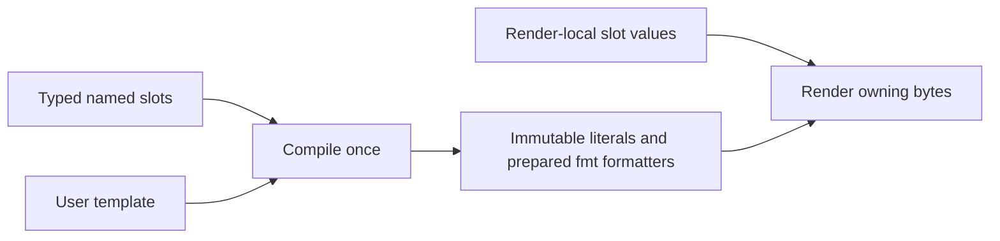

# Prepared byte formatting

Core Formatting provides `FormatSchema` and `CompiledFormat` under
`<Termaster/Core/Formatting/...>`. Timestamp supplies packet-specific values;
the formatting subsystem has no terminal, clock, persistence or GUI dependency.



## API

```cpp
FormatSchema schema;
const auto datetime = schema.add<QString>("datetime");
const auto index = schema.add<quint64>("index");
const auto packet = schema.add<QByteArrayView>("packet");

QString error;
const auto format = CompiledFormat::compile("[{datetime}] #{index:03} {packet}", schema, &error);
if (!format) {
    // Report error before creating a running consumer.
    return;
}
auto values = schema.createValues();

if (format->uses(datetime)) {
    values.set(datetime, expensiveDateText());
}
values.set(index, ++packetIndex);
if (format->uses(packet)) {
    values.set(packet, QByteArrayView(receivedBytes));
}
QByteArray output;
if (!format->render(values, output, 1024 * 1024, &error)) {
    // output is unchanged; no partial result is committed.
}
values.clear();
```

Supported slot types are `qint64`, `quint64`, `double`, `bool`, `QString` and
`QByteArrayView`. A typed descriptor carries schema identity and its numeric
index. Each plan owns its own usage mask; compiling another template never
changes an existing plan's mask. Unused slots may remain unset. Required unset
values or a mismatched schema produce a concrete render error.

Schema construction must finish before sharing it. Compilation and value-set
creation seal the schema. Invalid/duplicate names and adding slots after sealing
throw exceptions. Metadata is shared so descriptors, plans and values can outlive
the original schema. Compiled plans are immutable and support concurrent rendering
with independent Values and output objects. Values are caller-owned and must not
be mutated concurrently with rendering.

QString values cache their UTF-8 representation when assigned. Byte views borrow
their storage until synchronous rendering completes; `Values::clear()` releases
them. Neither plans nor callbacks retain packet storage. Output always owns its
bytes, including when input was created through QByteArray::fromRawData.

## Syntax and execution

Fields use `{name}` or `{name:spec}`. Names are ASCII identifiers. `{{` and `}}`
insert braces; dollar signs are ordinary literal text. Byte escapes are `\e`,
`\r`, `\n`, `\t`, `\0`, `\\` and `\xHH`. Literals are encoded and escapes
decoded once during compilation.

Numeric, boolean and textual specifications are parsed once by public
`fmt::formatter<T>::parse`. Each field occurrence stores its prepared formatter;
execution calls its `format` method directly. There is no runtime format parser,
name lookup or dictionary construction per packet. Different occurrences of one
slot can use different specifications. Plain text and raw byte fields append
directly. Explicit byte-string specifications use fmt's text formatting rules.

The language deliberately excludes positional, nested and dynamic-width fields.
Unknown names, invalid types/specifiers and incomplete escapes fail preparation.
Bounds are 256 slots, 1024 fields, 16384 UTF-8 template bytes, width 4096 and
precision 512. Callers additionally choose a maximum output byte count. Output
is committed atomically; scratch allocation is capped through a custom allocator
using fmt's public memory-buffer API, with a fixed 256-byte inline allowance.

fmt 12.2.1 remains an unmodified pinned submodule. Only public formatter, context,
allocator and memory-buffer APIs are used. No private fmt parser or JIT compiler
is embedded. The prepared plan is an in-memory sequence, not executable machine
code, and is recompiled when configuration changes.

## Performance measurement

`tools/benchmarks/Formatting` validates identical binary output before timing.
It measures 16, 128, 1024 and 65536-byte packets with four template shapes,
warmup/calibration and five timed samples. Measurements exclude plan compilation,
clock acquisition and calendar conversion, but include index assignment and output
ownership. Compile time is reported separately. The fmt runtime comparison reuses
an owning std::string and has no output bound or atomic replacement; the prepared
path supplies those guarantees with QByteArray. It is a practical comparison,
not an isolated estimate of parser cost.

Reproduce with the repository Qt/MSVC environment loaded:

```powershell
cmake --preset Desktop_Qt_6_12_0_MSVC2022_64bit-Release -DTERMASTER_BUILD_FORMAT_BENCHMARKS=ON
cmake --build --preset Desktop_Qt_6_12_0_MSVC2022_64bit-Release --target FormattingBenchmark
./build/Desktop_Qt_6_12_0_MSVC2022_64bit-Release/FormattingBenchmark.exe
```

The recorded MSVC 19.44 / Qt 6.12.0 Release run used a Ryzen 9 5900X. For 128-byte
packets the prepared medians were 67 ns (raw packet), 130 ns (index), 267 ns
(datetime/index/Unix) and 430 ns (repeated numeric formatting). The corresponding
fmt runtime medians were 78, 143, 291 and 496 ns. These are synthetic local
throughput measurements, not GUI throughput or real-device acceptance.
Raw results are in [MsvcRelease.json](benchmarks/formatting/MsvcRelease.json).

## Acceptance

The complete MSVC x64 Debug build passed all 51 CTest suites. CompiledFormatTests
and TimestampProcessorTests also passed in Release with their checks active.
Coverage includes independent usage masks, schema lifetime, formatter reuse,
concurrent independent values, binary ownership, bounded atomic output, unit
consistency and packet indices. Native Windows Lineflow captures verified the
updated generated form and preview. Linux boot-clock code was not executed on
this Windows host; other boot-clock platforms are explicitly unsupported.
