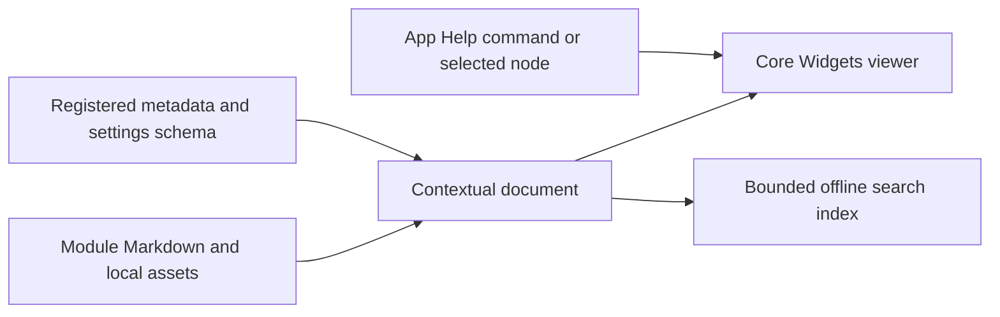

# Contextual help and third-party notices

Status: next scheduled stage after FLOW-26 configurable packet byte stuffing. This document
records the design; the runtime help browser and credits page remain planned.

## Help source and presentation

Use module-owned Markdown for user documentation and schema-derived parameter
reference sections. Doxygen remains an optional developer API build, separate
from packaged user help. Markdown explains behavior and examples; parameter
names, descriptions, defaults, types, required flags, enums and bounds come from
the exact registered SettingsSchema so they cannot drift into duplicate tables.

App owns the Help window and commands. Reusable Core/Gui/Help presentation uses
QTextBrowser and QTextDocument Markdown support, without WebEngine. The MVP has
a topic tree, text search and current-page Find. A bounded in-memory search index
covers authored text and generated parameter reference. It needs no database,
service or second processor registry.

Module distributions package help beside their library/public headers, resolved
relative to the module path, never the working directory or AppData. Relative
resource paths must stay inside their help root. Embedded metadata supplies a
help-root/topic reference discoverable without plugin startup. A processor entry
references a stable topic ID; missing topics fall back to generated schema help.

Lineflow's selected node and settings pages supply contextual Help/F1 targets.
Opening help must not instantiate processors, execute scripts, change settings or
connect devices. Read pages/images into host-owned memory; help must not retain
plugin factories, callbacks, resource pointers or provider leases. Provider removal
invalidates its index/history entries; an already copied page may remain visible
with its provider availability indicated.

MVP checks cover disabled-plugin help discovery, selected nested-node resolution,
unload with an open copied page, launch from another working directory, unknown
and stale topics, path containment, broken links, search and native DPI rendering.

## Third-party page and distribution

Add a separate App Help/About action for Third-party components. A versioned
manifest supplies component name, authors, upstream URL, selected version/commit,
license identifier and paths to verbatim license/NOTICE texts. The page presents
credits and links plus readable full original notices; acknowledgements do not
replace license conditions. Package the manifest and texts with each build.
Track only shipped code/assets and the chosen deployment's dependencies, not
unused tests or optional upstream integrations.

Initial repository audit:

| Component | Source evidence | Original notice |
| --- | --- | --- |
| fmt 12.2.1 | components/fmt, commit 208219daff58f2a7438f6931cc2ddc358acf33ef | components/fmt/LICENSE |
| PCRE2 10.49 | components/pcre2, commit 6f9d7c1373262c541324a16a358785b33ef116cf | components/pcre2/LICENCE.md and COPYING |
| SLJIT | components/pcre2/deps/sljit, commit de0259c7aaf36aa40cba8014f3fad3edde9307f9 | components/pcre2/deps/sljit/LICENSE |
| Valijson | components/valijson, commit af2383509277f8e8051acbb3e4b3060f4779aa10 | components/valijson/LICENSE |
| yaml-cpp | components/yaml-cpp, commit 1d8ca1f35eb3a9c9142462b28282a848e5d29a91 | components/yaml-cpp/LICENSE |
| Lucide and Feather-derived icons | components/lucide/SOURCE.md | components/lucide/LICENSE, retain both notices |
| Qt and bundled third-party code | selected Qt kit and deployed modules | deployment-specific Qt license/NOTICE inventory |

The current Qt 6.12.0 MSVC kit includes SPDX/CycloneDX SBOMs under its `sbom/`
directory. Use the actual selected kit/module records to resolve Qt's bundled
compression and other notices; do not infer the deployment from optional upstream
features. The project may use system ZLIB or Qt's bundled ZlibPrivate depending
on the configure result, so the manifest must record that choice.

Connection-status SVG geometry is attributed in docs/terminals-and-serial.md to
the adjacent Flowgate project's QML. That source project has no top-level license
file in the current checkout. Record provenance and resolve its ownership/license
explicitly before assigning it a third-party license. Project-generated artwork
and project-authored icons should be distinguished from copied third-party assets.

This inventory is source evidence and pending packaging work, not a declaration
that every redistribution obligation has already been fulfilled.
