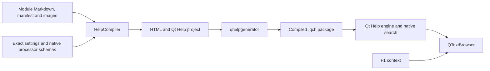

# Contextual help and third-party notices

Status: HELP-1 implements compiled, offline module help and contextual navigation.

## Sources, compilation and presentation

Each module owns `Help/manifest.json`, Markdown topics and declared local images.
The version 1 `termaster.help` JSON envelope contains `content/topics` entries
with stable `id`, `title`, optional `parent` and relative `file`, plus an optional
`content/assets` list. Paths cannot escape the source root, including through
symlinks. Source assembly is bounded to 1,024 entries and 16 MiB; individual pages
are limited to 256 KiB. Topic IDs are independent of titles and file names.

`HelpCompiler` converts Markdown through Qt QTextDocument, appends parameter
references from exact SettingsSchema descriptors and emits HTML plus a Qt Help
project. `qhelpgenerator` compiles that project into `.qch`. Native processor pages
come from registered metadata without constructing processors. Descriptions,
defaults, types, required flags, groups, discriminator variants, enum values and
bounds are generated rather than maintained in separate handwritten tables.
Markdown supplies text, tables, code, links and declared images. Inline HTML and
resource retrieval during conversion are disabled; compiled page/image links are
validated.

`termaster_compile_help` in `cmake/Help.cmake` is the shared build entry point.
The application ships `help/Termaster.qch`; each terminal plugin ships its own
`help/<Module>.qch` adjacent to its library. Only compiled packages are required
at runtime. No dependency or documentation download occurs during configuration.
The exported PluginApi SDK contains the help compiler and CMake helper for
independently built plugins. Doxygen remains an optional separate API workflow;
it is not needed to build or read the packaged user/developer help.

App owns HelpController, the Help menu command and the help window. Core's
HelpBrowser uses QHelpEngine, native Contents/Search widgets and QTextBrowser,
without WebEngine, a custom full-text index or a database service. Qt Help's
collection and search files live in an owned temporary directory. Full-text
indexing is local and asynchronous; page Find and Back/Forward use native Qt
text navigation. Opening a page never connects devices, instantiates processors
or applies settings.

## Context and package lifecycle

F1 and native Help buttons resolve the selected settings page/field or Lineflow
node, including nested linked operations and palette selections. Native nodes
open `processor.<catalog-id>`; a provider can set `Type.editor["helpTopic"]` to
its authored topic ID. Settings and private runtime definitions can render a
schema-derived page on demand when no compiled topic exists. This fallback does
not publish workspace processors or modify drafts. Explicit shortcut assignments
for Help.Contents remain editable; its default is F1.

Plugin JSON metadata declares `"help":"help/Module.qch"`. App reads it without
calling QPluginLoader::instance, so installed disabled plugins remain documented.
The help path must remain within the plugin library directory. Disappearing or
replaced packages are reconciled through the plugin catalog notifications.

HelpBrowser creates a bounded, atomic copy of each QCH before registration.
SQLite readers and index workers therefore do not hold module files. No factory,
callback, resource pointer or provider lease is retained. Removing a package
removes its live index/contents entries while an already displayed document stays
readable with an unavailable-provider notice. Help search workers are cancelled
and drained before temporary files are destroyed. Compiled packages are limited
to 64 MiB each and 128 active/retiring snapshots; generated pages and topic-identifier mappings also
have explicit bounds. File/network/data/script resource loading is denied;
external HTTP(S) links are emitted only after an explicit click.

## Developer tutorial and reproducible verification

The packaged `developer.processor` topic explains the complete sample in
`examples/ProcessorPlugin`. It implements the public Processor contract, a schema
with useful defaults, hosted registration, rejection and cancellation, an isolated
SHARED target and correct unload handling. The plugin links Qt and the public SDK;
only its integration test links Core. `ProcessorTutorialTests` exercises real
PluginManager discovery, disabled metadata, registration, binary/empty packets,
limits, prepared/live leases and final unload with synthetic input.

Enable `TERMASTER_BUILD_HELP_TESTS=ON`. The targets are HelpSourceTests,
HelpBrowserTests and ProcessorTutorialTests. AppTests additionally covers F1,
Help buttons, settings drafts, nested node resolution and actual disabled-plugin
package discovery. Native captures can be generated with TERMASTER_HELP_CAPTURE.
Build the complete application before packaging so its QCH, module QCHs and the
selected Qt Help/SQL runtime and SQLite driver are included. Qt notices include
those dependencies under the existing single Qt entry.

## Third-party page and distribution

Add a separate App Help/About action for Third-party components. A versioned
manifest supplies component name, authors, upstream URL, selected version/commit,
license identifier and paths to verbatim license/NOTICE texts. The page presents
credits and links plus readable full original notices; acknowledgements do not
replace license conditions. Package the manifest and texts with each build.
Track only shipped code/assets and the chosen deployment's dependencies, not
unused tests or optional upstream integrations.

Initial repository audit:

| Component | Source evidence | Original notice |
| --- | --- | --- |
| fmt 12.2.1 | components/fmt, commit 208219daff58f2a7438f6931cc2ddc358acf33ef | components/fmt/LICENSE |
| PCRE2 10.49 | components/pcre2, commit 6f9d7c1373262c541324a16a358785b33ef116cf | components/pcre2/LICENCE.md and COPYING |
| SLJIT | components/pcre2/deps/sljit, commit de0259c7aaf36aa40cba8014f3fad3edde9307f9 | components/pcre2/deps/sljit/LICENSE |
| Valijson | components/valijson, commit af2383509277f8e8051acbb3e4b3060f4779aa10 | components/valijson/LICENSE |
| yaml-cpp | components/yaml-cpp, commit 1d8ca1f35eb3a9c9142462b28282a848e5d29a91 | components/yaml-cpp/LICENSE |
| Lucide and Feather-derived icons | components/lucide/SOURCE.md | components/lucide/LICENSE, retain both notices |
| Qt and bundled third-party code | selected Qt kit and deployed modules | deployment-specific Qt license/NOTICE inventory |

The current Qt 6.12.0 MSVC kit includes SPDX/CycloneDX SBOMs under its `sbom/`
directory. Use the actual selected kit/module records to resolve Qt's bundled
compression and other notices; do not infer the deployment from optional upstream
features. The project may use system ZLIB or Qt's bundled ZlibPrivate depending
on the configure result, so the manifest must record that choice.

Project-owned artwork is excluded from the third-party inventory. Third-party
icon notices are retained with the copied upstream assets.

The Third-party components action now provides the offline manifest, credits,
upstream links and full notices. Qt is one component with its bundled notices
available in the license selector. The checked-in bundle is embedded in App and
copied beside the executable; builds do not inspect or lock the installed kit.
Dependency/deployment changes require refreshing the distribution notice inventory.
See [third-party components](third-party-components.md) for maintenance and scope.
This page does not itself fulfill source-availability or other redistribution terms.

FLOW-27 paired families keep help topics associated with the fixed catalog choice.
Parameter reference generation must consume the assembled descriptor for that
choice: unary pages include only common and selected-direction parameters; Codec
pages include common parameters once and both directional groups. The separate
family owners provide the source definitions. HELP-1 generates these references from the assembled descriptors.

## HELP-1 acceptance

Verified with Qt 6.12.0 and MSVC 2022 x64 on Windows:

- Debug and Release application/help/example builds complete. AppTests,
  SettingsSchemaTests, SettingsFormTests, LineflowEditorTests, HelpSourceTests,
  HelpBrowserTests and ProcessorTutorialTests pass. Native drag/optional visual
  fixture checks retain their normal skips; the host disallows the symbolic-link
  fixture. Source containment and malformed-path checks still run.
- Native Windows help tests pass at 100% and 200% scale, including a different
  working directory. Contents, parameter pages and page layout were visually
  inspected. Legacy bitmap font families can produce Qt/DirectWrite fallback
  warnings; the rendered help remains readable. Mixed-monitor transfers were not
  exercised.
- Native search is exercised by typing into Qt's actual query widget and waiting
  for its asynchronous index. Context checks cover dirty settings, nested linked
  nodes, Help buttons, F1 recording in the shortcut editor and zero factory calls.
- Disabled-plugin discovery uses real binary metadata without startup. Original
  QCHs can be deleted while owned snapshots remain readable; unregistering a
  package removes it from navigation/search and retains the displayed page.
  Missing packages/topics and blocked file/network/script resources are tested.
- The developer sample also configures and builds independently against the
  exported SDK, including its QCH. Debug deployment includes Qt Help/SQL and only
  the SQLite SQL driver. After deployment, offscreen tests use the selected kit's
  platform-plugin path explicitly; native deployment remains Windows-oriented.

No real-device or external-network acceptance was used. Runtime-generated private
schema pages are available through context help; they are not added to the
compiled full-text index. Distribution requires the QCH files and the selected
Qt runtime alongside the application and module libraries.
