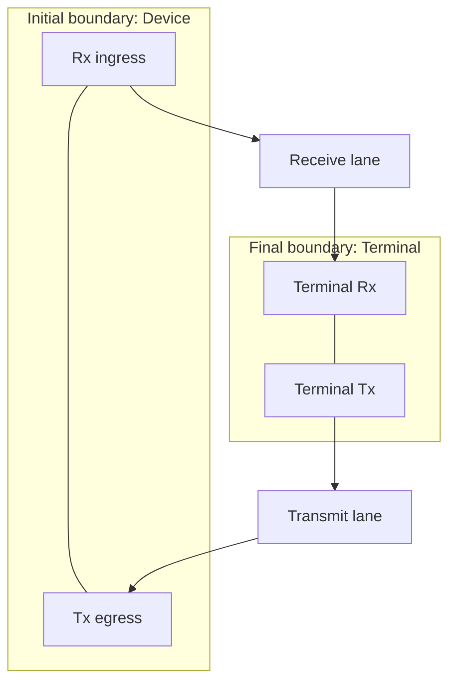
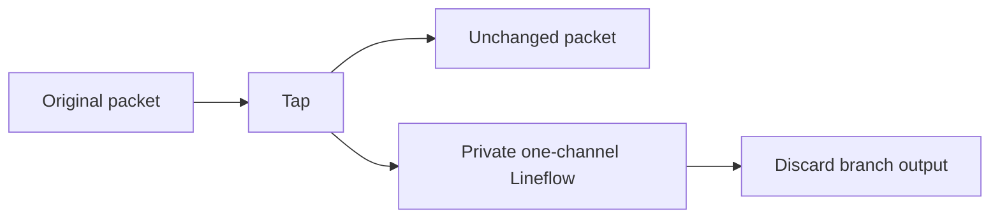

# Lineflow boundaries and observation branches

## Terminal composition

A terminal selects Bypass or one two-channel Lineflow. The first lane carries
received bytes from the device toward the terminal. The second lane carries
transmitted bytes in the opposite physical direction. An unused lane passes
packets unchanged. Reusable one-channel compositions remain available as children.
The terminal stores one `lineflow` selection and one `inplace/lineflow` map.

## Fixed endpoint recording

Initial and final boundaries have stable reserved occurrence names `@initial`
and `@final`; they are not draggable catalog processors. Definition source maps
`initial` and `final` hold their defaults, while normal occurrence overrides can
customize each instance. Nested boundaries retain prefixed paths. Disabled packet
recorders do not add runtime scheduling stages.

Packet recording is explicitly disabled by default. Enabled writers own absolute
file paths and exclusive locks. Direction substitutions keep Rx and Tx binary
streams separate. JSONL preserves packet boundaries, timestamp, direction, index,
length and Base64 payload. HEX and binary formats are alternatives. File size,
backup count and flush frequency are bounded and configurable. File access occurs
on execution/file workers, never in the editor or during preparation.

Rendered-line recording is distinct from byte recording. Only the actual terminal
root's final boundary can observe the terminal emulator. Primary-screen rows are
recorded after they leave the mutable screen for history, before history trimming.
Soft-wrapped source rows form one logical text line. Visual wrapping and display
layout are not recording boundaries. An optional final-screen flush captures the
remaining current text at recording stop; transient carriage-return redraws and
terminal escape bytes are not appended as packet text. With this option disabled,
an unfinished soft-wrap prefix is discarded rather than saved as a partial line.
Alternate-screen rows do not enter history; optional final-screen flush records
the currently visible alternate snapshot separately from any primary prefix.
Display-only local echo is part of the rendered screen and is recorded when stable.
Unused trailing screen rows are omitted, while interior blank lines are retained.
Writer queues and individual logical lines are limited to 1 MiB; pending records
are additionally limited to 1024. Writer failure is reported without disconnecting
the terminal. The file worker accepts only owned UTF-8 bytes and builtin primitive
configuration; it is drained and joined before terminal resources are released. Nested logical endpoints
cannot claim to observe a terminal display.

## Tap

A Tap is a one-channel observation composition. It forwards the original packet
unchanged exactly once and independently supplies a byte-owning copy to its
one-channel branch. Branch output is discarded. Branch work remains bounded and
strict failures are reported; cancellation waits for branch quiescence. Processors
inside the branch share the composition worker and retain their provider leases.

The Native palette provides a Tap template. Inserting it creates a private saved
composition in the owning definition collection. Editing one Tap does not rewrite
another Tap's branch. Duplication copies owned compositions while ordinary reusable
references remain shared. Unreferenced private compositions are removed with their
owning nodes. Double-click and the compact composition button open the editor for
the composition kind; one click continues to select parameters.

## Acceptance

All 63 Release CTest suites passed on 2026-11-18, including packet recording,
rendered-line lifecycle, Tap cancellation, session persistence and application
shutdown. The [Release test record](benchmarks/processing-boundaries/ReleaseTests.txt)
contains the complete suite result. Follow-up endpoint and bundled help suites passed
after final presentation and help changes. Native editor tests passed at 100% and
200% scaling; captures were visually inspected.

- [Terminal line settings, 100%](images/lineflow-boundaries/100TerminalLines.png)
- [Device packet settings, 100%](images/lineflow-boundaries/100DevicePackets.png)
- [Private Tap branch, 100%](images/lineflow-boundaries/100TapBranch.png)
- [Terminal line settings, 200%](images/lineflow-boundaries/200TerminalLines.png)

Verification used synthetic streams and local temporary files, without serial
hardware or external network connections. The current terminal processing format
is supported; obsolete Simplex/Duplex documents are not migrated automatically.

The final Debug application and bundled transport plugins were built successfully.
