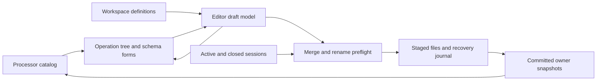

# Workspace Lineflow editor

The application opens the editor through **Tools > Lineflow editor** when a
workspace is open. Core provides configurable Gate, Framer and HEX/Base64 encoder/decoder
processors; plugins can add processors through the common catalog. The editor
creates reusable workspace definitions and never creates processing runtimes.
Terminal Rx/Tx selection and private properties are available through the
[terminal processing panel](terminal-processing.md).

## Draft model and presentation

The block selector addresses stable definition IDs separately from human-readable
names. The central native Qt canvas shows the selected block as one lane or paired Rx/Tx lanes. Nested
blocks expand as linked, read-only views; opening their definition edits the shared
block. The catalog groups native and workspace entries by origin and their descriptor
`group` subgroup. It contains native, provider-defined and workspace processors,
including unavailable entries with a concrete reason. No ControlFlow nodes or
freely connected graph are introduced.

Creation, duplication, naming, deletion and node insertion update a draft model.
Dragging a palette entry inserts a processor or linked block. A 1x1 entry lands
on the left Rx or right Tx lane according to pointer position; a 2x2 entry spans
both lanes. Drop indicators appear only during a valid drag. Dragging an operation
reorders it and can move a 1x1 node between lanes. Linked expanded nodes
cannot be moved into another definition implicitly. Cycle validation rejects
recursive insertion. Deleting a definition preserves references as unavailable.

The right-hand form uses the registered settings schema, schema defaults and
`x-widget` factories. Unknown configuration survives editing. Field drafts remain
available across selection changes, including invalid values; invalid drafts block
Apply. A node name is its identity within its containing block. New nodes have no
previous identity to migrate. Rename histories are reduced to original/final
identities and emitted as collision-free sequential renames, including name swaps.

Plugin widget removal destroys live property widgets before unloading their code;
the model and host-owned field drafts remain available. Registry changes refresh
availability without silently replacing or deleting operations. Missing providers
never turn a processor into pass-through.

## Applying and refactoring

Apply performs a three-way comparison of the opening baseline, current workspace
and editor draft. Concurrent edits to untouched fields survive; conflicting edits
are rejected. Cancel discards the editor draft. Successful Apply publishes saved
definitions through the common catalog; running processors retain their existing
snapshots until explicitly replaced.

Node renames rewrite occurrence paths in Rx/Tx selections for the active session
and every registered closed session. Refactoring also updates definition defaults
and nested instance configuration overrides. Repeated nested occurrences each keep
their own settings. Stale or ambiguous addressed nodes, malformed sessions and
collisions stop preflight without changing files.

Saved definitions occupy individual `termaster.processor-definition` YAML files
under `<workspace filename>.d/processors/`; the workspace YAML contains no inline
processor payload. Filenames derive from stable IDs rather than editable names.
The [workspace storage contract](workspaces-and-sessions.md#reusable-processor-definitions)
specifies the layout, envelope and collection bounds.

Persistence serializes complete owner snapshots, including pending unrelated
settings and unknown envelope fields. Definition-file creation, update and deletion
participate in the same transaction as occurrence refactoring. Borrowed settings views remain valid when
committed snapshots are adopted. Disk baselines reject external changes before
Apply as well as during commit. Each document is limited to 4 MiB. Rename preflight inspects at most 4096
session entries and reads at most 32 MiB. The recovery journal is limited to
32 MiB. Tree expansion is capped at 2048 visible rows; saved definition and runtime
expansion limits remain enforced by the common catalog. The external processor
collection is bounded to 1024 documents and 4 MiB of YAML in total.

All replacement files are staged before commit. A bounded owner-permission journal
beside the workspace records recognized original/replacement bytes. Commit failure
rolls back recognized files; opening a workspace first recovers an interrupted
transaction. Recovery refuses unexpected external edits, symbolic journal paths
and targets outside the workspace file, session root or deterministic processor
files, leaving the journal for resolution. The version 2 journal distinguishes
absent files from present byte payloads; rollback removes newly created files and
restores deleted files only when their current states are recognized. The complete
processor inventory is checked, so unexpected YAML files are preserved and stop
recovery. An atomic exclusive journal reservation prevents competing transactions
from replacing one another's recovery record. Configuration contents are never included in routine diagnostics. The journal is
an internal bounded recovery record rather than a user settings document; its
original/replacement payloads are Base64 encoded inside JSON.

## Verification

Synthetic fixtures cover graph editing, drag/drop, nested reuse, unavailable
processors, schema and custom-widget drafts, renaming and cancellation. Persistence
fixtures cover closed-session refactoring, unknown and pending settings, conflict
rejection, journal recovery and rollback. Native captures use a logical window
size of 1100 by 760 at display scales 1 and 2.

Verified on 2026-11-09 with Qt 6.12.0, MSVC x64 and the existing Debug preset.
The full application/plugin build and all 39 configured CTest targets passed
(69.24 s). After final screen-fit and journal-target checks, the affected App,
editor and persistence targets were rerun. Native Windows tests separately checked
available-screen fitting and captured the editor at display scales 1 and 2, with
four passes and no skips per scale. Captures use fixed logical 1100 by 760 client
areas; the ordinary editor instead adapts its initial geometry to the available
screen. Both captures were visually inspected for fonts, icons, form alignment,
linked rows, unavailable entries and clipping.

- [Editor at scale 1](images/lineflow-editor/Editor.png)
- [Editor at scale 2](images/lineflow-editor/Editor2x.png)

The captures use explicit synthetic processor descriptors and do not execute
processing or connect transports. Acceptance uses temporary fixtures, including
closed sessions, external-edit conflicts, recognized crash rollback and rejection
of foreign/duplicate journal targets. No real serial device, external network
endpoint or elevation was used. The obsolete standalone operation prototype and
its captures were removed after checking callers. Source files were clang-formatted;
local documentation links, pinned SVG XML and `git diff --check` were checked.

Built-in options and framing/codec boundary rules are specified in
[processing nodes](processing-nodes.md).

The configurable node/catalog follow-up adds descriptor subgroups and prioritizes
the operation name column, preserving the compact class-column width across model
resets. Latest native captures include the actual built-in HEX encoder and Framer
schemas instead of an illustrative parameter fixture. See
[configured node verification](processing-nodes.md#verification) for the 42-target
acceptance record and updated captures.

## Docked editor and topology

The palette is a movable/resizable/floating QDockWidget initially on the left;
selected-node properties use a second dock initially on the right. The center
remains the Lineflow canvas. Qt palette colors, icons and existing generated forms
are retained. Port counts and direction are communicated through topology icons,
connection marks and tooltips, not repeated explanatory text on every node.
The block topology picker chooses 1x1 or 2x2; invalid shape changes preserve the
draft and report the affected placement. Unary lanes run independently between
full-width shared stages. Linked nested definitions stay read-only until opened.
Keyboard selection, Delete and existing insert/move actions remain available.

Dock placement and sizes are presentation state, stored through the application
settings owner at `settings/ui/lineflow/docks` as bounded Base64 Qt saveState data.
They are independent of the workspace processor definition and terminal settings.
The dialog exposes layout state and change notifications; it performs no file I/O.

## FLOW-8 acceptance

Qt 6.12.0 / MSVC2022 x64 Debug built the application, bundled modules and tests.
The final full run passed all 47 configured CTest executables in 112.48 seconds,
including named ports, orientation mapping and external chevrons. The full
application and bundled plugins built after the final rendering changes.
Native Windows capture fixtures passed at scales 1 and 2, with three QtTest passes
and no skips per run, using 1100 by 760 logical client areas. Captures were inspected
for opaque node backgrounds, selected-icon contrast, full-width shared nodes,
property-form fit and drag-only indicators. Shared protocol nodes in these captures
are synthetic acceptance fixtures, not a bundled protocol implementation.

Coverage includes independent lane packing, splitting a segment with a duplex
barrier, insertion/movement between lanes, nested shape validation, keyboard deletion,
dock movement/resizing/floating/restoration and retained invalid schema drafts.
The independently configured SDK consumer built and its explicit plugin test passed
without skips. No real serial device, external endpoint or elevation was used;
Release was not rebuilt. Changed C++ files were clang-formatted; local links and
`git diff --check` passed.

- [Paired editor](images/duplex-lineflow/Paired.png)
- [Insertion indicator](images/duplex-lineflow/Dragging.png)
- [Paired editor at scale 2](images/duplex-lineflow/Paired2x.png)
- [Insertion at scale 2](images/duplex-lineflow/Dragging2x.png)

## Named ports and flipping

Wired node connectors use compact chevrons centered on the border, with port labels
inside gently rounded blocks. Input chevrons point into the node and output
chevrons away from it; tooltips state the full name and direction. Linked nested rows remain compact reference previews; opening
the nested definition shows its actual wiring. A selected 2x2 node exposes an
icon-only Flip action. Its checked state and a small card icon indicate reversed
orientation. Labels follow the effective port mapping after a flip. The action
updates only the draft occurrence flag, preserving the processor configuration.

The connector shape follows the compact port-symbol convention illustrated in the
[MathWorks connection guide](https://www.mathworks.com/help/simulink/ug/connect-blocks.html),
rotated for vertical Rx/Tx traversal. Port markers have no circular socket or
arrow shaft. Qt palette colors, selection contrast and font metrics remain native.

Named-port checks cover registered/prepared/runtime label ownership and snapshots,
invalid/duplicate/control-character labels, useful native labels and nested flips
in both saved and standalone preparation. Editor checks verify labels inside the
body, markers centered on its boundary, a 6-pixel text inset, narrow canvases and doubled
fonts. Selected and flipped captures passed native 1x/2x checks. The application
integration also verifies dock-layout restoration through the application settings
owner. One earlier suite observed an intermittent ConsoleElevationTests heap failure;
isolated reruns and the final full suite passed. The unresolved observation is
recorded in [local console acceptance](local-console.md#intermittent-acceptance-observation-2026-11-09).

- [Flipped shared node](images/duplex-lineflow/Flipped.png)
- [Flipped shared node at scale 2](images/duplex-lineflow/Flipped2x.png)

Node names and processor classes are centered in the block body. Symmetric title
margins reserve space for the type icon and optional flip badge, keeping the text
center fixed when orientation changes. Linked previews center their names in their
own compact rows.

The centered-label refinement passed the affected LineflowEditorTests suite and
native Windows captures at scales 1 and 2 (three QtTest passes per capture run,
no skips). The Debug application and affected targets built successfully.

## Compact table layout

The palette displays 1x1 processors in a unary block and both 1x1 and 2x2
processors in a paired block. Incompatible favorites are omitted from the view
without removing their saved IDs. Terminal selectors require the exact topology
of their Simplex or Duplex mode and add their own local Inplace entry.

The center canvas uses compact numbered stages with a small gap between rounded,
opaque tinted blocks. Unary nodes occupy one Rx or Tx column; shared 2x2 nodes
span both. Names and classes share one centered line when space permits; redundant
class text is omitted when it exactly matches the occurrence name. Full metadata
remains available in tooltips and properties. Font metrics determine the row height.
Linked reference previews remain read-only inside their owning block.

Device and terminal endpoint labels align with the same lane axes used by unary
centers, duplex ports and three-pixel wires. Thin port chevrons sit on block borders
and indicate input toward the body and output away from it. Port captions contain
the name and in/out type, without repeated arrow characters. Endpoint chevrons use
the wire color. Layout geometry is derived from the viewport and is not persisted.

Each editable shared node has an inline rotation control in addition to the selected
operation action. A 180-degree turn maps top-left to bottom-right and top-right to
bottom-left while retaining port identity and input/output type. Text stays upright.
The existing occurrence orientation flag and runtime mapping remain unchanged.
Selection is restored after the model reset caused by changing orientation.

Palette insertion and drag/drop retain topology validation and the draft model as
the authority. Unary nodes can move between lanes; shared nodes move as full-width
barriers. Drop indicators appear only during a valid drag. Keyboard selection,
Delete, nested-definition opening and movable palette/property docks remain active.

New occurrences use the registered processor title or referenced block name.
The first available name is unnumbered, then a space and suffix starting at 2 is
added: `Gate`, `Gate 2`, `Gate 3`. Names are unique within the containing block;
existing and moved occurrences are not renamed. Slash/NUL removal and bounded
truncation keep generated names valid for the current definition format.

### Processing block icons

Processing views use four project-owned SVG symbols: an empty rounded body for an
elementary processor and a body divided into four sections for a composite definition.
One lead above and below denotes 1x1 topology; two leads above and below denote 2x2.
Composition is determined by definition kind, independently of catalog origin.
Unavailable entries retain the warning symbol. Palette favorites, canvas previews
and terminal selectors share the same symbols; the topology picker uses composite
symbols because it describes a Lineflow block. Rendering retains palette-aware
colors, selected-state contrast and disabled opacity through the existing icon engine.
The original artwork belongs to Core under `Res/Icons`; it does not modify Lucide.

The icon refinement built the Debug application and modules and passed all four
affected Icon/LineflowEditor/TerminalProcessing/ProcessorFavorites CTest suites in
14.74 seconds. Native Windows 1x/2x captures each passed three QtTest checks without
skips; elementary and composite symbols were visually inspected. SVG XML and
`git diff --check` passed. Release and unrelated suites were not rerun for this
presentation-only change.

### FLOW-9 verification

Qt 6.12.0 / MSVC2022 x64 Debug built the application, bundled modules and tests.
The full configured suite passed 47 of 47 CTest executables in 102.79 seconds.
After final lane-edge, footer-scroll and nested-label fixes, all four affected
App/Lineflow persistence/editor/terminal-processing suites passed in 53.10 seconds.
Native Windows captures at scales 1 and 2 each passed three QtTest checks with
no skips. The paired, flipped and nested layouts were visually inspected; refreshed
captures retain the same 1100 by 760 logical client size.

Checks cover compact/font-scaled geometry, common lane axes, boundary-centered
markers, inline rotation and configuration retention, narrow-canvas lane selection,
large-font footer reachability, nested output-label clearance and unique names
across insertion and drag/drop paths. Changed C++ files were clang-formatted and
`git diff --check` passed. Release was not rebuilt. No real serial device, external
endpoint or elevation was used; protocol nodes in captures remain synthetic fixtures.
