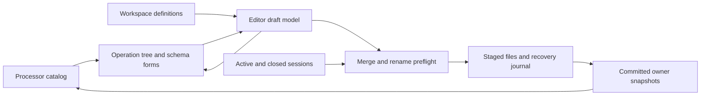

# Workspace Lineflow editor

The application opens the editor through **Tools > Lineflow editor** when a
workspace is open. Core provides configurable Gate, Framer and HEX/Base64 encoder/decoder
processors; plugins can add processors through the common catalog. The editor
creates reusable workspace definitions and never creates processing runtimes.
Terminal Rx/Tx selection and private properties are available through the
[terminal processing panel](terminal-processing.md).

## Draft model and presentation

The block selector addresses stable definition IDs separately from human-readable
names. The operation tree shows the selected block in traversal order. Nested
blocks expand as linked, read-only views; opening their definition edits the shared
block. The catalog groups native and workspace entries by origin and their descriptor
`group` subgroup. It contains native, provider-defined and workspace processors,
including unavailable entries with a concrete reason. No ControlFlow nodes or
freely connected graph are introduced.

Creation, duplication, naming, deletion and node insertion update a draft model.
Dragging a catalog entry inserts a processor or a linked block; dragging an
operation reorders siblings in its containing definition. Linked expanded nodes
cannot be moved into another definition implicitly. Cycle validation rejects
recursive insertion. Deleting a definition preserves references as unavailable.

The right-hand form uses the registered settings schema, schema defaults and
`x-widget` factories. Unknown configuration survives editing. Field drafts remain
available across selection changes, including invalid values; invalid drafts block
Apply. A node name is its identity within its containing block. New nodes have no
previous identity to migrate. Rename histories are reduced to original/final
identities and emitted as collision-free sequential renames, including name swaps.

Plugin widget removal destroys live property widgets before unloading their code;
the model and host-owned field drafts remain available. Registry changes refresh
availability without silently replacing or deleting operations. Missing providers
never turn a processor into pass-through.

## Applying and refactoring

Apply performs a three-way comparison of the opening baseline, current workspace
and editor draft. Concurrent edits to untouched fields survive; conflicting edits
are rejected. Cancel discards the editor draft. Successful Apply publishes saved
definitions through the common catalog; running processors retain their existing
snapshots until explicitly replaced.

Node renames rewrite occurrence paths in Rx/Tx selections for the active session
and every registered closed session. Refactoring also updates definition defaults
and nested instance configuration overrides. Repeated nested occurrences each keep
their own settings. Stale or ambiguous addressed nodes, malformed sessions and
collisions stop preflight without changing files.

Saved definitions occupy individual `termaster.processor-definition` YAML files
under `<workspace filename>.d/processors/`; the workspace YAML contains no inline
processor payload. Filenames derive from stable IDs rather than editable names.
The [workspace storage contract](workspaces-and-sessions.md#reusable-processor-definitions)
specifies the layout, envelope and collection bounds.

Persistence serializes complete owner snapshots, including pending unrelated
settings and unknown envelope fields. Definition-file creation, update and deletion
participate in the same transaction as occurrence refactoring. Borrowed settings views remain valid when
committed snapshots are adopted. Disk baselines reject external changes before
Apply as well as during commit. Each document is limited to 4 MiB. Rename preflight inspects at most 4096
session entries and reads at most 32 MiB. The recovery journal is limited to
32 MiB. Tree expansion is capped at 2048 visible rows; saved definition and runtime
expansion limits remain enforced by the common catalog. The external processor
collection is bounded to 1024 documents and 4 MiB of YAML in total.

All replacement files are staged before commit. A bounded owner-permission journal
beside the workspace records recognized original/replacement bytes. Commit failure
rolls back recognized files; opening a workspace first recovers an interrupted
transaction. Recovery refuses unexpected external edits, symbolic journal paths
and targets outside the workspace file, session root or deterministic processor
files, leaving the journal for resolution. The version 2 journal distinguishes
absent files from present byte payloads; rollback removes newly created files and
restores deleted files only when their current states are recognized. The complete
processor inventory is checked, so unexpected YAML files are preserved and stop
recovery. An atomic exclusive journal reservation prevents competing transactions
from replacing one another's recovery record. Configuration contents are never included in routine diagnostics. The journal is
an internal bounded recovery record rather than a user settings document; its
original/replacement payloads are Base64 encoded inside JSON.

## Verification

Synthetic fixtures cover graph editing, drag/drop, nested reuse, unavailable
processors, schema and custom-widget drafts, renaming and cancellation. Persistence
fixtures cover closed-session refactoring, unknown and pending settings, conflict
rejection, journal recovery and rollback. Native captures use a logical window
size of 1100 by 760 at display scales 1 and 2.

Verified on 2026-11-09 with Qt 6.12.0, MSVC x64 and the existing Debug preset.
The full application/plugin build and all 39 configured CTest targets passed
(69.24 s). After final screen-fit and journal-target checks, the affected App,
editor and persistence targets were rerun. Native Windows tests separately checked
available-screen fitting and captured the editor at display scales 1 and 2, with
four passes and no skips per scale. Captures use fixed logical 1100 by 760 client
areas; the ordinary editor instead adapts its initial geometry to the available
screen. Both captures were visually inspected for fonts, icons, form alignment,
linked rows, unavailable entries and clipping.

- [Editor at scale 1](images/lineflow-editor/Editor.png)
- [Editor at scale 2](images/lineflow-editor/Editor2x.png)

The captures use explicit synthetic processor descriptors and do not execute
processing or connect transports. Acceptance uses temporary fixtures, including
closed sessions, external-edit conflicts, recognized crash rollback and rejection
of foreign/duplicate journal targets. No real serial device, external network
endpoint or elevation was used. The obsolete standalone operation prototype and
its captures were removed after checking callers. Source files were clang-formatted;
local documentation links, pinned SVG XML and `git diff --check` were checked.

Built-in options and framing/codec boundary rules are specified in
[processing nodes](processing-nodes.md).

The configurable node/catalog follow-up adds descriptor subgroups and prioritizes
the operation name column, preserving the compact class-column width across model
resets. Latest native captures include the actual built-in HEX encoder and Framer
schemas instead of an illustrative parameter fixture. See
[configured node verification](processing-nodes.md#verification) for the 42-target
acceptance record and updated captures.
