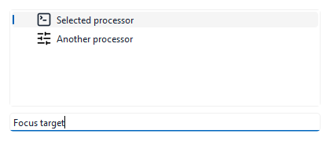

# Lineflow selection icons

The catalog and operation tree use a style-aware item delegate for selected
monochrome icons. The delegate samples the selected row background and chooses
a contrasting palette foreground. Text and ordinary item painting remain with Qt.
Unselected and disabled icon rendering is unchanged, including disabled opacity.

## Verification

The MSVC Debug build and IconTests/LineflowEditorTests pass. Icon tests cover
active and inactive selection, light and dark backgrounds, device scales 1 and 2,
and unchanged pixels outside the icon. A native Windows capture confirms that
unfocused pale selection retains a visible dark icon.

