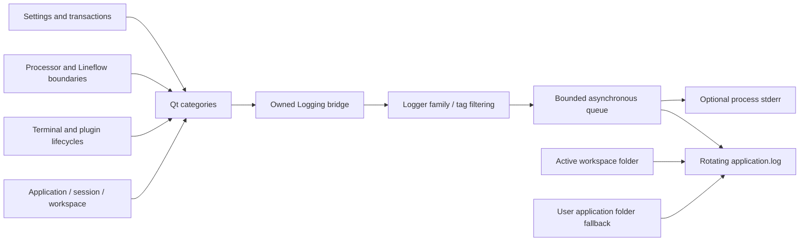

# Application logging

Core owns `Logger`, the asynchronous named logger, and `Logging`, the
application-owned Qt message bridge. App owns policy, settings and destination
selection. Loaded terminal plugins use Qt categories and do not link a second
logger family or hold application pointers.

## Destinations and lifecycle

With a workspace open, output is `<workspace-file-parent>/logs/application.log`.
It is beside the workspace file, not under `<workspace-file>.d` or inside a
session directory. Without a workspace, `ApplicationPaths::logsDirectory()` is
used: normally the current user's local application-data `Termaster/logs` folder.
Explicit application data/log path overrides retain their existing meaning.

Startup installs the Qt bridge with outputs disabled, loads application settings,
then configures the saved policy. A persisted file-output opt-out creates no log
directory. A valid logging opt-out is retained even when unrelated startup
preferences fail validation. Opening/restoring/replacing a workspace switches output only after its
activation succeeds. Closing it switches back to the user destination. A failed
log-directory/sink preparation preserves the previous policy and reports a
logging diagnostic; it never rejects an otherwise valid workspace or disconnects
a terminal. Already accepted records finish in their original destination.



Exactly one bridge owns the process Qt message handler/filter. It restores the
previous handler/filter on destruction and protects message delivery while
swapping families. Configuration and destruction run on the application owner
thread; producers may log from worker threads. No Widgets are accessed there.
Same-directory policy changes reuse the family and its serialized configure
barrier. Identical policies are no-ops. App retains the logger until after
terminal/plugin retirement; explicit flush plus final shared-family destruction
drain and join output workers before QApplication teardown. Fatal Qt diagnostics
are also written to stderr even if normal sinks were disabled.

## Preferences

Application settings → Application → Logging edits `settings/logging` in the
application settings owner. These preferences are global; workspace activation
changes the output location, not the policy. The generated form stays a draft
until Apply and uses the existing atomic settings persistence.

| Key | Default | Meaning |
| --- | --- | --- |
| `minimumLevel` | `info` | trace, debug, info, warning, error or critical |
| `console` | `false` | Process stderr; no console window is created |
| `file` | `true` | Enable rotating files |
| `maximumFileBytes` | `2097152` | File limit, 4096–16777216 bytes |
| `retainedFiles` | `3` | Archives `.1` through `.N`, 0–10 |
| `tagLevels` | `{}` | Up to 64 tag minimum-level overrides |

The tag table is selected by `x-widget: loggingTags`. Its presentation model owns
editable rows; the form owns draft validation/persistence. Names contain 1–256
ASCII letters, digits, dots, underscores, hyphens and single colon separators.
Empty segments, duplicates, unsupported levels and oversized maps cannot apply.
Oversized loaded maps render at most 65 rows and preserve hidden values until an
explicit field reset; invalid data is never silently truncated into a valid draft.
Custom editor input constraints apply to loaded/programmatic values as well as
interactive edits. Unchanged input diagnostics do not trigger repeated validation.

Example owner payload:

```yaml
settings:
  logging:
    minimumLevel: "info"
    console: false
    file: true
    maximumFileBytes: 2097152
    retainedFiles: 3
    tagLevels:
      termaster:processing: "trace"
      termaster:transport: "warning"
```

Rules include descendants at colon boundaries. The most-specific rule wins:
`termaster:processing` includes `termaster:processing:lineflow`, but does not
include `termaster:processing2`. Qt trace categories use a `.trace` suffix to
express the sixth severity; the suffix is removed from the final tag. Trace and
debug category evaluation is disabled when no active policy can accept that
severity. If one override enables it, final per-tag filtering remains with Logger.

## Tags and instrumentation

| Tag family | Events |
| --- | --- |
| `termaster:app` | Settings activation, application shutdown, logging failures |
| `termaster:app:workspace` | Open/save/close and activation |
| `termaster:app:session` | Open/save/close and stable session identity |
| `termaster:app:settings` | Configuration application |
| `termaster:app:terminal` | Terminal close and connection requests/attempts |
| `termaster:storage:settings` | Load, sync, atomic write count and I/O failure |
| `termaster:storage:workspace` | Load, sync and transaction failure |
| `termaster:storage:session` | Session load and sync |
| `termaster:plugins` | Plugin start/stop, public IDs and lifecycle failures |
| `termaster:transport:serial` | Serial state, open/close, writes and backpressure |
| `termaster:transport:socket` | Socket state, open/close, writes and backpressure |
| `termaster:transport:console` | Local console state and queue boundaries |
| `termaster:processing:registry` | Preparation, creation, publication and retirement |
| `termaster:processing:lineflow` | Invocation, completion, cancellation and failure |
| `termaster:processing:router` | Direction submission/replacement/backpressure |
| `termaster:ui:lineflow` | Distinct drop validation and draft commits |
| `termaster:qt` | Other Qt diagnostics; category descendants are retained |

Info records describe lifecycle changes. Trace records mark important operations
and packet/invocation boundaries with ports, public IDs and byte/queue counts.
There is no per-character/cell logging and no raw packets, terminal contents,
commands, passwords, keys, configuration documents or private payloads in the
new instrumentation. Plugin failure diagnostics remain available to the existing
GUI; routine log records do not copy arbitrary plugin-provided error text.
The bridge covers the main Widgets process and loaded plugins. Existing one-shot
helpers remain separate processes; no logging IPC or backend service is added.

For a new module:

```cpp
Q_LOGGING_CATEGORY(moduleLog, "termaster.example", QtInfoMsg)
Q_LOGGING_CATEGORY(moduleTrace, "termaster.example.trace", QtInfoMsg)

qCInfo(moduleLog) << "Operation completed";

qCDebug(moduleTrace) << "Packet accepted bytes" << packet.size();
```

## Bounds and errors

Records have a local ISO timestamp with milliseconds/UTC offset, severity, tag
and escaped single-line text. Native parameters support typed bounded values.
The queue admits at most 1024 records and 4 MiB, including in-flight work.
Adjacent compatible records batch up to 64 KiB. Message/parameter/value-depth
limits and rotating files bound normal output. Queue overload refuses the newest
sink record and exposes the dropped count/error; it never becomes transport
backpressure or replaces a terminal failure.

Acceptance is not durable delivery. `flush()` waits for previously accepted sink
attempts and reports failure. Asynchronous sink failures are available through
`Logging::error()` and subsequent flush/configuration diagnostics. A crash can
lose queued records; a stalled OS write may delay explicit flush/final shutdown.
No worker is detached. Recovery journals retain separate synchronous durability.

Windows files use native ownership, no-reparse, single-link and private-DACL
checks; uncertain or foreign targets are refused, never recursively removed.
The portable Qt fallback is provided but has not received native-platform
acceptance and does not establish identical Windows handle-based race guarantees.


## Verification

On 2026-11-11 the MSVC/Qt 6.12 Release application/plugin build and all 40
configured CTest suites passed (91.39 s). Rebuilt Debug AppTests,
SettingsSchemaTests, SettingsFormTests, LoggerTests and LoggingTests passed
(83.04 s). The startup-recovery follow-up also passed full AppTests in Release
(54.01 s) and Debug (88.99 s).

Coverage includes typed values and escaped Unicode, tag inheritance, concurrent
producers, bounded queues/history, batching, rotation and file refusal, observer
lifetimes, flush/join, previous Qt handler/filter restoration, and concurrent
message delivery while switching directories. Application fixtures verify saved
file-output opt-out, including unrelated malformed startup history; live settings
Apply; invalid tag names/levels and duplicate/oversized table drafts; preservation
of hidden/invalid values; workspace/user routing; failed destination retention;
and normal close with auxiliary windows, console and nested processing.

The Logging preferences page was visually checked on native Windows at scale
factors 1 and 2: [normal](images/logging/Logging.png),
[high DPI](images/logging/LoggingScale2.png). Labels, selected icons and table
columns remain readable; constrained high-DPI screens use the existing vertical
form scroll area. clang-format and whitespace checks passed.

A separate one-cycle application acceptance run used an isolated copy of the
six-terminal `G:/TMP/Tmaster` fixture with ordinary info/file logging enabled.
All measured stages and normal process exit succeeded. Both user and workspace
log files were inspected for their expected lifecycle markers and absence of
trace output. Original source file hashes stayed unchanged; restored terminals
remained disconnected. The raw [run record](benchmarks/logging/workspace/Run1.json)
and [exit/source checks](benchmarks/logging/workspace/Runs.json) retain timings.
This single run is lifecycle/routing acceptance, not a statistical performance
comparison. It precedes the separately tested startup-recovery-only follow-up.
No real serial device, remote service, driver installation or dependency download
was involved. Temporary build/test storage was on G: because C: was previously
space constrained.
