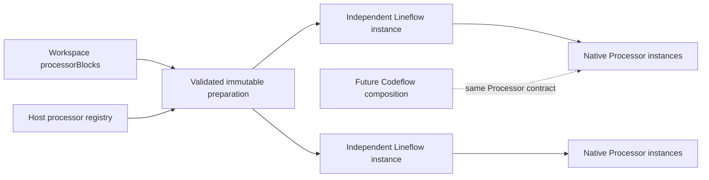
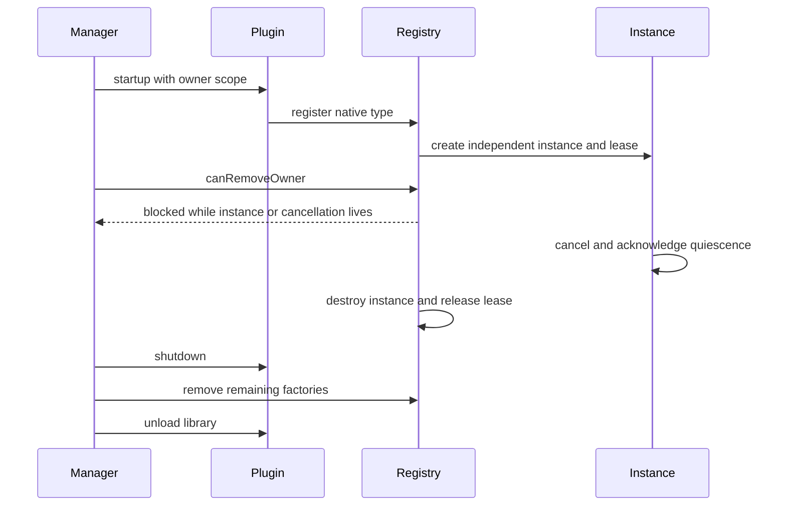
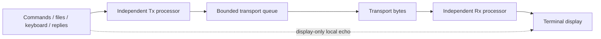
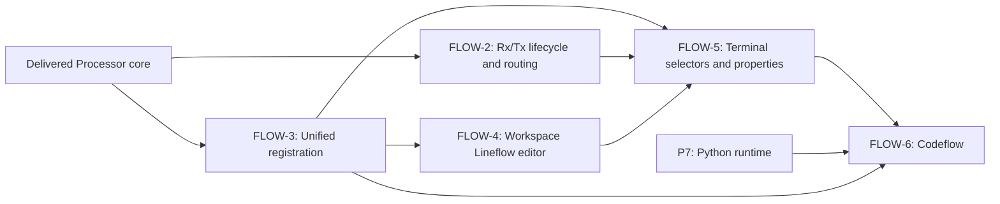

# Processing core

`Processor` is the shared asynchronous byte processing contract. Native elementary
processors and `Lineflow` implement that contract. A future `Codeflow` composition
can implement the same interface around a Python runtime; no interpreter, script
execution or control-flow language is delivered in this stage.

The core is independent of terminal widgets and transports. Workspace definitions
are reusable configuration, while each instantiated pipeline owns separate stream
state. Rx and Tx consumers must instantiate separate pipelines. The operation
editor remains a standalone interaction prototype and is not connected to this core.



## Contract and ownership

`Processor::Chunk` owns a `QByteArray` and a stream-chunk or packet boundary. NUL
bytes remain bytes; an empty packet is an explicit output. Stream chunks do not
imply complete messages. An accepted invocation can produce zero, one or many
outputs followed by exactly one completion. A stateful framer completes an input
that only extends its buffer without producing output. `WouldBlock` and `Rejected`
consume nothing and do not invoke callbacks. Input acceptance is not delivery to
a device.

All calls and callbacks run on the processor QObject thread. Workers post through
context-bound queued connections. A consumer allows only one active invocation;
Lineflow serializes child invocations and preserves emitted output order. Its
queued pump has a finite event budget and retries a temporarily blocked child in
a later event-loop turn. Output callbacks have no per-output credit: the host
bounds its queue, each child invocation's expansion and the final output of an
accepted input, then fails and cancels on overflow. Identity stages do not divide
the maximum payload size by pipeline depth.
Native plugin code is trusted to bound its own buffers according to factory limits;
these bounds do not sandbox arbitrary plugin memory or CPU usage.

Cancellation immediately stops acceptance and suppresses pending invocation
callbacks, and acknowledges only after every worker has stopped using the
instance. Cancellation is idempotent; each caller receives an acknowledgement.
Generations discard stale pipeline callbacks but do not stop native worker work.
Reset creates a new instance from the prepared snapshot after the old instance
has acknowledged cancellation; prepared definitions do not carry stream state.

The registry returns shared instance leases. Last release invokes cancellation;
the native instance and module lease remain alive until acknowledgement and a
subsequent event-loop turn, so plugin cancellation returns before destruction. A plugin
that never acknowledges remains pinned. Factories and instances must be created
and released on the registry's owning thread. Factories return an unparented
processor on that same thread. Configuration snapshots contain persisted value
types, not QObject pointers.

## Plugin lifetime

The plugin SDK consists of header-only `Processor`, `ProcessorCatalog`, and the
existing pure host interfaces. Hosted capability IID version 7 rejects older
host layouts before any new SDK field or method can be used. Native plugins link Qt and the SDK, not another
static Core. `PluginHost::registerProcessorType` uses a manager-assigned owner
scope during plugin startup. Every type supplies a stable ID, title, version 1
`termaster.settings-schema` descriptor and factory. Registry catalog queries
return copied metadata without an executable factory. Unknown configuration
properties are retained according to the descriptor's schema. Registration throws
on invalid metadata, duplicate IDs, invalid descriptors or an unusable default
configuration. It validates the resolved empty configuration before inserting the
factory; required settings must therefore have a valid default baseline.

`PluginManager` owns the registry. Shutdown/reload fails while a factory is being
called or a live/cancelling instance holds its owner lease. Once leases drain,
plugin shutdown runs; the manager removes all remaining factories before unloading
the library, including factories a plugin forgot to unregister. A failed shutdown
keeps the library mapped. Host copies of names, descriptors and errors do not
retain pointers into an unloaded plugin's literal storage.



## Workspace definitions and preparation

Workspace content contains an optional `processorBlocks` map. Keys are stable
IDs, independent of mutable names. A block contains matching `id`, `name` and
ordered `nodes`. Each node has a unique `name` within its block; that name is its identity, and contains
either a native `type` with a `configuration` map or a `reference` to another block. References reuse definitions, never live
instances. Reference configuration overrides are rejected during preparation.
Unknown block and node metadata is retained by the settings owner.

```yaml
processorBlocks:
  receive-lines:
    id: receive-lines
    name: Receive lines
    nodes:
      - name: frame
        type: native.cr-framer
        configuration: {}
  receive:
    id: receive
    name: Receive processing
    nodes:
      - name: framing
        reference: receive-lines
      - name: output
        type: native.identity
        configuration: {}
```

Workspace load/sync checks structural limits, IDs, reference existence and cycles.
Unavailable native types remain valid persisted definitions, so a workspace opens
without a missing plugin. `Lineflow::prepare` checks the selected graph, value
bounds, expansion depth/instance limits, registered types and settings schemas,
then snapshots definitions and configurations. Instantiation creates fresh
processors and revalidates against the currently registered factories. A prepared
snapshot does not pin plugin libraries or bypass later schema validation.

## Defaults and private terminal overrides

Configuration resolution merges schema defaults, the workspace node configuration,
and private instance overrides in that order. Maps merge recursively, arrays
replace, and unknown properties are preserved. Required values with defaults are
filled before validation. Registration rejects a type whose empty resolved
configuration lacks a required value or violates its descriptor. Resolved effective values reach
the native factory and its `configuration()` snapshot without changing shared
workspace definitions.

Private overrides are a map keyed by leaf occurrence paths. Paths join
reference-node names and the leaf-node name with `/`; they do not use positional indexes
or processor type IDs. Reordering a node preserves its address. Renaming changes identity: old override
paths are rejected, and a future editor must update affected references atomically. Two references
to the same definition have separate paths and independent live instances.
`Prepared::instantiate(registry, overrides, error)` validates exact addresses and
creates a fresh runtime. The prepared common configuration remains immutable.

Terminal-specific settings persist in the session object's existing settings map:

```yaml
objects:
  terminal-a:
    type: terminal
    module: vendor.terminal
    settings:
      processing:
        rx:
          block: receive
          overrides:
            framing/frame:
              futureFramerOption: true
        tx:
          block: receive
          overrides: {}
```

`framing/frame` above is one literal map key. Read and write the whole `overrides`
map atomically through `Settings::Node`; do not pass the key to the slash-delimited
settings path API. Terminal A and terminal B keep separate maps, as do Rx and Tx.
Saving these opaque settings does not load a plugin, resolve defaults, start a
processor, or connect terminal routing.

The supplied native factories are `native.identity`, `native.cr-framer` and
`native.hex-decoder`; register them explicitly with `registerNativeProcessors`.
The CR framer preserves partial frames across stream chunks and emits packet
boundaries at CR, including empty packets. The HEX decoder preserves a split
nibble across stream chunks, rejects invalid hexadecimal bytes and rejects a
packet ending in a half byte. These processors have no terminal UI integration.

## Verification

Configure the existing Debug tree from the repository root:

```powershell
. ./.vscode/ExportEnvironment.ps1
cmake -S . -B build/Desktop_Qt_6_12_0_MSVC2022_64bit-Debug -DTERMASTER_BUILD_PLUGIN_TESTS=ON -DTERMASTER_BUILD_PROCESSING_TESTS=ON
cmake --build build/Desktop_Qt_6_12_0_MSVC2022_64bit-Debug --parallel 6
ctest --test-dir build/Desktop_Qt_6_12_0_MSVC2022_64bit-Debug --output-on-failure
```

Synthetic checks cover binary and empty packets, stateful zero-output completion,
independent instances, nested references, schema rejection, graph and queue bounds,
async multiple output ordering, temporary backpressure and cancellation. The real
SDK plugin fixture registers an asynchronous native factory, instantiates it through
the host registry, verifies unload refusal during a live/cancelling instance and
verifies automatic factory removal before unload. Workspace tests verify unknown
metadata and unavailable-type roundtrips and atomic failure preservation.

Production editing UI, Python execution and Codeflow runtime remain separate work.
Terminal routing is described below. Verification uses synthetic bytes without serial hardware,
external network acceptance or elevation.

Verified on 2026-11-09 with Qt 6.12.0, MSVC x64 and the existing Debug tree:
full application/plugin build and all 34 configured CTest executables passed.
The separately built SDK consumer was rebuilt against the generated package and
its targeted `independentSdkConsumer` test passed without skips. The ordinary
suite leaves opt-in visual capture disabled; host symlink privileges were not
available for the existing confinement fixtures. No processing test was skipped.
All changed C++ files were clang-formatted; local documentation file links and
`git diff --check` passed.

## Terminal routing

The App-owned ProcessingRouter connects each terminal's independent Rx and Tx
instances to the existing display and transport output queue. Settings under
`processing/rx` and `processing/tx` select either `block: <workspace block id>` or
`type: <registered type id>`. Elementary selections accept `configuration` and
`overrides` maps; block overrides retain the occurrence-path format above. An
absent or empty selection uses direct pass-through. Selection editors remain a
later milestone; selections can currently be stored in terminal settings.

Rx consumes transport chunks before display decoding. UDP receives carry packet
boundaries, including empty datagrams. On orderly transport closure, already
received Rx work may finish and display final output. Reconnection recreates both
processor instances and discards unfinished state from the previous connection.
Explicit terminal destruction cancels both directions. Definitions and unavailable
references remain saved even when preparation fails; connection fails with a
concrete error instead of silently bypassing processing.

Tx accepts prepared command bytes, immediate keyboard/paste bytes, mouse/focus
reports and protocol replies. Only command preparation adds the selected
terminator. Replies never receive a command terminator. Local echo remains a
display-only operation on the original input and is never fed into Rx or Tx again.
File and periodic producers wait for both processing and transport queues, so
asynchronous processing cannot create overlapping periodic submissions. Transport
pacing options follow each invocation and apply to every emitted output chunk.
Each output is a separate atomic datagram for UDP; stream output uses the existing
partial-write queue. UDP payload limits and unsupported byte pacing are rejected.

Each direction bounds queued plus active input to 4 MiB / 1024 chunks, and bounds
pending output separately to the same limits. Processing uses a per-turn event
budget and retries temporary backpressure. Receive overflow is reported and closes
the connection because the byte-device interface currently has no read-pause API.
Processor/output errors also stop the connection; payloads are not logged. Native
processor internal buffering remains subject to its own Processor limits.

Replacement cancels and waits for the old processor before starting the new one.
Fresh ingress is bounded while cancellation completes; late callbacks from the old
generation are ignored. Repeated replacement requests keep the latest prepared
instance. Stop discards pending Tx work before resetting the transport queue;
changing a valid processing selection prepares both instances before replacement.
Native registry leases remain held through cancellation and prevent premature
plugin unloading. A provider that never acknowledges cancellation remains pinned.

Offline retention retains its existing behavior in pass-through mode. With a Tx
processor selected, new submissions require an open terminal and explicitly report
this requirement; arbitrary processor state is not replayed across connections.
Previously accepted transport submissions still follow the output queue's existing
retention policy. This is a deliberate current limitation of processed sending.



Routing verification on 2026-11-09 used Qt 6.12.0 / MSVC x64 Debug: the full
application build and all 35 configured CTest executables passed (59.09 s).
New synthetic router checks cover asynchronous multiple/zero output, binary and
empty packets, backpressure, bounds, deferred cancellation, superseded replacement,
stale callback suppression and lifetime retention after coordinator destruction.
Controller acceptance covers independent Rx/Tx decoder state, workspace block
selection, replies without command terminators, final output after close, immediate
reconnect, Stop against a full transport queue and pass-through producer ordering.
Existing real-plugin lease/unload tests also passed. No serial hardware, external
network endpoint or elevation was used for the new acceptance. No visual layout
was changed. Changed C++ files were clang-formatted; local documentation links
and `git diff --check` passed.

## Planned unified catalog

The registration contract covers elementary native processors and reusable
composite definitions alike. Saving a validated Python processor or Lineflow block
publishes an entry into the same catalog used by Rx/Tx selectors and composition
editors. Opening a workspace restores its saved entries. A dedicated processor
plugin is not required: any plugin can provide types, while workspace and code
editors provide saved definitions.

Each entry exposes a stable identifier, display name, defaults, configuration
schema, editor metadata and an instance factory. Origin and composition kind are
metadata; callers instantiate the common Processor contract without switching on
native, Lineflow or Codeflow kinds. Registration publishes a definition and does
not execute user code or start a processor. Each use creates independent runtime
state with its own resolved configuration and lifecycle.

Nested compositions resolve catalog references with cycle checks. Definition
updates notify consumers but do not mutate running instances; application uses
explicit preparation and safe runtime replacement. Removing a definition or
closing its provider preserves references as unavailable and respects active
instance leases and cancellation. Invalid editor drafts are not published.

This unified publication and notification contract is planned work. The delivered
native type registry and workspace block storage are still separate APIs.

## Follow-up delivery order

The single implementation checklist is in [the roadmap](roadmap.md#flow-3-unified-processor-registration).
The next steps are unified registration, terminal lifecycle/routing, workspace
editing, compact terminal selectors/private properties and Codeflow.
Routing requires an explicit receive backpressure and outgoing-kind contract;
the current core alone does not establish transport integration.


