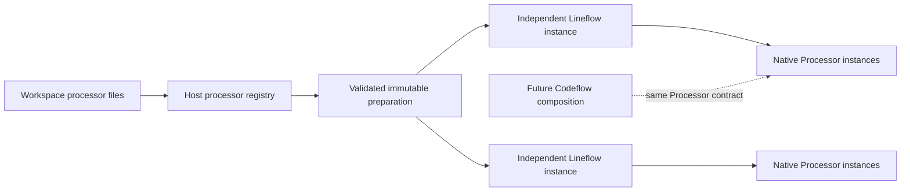
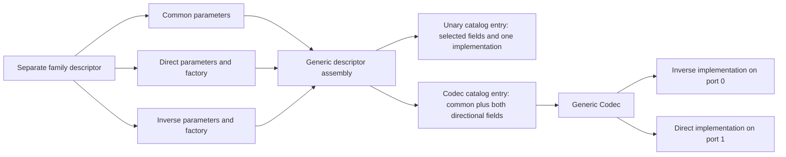
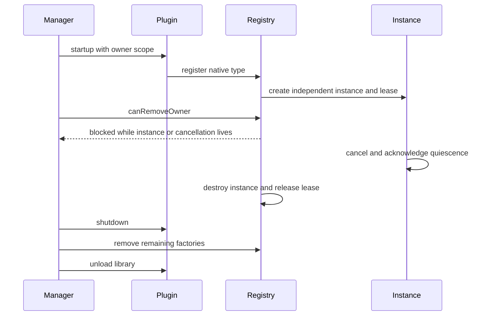
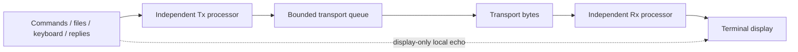
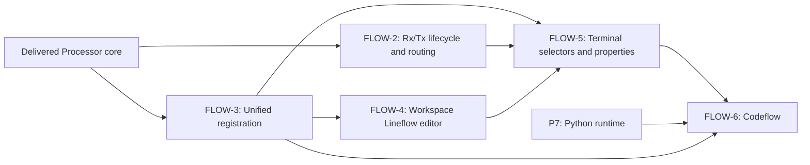
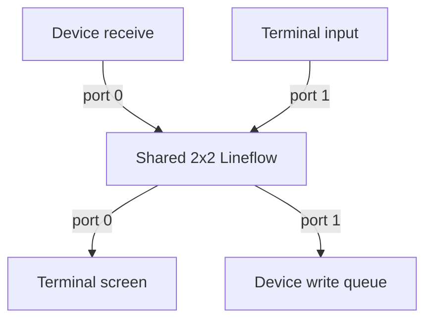

# Processing core

`Processor` is the shared asynchronous byte processing contract. Native elementary
processors and `Lineflow` implement that contract. A future `Codeflow` composition
can implement the same interface around a Python runtime; no interpreter, script
execution or control-flow language is delivered in this stage.

The core is independent of terminal widgets and transports. Workspace definitions
are reusable configuration, while each instantiated pipeline owns separate stream
state. Independent Rx/Tx selections instantiate separate 1x1 pipelines; a shared
2x2 selection uses one instance for both directions. The [workspace Lineflow editor](lineflow-editor.md) edits reusable definitions
through the catalog; it does not instantiate processing runtimes.



## Paired native families

Six separate family classes own shared and directional parameter descriptors:
Length, Checksum, Stuffing, HEX, Base64 and Compression. `Codec::Definition` is a
family-agnostic schema/factory helper. It assembles a direct, inverse or duplex
schema before generated form construction. Only parameter-specific variants such
as Length Fixed/Varint use form discriminators; the operation is a fixed catalog
creation choice. The SDK and processor ABI are unchanged.



The generic Codec owns independent children and remaps their local port zero to
the selected Codec port. It forwards complete owned packets and preserves multiple
outputs, per-port backpressure, same-port reentry rejection and cross-port progress.
An error stops new input on both ports, while accepted peer invocations still
complete. Cancellation immediately suppresses publication and waits for both child
acknowledgements; it does not assume that all future children are synchronous.

## Contract and ownership

`Processor::Chunk` owns one complete `QByteArray` packet and a zero-based `port`
index. There is no stream-chunk flag. Executors preserve each packet as one
invocation, including empty packets. Buffering and deliberate packet splitting
belong to individual configured nodes. Processor input/output counts are immutable for an instance
and described in catalog metadata without creating a runtime. Native and provider
processors support 1 to 32 ports on each side; Lineflow supports 1x1 and 2x2. NUL
bytes remain bytes; an empty packet is an explicit output. Transport read chunks
become input packets but do not imply protocol-message boundaries. Delimiter Framer, Timed Framer and Pattern Framer explicitly
accumulate those packets into protocol frames. An accepted invocation can produce zero, one or many
outputs followed by exactly one completion. A stateful framer completes an input
that only extends its buffer without producing output. `WouldBlock` and `Rejected`
consume nothing and do not invoke callbacks. Input acceptance is not delivery to
a device.

All calls and callbacks run on the processor QObject thread. Workers post through
context-bound queued connections. A consumer allows one active invocation per input port;
Lineflow permits one accepted invocation per stage input and preserves each input's FIFO.
An asynchronous child's output can advance through later stages and reach the
consumer before that child completes. Each root invocation completes after its descendant stages and queued work drain. A later error or cancellation suppresses future callbacks;
already emitted prefixes cannot be rolled back.

The queued pump has a finite event budget and retries a temporarily blocked child
in a later event-loop turn. Output callbacks have no per-output credit.
`maxChunks` bounds resident queued work, rather than the cumulative number of
fragments in a streamed invocation. Queued bytes remain bounded by `maxBytes`;
each child invocation and the final root output also have cumulative `maxBytes`
limits. Their emission counters are bounded by `max(maxBytes, maxChunks)`, including
empty chunks, so draining the queue cannot permit unlimited zero-byte emissions.
Overflow fails and cancels the composition. Pass-through stages do not divide the
maximum payload size by pipeline depth.
Native plugin code is trusted to bound its own buffers according to factory limits;
these bounds do not sandbox arbitrary plugin memory or CPU usage.

Cancellation immediately stops acceptance and suppresses pending invocation
callbacks, and acknowledges only after every worker has stopped using the
instance. Cancellation is idempotent; each caller receives an acknowledgement.
Generations discard stale pipeline callbacks but do not stop native worker work.
Reset creates a new instance from the prepared snapshot after the old instance
has acknowledged cancellation; prepared definitions do not carry stream state.

The registry returns shared instance leases. Last release invokes cancellation;
the native instance and module lease remain alive until acknowledgement and a
subsequent event-loop turn, so plugin cancellation returns before destruction. A plugin
that never acknowledges remains pinned. Factories and instances must be created
and released on the registry's owning thread. Factories return an unparented
processor on that same thread. Configuration snapshots contain persisted value
types, not QObject pointers.

## Plugin lifetime

The plugin SDK consists of header-only `Processor`, `ProcessorCatalog`, and the
existing pure host interfaces. Hosted capability IID version 10 rejects older
host layouts before any new SDK field or method can be used. Native plugins link Qt and the SDK, not another
static Core. `PluginHost::registerProcessorType` uses a manager-assigned owner
scope during plugin startup. Every type supplies a stable ID, title, version 1
`termaster.settings-schema` descriptor and factory. Registry catalog queries
return copied metadata without an executable factory. Unknown configuration
properties are retained according to the descriptor's schema. Registration throws
on invalid metadata, duplicate IDs, invalid descriptors or an unusable default
configuration. It validates the resolved empty configuration before inserting the
factory; required settings must therefore have a valid default baseline.

`PluginManager` owns the registry. Shutdown/reload fails while a factory is being
called or a live/cancelling instance holds its owner lease. Once leases drain,
plugin shutdown runs; the manager removes all remaining factories before unloading
the library, including factories a plugin forgot to unregister. A failed shutdown
keeps the library mapped. Host copies of names, descriptors and errors do not
retain pointers into an unloaded plugin's literal storage.



## Workspace definitions and preparation

Saved definitions live in individual versioned YAML documents under
`<workspace-file>.d/processors/`. The file name is the SHA-256 of the stable catalog
ID, followed by `.yaml`; mutable display names and groups remain inside `content`.
The workspace YAML contains no processor payload. Unknown descriptor and envelope
metadata is preserved. See [workspace storage](workspaces-and-sessions.md).

```yaml
version: 1
type: "termaster.processor-definition"
description: "Workspace processor definition"
content:
  id: "receive-lines"
  name: "Receive lines"
  kind: "lineflow"
  group: "Framing"
  source:
    nodes:
      - name: "frame"
        type: "native.framer"
        configuration: {}
      - name: "output"
        type: "native.gate"
        configuration: {}
```

Each definition contains `id`, `name`, `kind` and a `source` map. Lineflow source
contains `channels` (1 or 2, default 1) and ordered `nodes`; other providers own their source format. Optional
defaults, settings schema, editor metadata and explicit references share the same
descriptor contract.

Each node has a unique `name` within its composition; the name is its identity.
Node type/reference IDs resolve through the unified catalog, so compositions can
include elementary, Lineflow or provider-defined processors. Definitions reuse
configuration rather than live instances. Missing dependencies and unavailable
providers preserve saved definitions and expose a reason for execution being
unavailable. Known dependency cycles and malformed structures are rejected.

Workspace load/sync validates saved definitions. App preflights catalog publication
and publishes changes; persistence never starts a processor. Terminal selection
uses `type: <catalog ID>` for every origin. Preparation captures immutable
configuration and executable provider leases. Independent instances are created
only when requested. Updating/removing a definition changes future preparation;
already prepared or running instances remain valid until explicitly replaced.
The lower-level standalone Lineflow preparation API remains available for explicit
in-memory composition fixtures.

## Defaults and private terminal overrides

Configuration resolution merges schema defaults, the workspace node configuration,
and private instance overrides in that order. Maps merge recursively, arrays
replace, and unknown properties are preserved. Required values with defaults are
filled before validation. Registration rejects a type whose empty resolved
configuration lacks a required value or violates its descriptor. Resolved effective values reach
the native factory and its `configuration()` snapshot without changing shared
workspace definitions.

Private overrides are a map keyed by leaf occurrence paths. Paths join
reference-node names and the leaf-node name with `/`; they do not use positional indexes
or processor type IDs. Reordering a node preserves its address. Renaming changes identity: old override
paths are rejected, and the editor updates affected references atomically. Two references
to the same definition have separate paths and independent live instances.
`ProcessorRegistry::Prepared::instantiate(overrides, error)` validates exact addresses and
creates a fresh runtime. The prepared common configuration remains immutable.

Terminal-specific settings persist in the session object's existing settings map:

```yaml
objects:
  terminal-a:
    type: terminal
    module: vendor.terminal
    settings:
      processing:
        rx:
          type: receive
          overrides:
            framing/frame:
              futureFramerOption: true
        tx:
          type: receive
          overrides: {}
```

`framing/frame` above is one literal map key. Read and write the whole `overrides`
map atomically through `Settings::Node`; do not pass the key to the slash-delimited
settings path API. Terminal A and terminal B keep separate maps, as do Rx and Tx.
Saving these opaque settings does not load a plugin, resolve defaults, start a
processor, or connect terminal routing.

The built-in catalog contains Gate, Framer, Pacer and separate HEX/Base64 encoders and
decoders, with independent parameter schemas and descriptor groups. See
[processing nodes](processing-nodes.md) for configuration and byte-boundary rules.

## Verification

Configure the existing Debug tree from the repository root:

```powershell
. ./.vscode/ExportEnvironment.ps1
cmake -S . -B build/Desktop_Qt_6_12_0_MSVC2022_64bit-Debug -DTERMASTER_BUILD_PLUGIN_TESTS=ON -DTERMASTER_BUILD_PROCESSING_TESTS=ON
cmake --build build/Desktop_Qt_6_12_0_MSVC2022_64bit-Debug --parallel 6
ctest --test-dir build/Desktop_Qt_6_12_0_MSVC2022_64bit-Debug --output-on-failure
```

Synthetic checks cover binary and empty packets, stateful zero-output completion,
independent instances, nested references, schema rejection, graph and queue bounds,
async multiple output ordering, temporary backpressure and cancellation. The real
SDK plugin fixture registers an asynchronous native factory, instantiates it through
the host registry, verifies unload refusal during a live/cancelling instance and
verifies automatic factory removal before unload. Workspace tests verify unknown
metadata and unavailable-type roundtrips and atomic failure preservation.

Production editing UI, Python execution and Codeflow runtime remain separate work.
Terminal routing is described below. Verification uses synthetic bytes without serial hardware,
external network acceptance or elevation.

Verified on 2026-11-09 with Qt 6.12.0, MSVC x64 and the existing Debug tree:
full application/plugin build and all 34 configured CTest executables passed.
The separately built SDK consumer was rebuilt against the generated package and
its targeted `independentSdkConsumer` test passed without skips. The ordinary
suite leaves opt-in visual capture disabled; host symlink privileges were not
available for the existing confinement fixtures. No processing test was skipped.
All changed C++ files were clang-formatted; local documentation file links and
`git diff --check` passed.

## Terminal routing

The App-owned ProcessingRouter connects each terminal's independent Rx and Tx
instances to the existing display and transport output queue. Settings under
`processing/rx` and `processing/tx` select `type: <catalog ID>` for any
registered native, Lineflow or provider-defined processor. Elementary selections accept `configuration` and
`overrides` maps; block overrides retain the occurrence-path format above. An
absent or empty selection uses direct pass-through. The terminal selectors and
private property drafts are described in [terminal processing](terminal-processing.md).

Rx wraps each transport callback as one packet before display decoding. UDP
receives preserve whole datagrams, including empty ones. Each keyboard event and
command submission likewise becomes one Tx packet. On orderly transport closure, already
received independent Rx work may finish and display final output. A shared duplex
flow cancels both directions together. Reconnection recreates selected instances
and discards unfinished state from the previous connection.
Explicit terminal destruction cancels both directions. Definitions and unavailable
references remain saved even when preparation fails; connection fails with a
concrete error instead of silently bypassing processing.

Tx accepts prepared command bytes, immediate keyboard/paste bytes, mouse/focus
reports and protocol replies. Only command preparation adds the selected
terminator. Replies never receive a command terminator. Local echo remains a
display-only operation on the original input and is never fed into Rx or Tx again.
File and periodic producers wait for both processing and transport queues, so
asynchronous processing cannot create overlapping periodic submissions. Only the
disconnected retention policy accompanies transport submissions; timing is owned
by a selected Pacer processor. Each output is a separate atomic datagram for UDP;
stream output uses the existing partial-write queue. UDP payload limits are
validated independently. Configured Pacer timing can intentionally split a packet,
so each emitted piece becomes a separate UDP datagram.

Each direction bounds queued plus active input to 4 MiB / 4096 resident chunks,
and bounds pending output separately to the same limits. Every submission is
copied into one whole invocation, including empty packets. Admission counts
queued and active input before accepting a packet; no implicit 1024-byte
fragmentation is performed. A request exceeding the total byte or chunk
limit is rejected; temporary remaining-capacity shortages return WouldBlock without
consuming bytes. Counters count the original accepted bytes once, while pending
submission counts include fragments. Processing uses a per-turn event
budget and retries temporary backpressure. Receive overflow is reported and closes
the connection because the byte-device interface currently has no read-pause API.
Processor/output errors also stop the connection; payloads are not logged. Native
processor internal buffering remains subject to its own Processor limits.

Replacement cancels and waits for the old processor before starting the new one.
Fresh ingress is bounded while cancellation completes; late callbacks from the old
generation are ignored. Repeated replacement requests keep the latest prepared
instance. Stop discards pending Tx work before resetting the transport queue;
changing a valid processing selection prepares both instances before replacement.
Native registry leases remain held through cancellation and prevent premature
plugin unloading. A provider that never acknowledges cancellation remains pinned.

Offline retention retains its existing behavior in pass-through mode. With a Tx
processor selected, new submissions require an open terminal and explicitly report
this requirement; arbitrary processor state is not replayed across connections.
Previously accepted transport submissions still follow the output queue's existing
retention policy. This is a deliberate current limitation of processed sending.



Routing verification on 2026-11-09 used Qt 6.12.0 / MSVC x64 Debug: the full
application build and all 35 configured CTest executables passed (59.09 s).
New synthetic router checks cover asynchronous multiple/zero output, binary and
empty packets, backpressure, bounds, deferred cancellation, superseded replacement,
stale callback suppression and lifetime retention after coordinator destruction.
Controller acceptance covers independent Rx/Tx decoder state, workspace block
selection, replies without command terminators, final output after close, immediate
reconnect, Stop against a full transport queue and pass-through producer ordering.
Existing real-plugin lease/unload tests also passed. No serial hardware, external
network endpoint or elevation was used for the new acceptance. No visual layout
was changed. Changed C++ files were clang-formatted; local documentation links
and `git diff --check` passed.

## Unified catalog

The registry presents elementary factories and saved composite definitions through
the same metadata and preparation API. Creating or editing a saved definition
publishes a complete owner batch atomically. Opening a workspace restores its
entries; closing or switching workspace removes that owner's published definitions.
Catalog notifications let future selectors and editors refresh without polling.
A dedicated processor plugin is not required.

Each entry has an ID, display name, kind, defaults, settings schema and editor
metadata. Provider-defined source and explicit dependencies support future Python
and Codeflow editors through the same publication path. Providers validate source
and prepare an instance factory; user code executes only in the resulting runtime.
No Python interpreter or production code editor is introduced by this milestone.
Providers use `PluginHost::registerProcessorProvider` during startup. Their source
validator must not execute the authored program. Preparation may compile or parse
source and receives prepared factories for declared catalog references; it must
return a factory that honors the final resolved configuration. Reference factories
create independent instances and retain their own provider leases.

Saved code definitions without an installed provider remain visible and unavailable.

Provider removal immediately makes affected definitions unavailable in the catalog.
Previously prepared factories and running instances remain pinned and usable;
module removal remains blocked until their leases drain. Native type removal still
refuses removal while prepared or live instances exist. Invalid provider exceptions
are reported as validation/preparation failures. Cancellation that discards its
acknowledgement retains a sentinel lease, so leaked native work cannot silently
permit module unloading.

Only the registry selects the implementation during preparation. Consumers never
switch on composition kind. Registration/publication does not construct a live
processing chain. Missing references, provider removal and reinstallation update
availability; active preparation/runtime leases guard native provider lifetimes.
Definition updates use fresh immutable snapshots rather than mutating active state.

Unified catalog verification on 2026-11-09 used Qt 6.12.0 / MSVC x64 Debug.
The full application and bundled plugins built; all 36 configured CTest executables
passed (60.39 s). Catalog tests cover atomic publication, cross-kind cycles,
shared-graph depth/availability bounds, unavailable/late providers, source validation,
defaults and composite private schema constraints, independent instances, immutable
updates/removal, provider exceptions and discarded cancellation acknowledgement.
A real DLL fixture verifies provider registration, prepared/runtime module leases,
old source snapshots after update/removal and unloading after quiescence. Workspace,
session and App tests cover automatic publication, persistence, notifications,
workspace switching and collision rejection without losing the active session.
The independent SDK consumer was rebuilt from a clean external build and its
explicit acceptance reported three passes without skips. Changed C++ files were
clang-formatted; local documentation links and `git diff --check` passed.
That milestone did not change visual layout. Python execution remains future work;
the subsequent [Lineflow editor](lineflow-editor.md) delivers workspace editing.

## Follow-up delivery order

The single implementation checklist is in [the roadmap](roadmap.md#flow-3-unified-processor-registration).
Terminal selectors, private properties and routing are described in
[terminal processing](terminal-processing.md). Codeflow remains future work.



## Paired Lineflow and unsolicited traffic

In a 2x2 Lineflow, port 0 is Rx and port 1 is Tx. Node order is physical placement
from device to terminal: Rx follows increasing positions and Tx decreasing positions.
A 1x1 node has lane `rx` or `tx`; a 2x2 node has lane `duplex` and occupies both
lanes. For a shared node, input 0/output 0 belong to Rx and input 1/output 1 to Tx.
Outputs may target either port regardless of the invoking input. One shared node
instance owns both sides, allowing acknowledgements and protocol state. A nested
2x2 block is also a shared node; a nested 1x1 block fits either individual lane.
Other port shapes cannot be inserted into Lineflow. Unsupported placements fail
validation rather than being silently rewired. Live topology is changed by
preparing and replacing instances, not by resizing a running node's ports.

An accepted invocation's callbacks remain scoped to its completion. Timer-driven
traffic after completion uses `setOutputHandler` / protected `publishOutput`, with
`setErrorHandler` / `publishError` for lifecycle errors. All calls use the owner
thread. Cancellation clears handlers and stops future publication before its
quiescence acknowledgement. Registry wrappers validate input/output indices and
payload bounds; Lineflow applies bounded queues to unsolicited work too. Invalid
outputs stop processing and report a concrete error. No transport or widget is
exposed to a processor.



A shared processor may keep an invocation pending on one input while accepting
another on its other input, for example waiting for an Rx acknowledgement after a
Tx command. Lineflow tracks pending calls separately for each child input port.
Cross-direction paths may revisit shared stages; `Limits.maxSteps` bounds the total
work in each accepted or unsolicited output lineage, including branches and empty
chunks. Exceeding the budget cancels the composition instead of circulating forever.
Independent timer emissions receive independent budgets; lifetime traffic is not
limited by a cumulative counter.

FLOW-8 synthetic checks additionally exercise cross-port responses, shared stream
state, Tx waiting for an Rx acknowledgement, concurrent paced Rx and Tx, nested
shared definitions, direct-preparation parity, general 3x5 native metadata,
factory/runtime shape mismatch, mutated native counts, invalid ports, cancellation
during deferred failure and bounded zero-byte cross-direction loops. Terminal
checks cover queued input during replacement, coalesced ready callbacks, shared
cancellation exactly once, switching back to independent directions after
quiescence, binary ingress, property persistence and reconnect. Capture and suite
acceptance are recorded in [the editor documentation](lineflow-editor.md#flow-8-acceptance).

## Port labels and node orientation

Processor catalog types and saved definitions expose `inputNames` and `outputNames`.
Names are presentation metadata; connections continue to address stable zero-based
indices. Empty name lists resolve to bounded defaults. Explicit lists must match
the port count and contain unique, nonempty single-line names. Native codecs and
framing/timing nodes provide meaningful labels. Lineflow 2x2 defaults distinguish
the device and terminal sides. Prepared snapshots and instance wrappers own copies
of these labels independently of plugin literal storage.

A 2x2 Lineflow node may set `flipped: true` beside `name`, `type`/`reference` and
`lane`. This swaps both input and output port pairs for that occurrence: outer
port 0 binds child port 1 and outer port 1 binds child port 0. One shared instance
and its state are preserved. The same mapping applies to unsolicited output and
nested blocks. Names and private occurrence override paths remain unchanged.
Unary nodes cannot enable flipping; malformed flags or incompatible shapes fail
validation. Changing orientation replaces running terminal instances through the
existing prepared-configuration path.

Processor catalog trees use a shared 12-logical-pixel indentation per level in
the Lineflow palette and terminal selector popup, preserving hierarchy while
leaving more width for processor names.
Processing actions use the module-owned Processing icon (two channels through a
central block). Lineflow commands, Inplace editor buttons and the editor window
use the Lineflow icon (two vertical lanes with staggered blocks). Both SVGs use
palette-aware strokes through the existing icon engine. The editor offers Apply
and Close; Close discards unapplied changes through the existing reject path.
