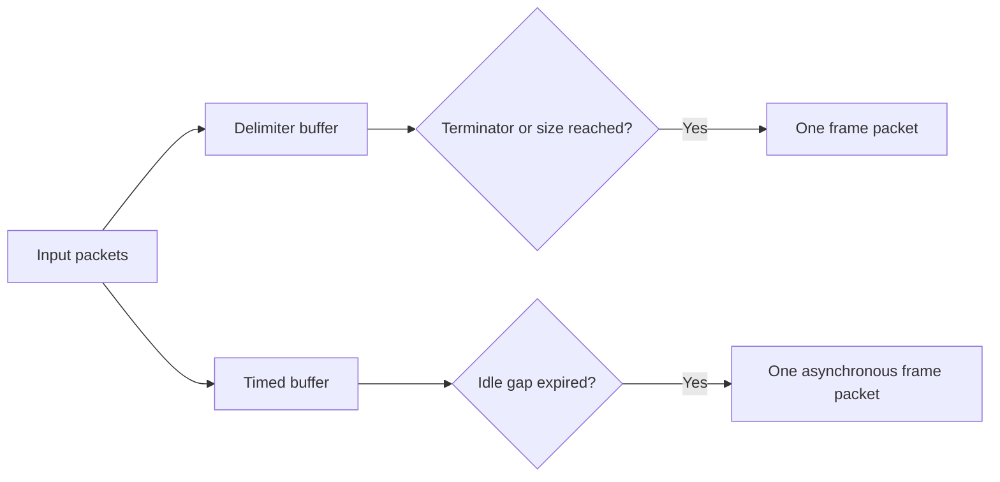

# Configurable processing nodes

Built-in processing implementations live in `src/Core/src/Processing/Nodes`.
Each node owns its algorithm, state, schema and factory: Bypass, Stub, Gate, Framer, HexEncoder,
HexDecoder, Base64Encoder, Base64Decoder, HexCodec, Base64Codec, TimedFramer, PatternFramer, Timestamp and Pacer. NativeProcessors only registers the
catalog entries. Codec, Bypass and Stub nodes share bounded synchronous invocation plumbing, not
an algorithm dispatcher or mutable state.

Descriptors expose `group` as a trimmed optional string of at most 128 characters,
with no NUL. Saved workspace definitions use the same field. An empty group is
presented as General. The catalog groups by origin (Native / Workspace), then
by this subgroup. Group headings are expandable and cannot be selected as
operations or dragged. Searching matches origin, subgroup, name and ID. Workspace
block groups can be edited beside the block selector and remain drafts until Apply.

## Bypass and Stub

`native.bypass` and `native.stub` are built-in Control processors with no editable
parameters. Both remain in Native. Bypass forwards binary bytes unchanged and
preserves packet boundaries, including empty packets. Stub completes every accepted
input with no output at all, including empty packets. It does not buffer input for
later release. Both enforce input limits and stop acceptance after cancellation.

An unnamed favorites section appears above the named origin branches, separated
by a dashed line. Its ordered IDs belong to the workspace document under
`content/state/processing/favorites`. A newly created workspace contains Bypass.
Context menus add/remove favorites and change their order. The same model is used
by Lineflow and terminal Rx/Tx selectors; unavailable favorite IDs remain saved.

## Gate

`native.gate`, group Control, has `enabled: true` by default. Enabled input is
forwarded as one unchanged packet. Disabled input
completes successfully with zero outputs: traffic is dropped, never queued for
later release. It therefore does not stall a Lineflow. Limits still apply while
disabled. Cancellation stops acceptance. Configuration changes follow the common
prepared-instance replacement contract rather than mutating another instance.

## Timestamp

`native.timestamp`, group Timing, emits one packet for each accepted input packet.
It samples the system wall clock when the node processes the packet, rather than
recording transport arrival time. Place a Framer before Timestamp to label complete
frames instead of individual read chunks. It does not buffer input.

Settings:

- `format`: Qt date/time format, default `yyyy-MM-dd HH:mm:ss.zzz`, at most 512
  characters. Single-quoted portions are literal text.
- `timeZone`: `local` (default) or `utc`.
- `template`: output composition, default `[${timestamp}] ${packet}`, at most
  4096 characters. `${timestamp}` inserts the formatted time; `${packet}` inserts
  the original raw bytes. Either may occur anywhere, repeatedly, or be omitted.
  Repeated timestamp placeholders use the same sampled time within a packet.

Literal template text is UTF-8. `$$` inserts a dollar. Byte escapes are `\r`,
`\n`, `\t`, `\0`, `\e` (ESC), `\\` and `\xHH`. Unknown placeholders, incomplete
references and invalid escapes fail configuration before runtime. Packet contents
are never decoded or interpreted as template syntax. ANSI sequences may color
the timestamp, payload or surrounding text:

```yaml
format: 'HH:mm:ss.zzz'
timeZone: utc
template: '\e[90m[${timestamp}]\e[0m ${packet}'
```

This dims the timestamp and restores the terminal's attributes before the packet.
Color interpretation belongs to the terminal endpoint; on Tx these remain actual
bytes sent downstream. No reset or line ending is appended implicitly. An empty
template emits an empty packet. Binary ownership, cancellation and output byte
limits follow the shared synchronous node lifecycle; oversized expansion fails
atomically without partial output. Unknown configuration values remain preserved.

FLOW-18 acceptance used Qt 6.12.0 / MSVC x64 Debug. The complete build and all
50 CTest suites passed. After tightening borrowed-buffer ownership, Timestamp,
Processing and LineflowEditor suites passed again. Native Windows form capture
verified the time format, time zone and output template controls. Release and
real-device acceptance were not run.

Timestamp's schema selects the `timestampPreview` auxiliary settings widget through
`x-widget`. The preview runs the actual node against editable synthetic UTF-8
packet text and renders its output through TerminalDisplay. It adds no syntax
coloring; only ANSI sequences produced by the configured template affect colors.
Draft format, zone and template changes render immediately without Apply. Sample
text belongs only to the widget and is neither persisted nor sent to a transport.
While visible, a single-shot precise timer samples a fresh interval from 100 to
1000 ms inclusive after each update. Hiding or destroying the widget stops it.
Invalid templates show a local diagnostic; preview output is bounded to 8192 bytes.
FLOW-19 acceptance passed all 50 MSVC x64 Debug CTest suites. Native Windows
captures verified plain output and template-provided true-color ANSI output.
Form tests verified immediate draft updates, sampled timer intervals, hidden-state
cancellation and that sample text never writes settings. Release was not tested.

## Framers

Both framers belong to Framing and explicitly accumulate bytes across input
packets. Input packet boundaries do not flush their buffers. Each completed frame
becomes one independent output packet; UTF-8 is not decoded during framing.

### Delimiter Framer

`native.framer` collects bytes until a terminator is matched or an optional byte
count is reached. A configured `frameSize: 0` (default) disables size-triggered
emission, so accumulation continues until the terminator. It does not disable
host runtime memory bounds. Exceeding a runtime bound reports a processing error
without closing the transport.

| Parameter | Default | Behavior |
|---|---|---|
| frameSize | 0 | Zero waits only for the terminator; positive sizes also emit at this many raw bytes |
| ending | `\r` | Byte pattern with `\r`, `\n`, `\0`, `\xHH`, `\\` escapes; literal text is UTF-8 |
| includeEnding | false | Keep a matched ending in the emitted frame |
| emitEmpty | true | Preserve empty frames produced by a terminator |

Terminator bytes count toward the configured size. A complete terminator wins a
tie with the size rule and is removed only when includeEnding is false. A partial
terminator at a size boundary remains raw data in that frame. Matching is linear,
handles overlapping patterns and survives arbitrary input splits. The decoded
pattern contains 1 to 256 bytes. Cancellation discards any incomplete frame.
The previous mode, input-tail and per-node maximum controls are removed.

### Timed Framer

`native.timed-framer` collects nonempty input packets until the idle interval is
at least `gapMs` milliseconds. The default is 20 ms; the supported range is 1 to
60,000 ms. Each nonempty arrival restarts the deadline. Empty packets neither
create a frame nor postpone it. Host runtime byte bounds limit the buffer.

A monotonic clock measures the gap. If a packet arrives after the deadline before
Qt dispatches the timer, the previous frame is emitted first and the new packet
starts another frame. The timer also emits the buffered frame during silence;
there is no requirement for another input to trigger output. Input acknowledgements
complete immediately; frames use the Processor lifetime output channel. Timers,
state and callbacks use the owning QObject thread. Cancellation stops the timer
and discards buffered bytes, with no later output.



### Pattern Framer

`native.pattern-framer` uses PCRE2-8 JIT with hard partial matching to accumulate
binary packets and detect frames across input boundaries. Its two settings are:

| Parameter | Default | Behavior |
|---|---|---|
| pattern | `(?<payload>[^\r\n]+)\r?\n` | PCRE2 byte pattern defining a complete frame |
| outputTemplate | empty | Empty emits the complete match; otherwise composes one output packet from captures and literal bytes |

Example configuration:

```yaml
pattern: '<(?<header>[A-Z]):(?<payload>[^>]+)>'
outputTemplate: '${payload}abcdef${header}END\r\n'
```

Input `noise<H:123>tail` emits `123abcdefHEND` followed by CRLF. The whole matched
`<H:123>` and preceding noise are consumed; the trailing bytes remain pending.
An explicit `${0}` also emits the whole match. A whitespace-only template is a
literal template rather than an empty setting.

Capture references are `${name}` or `${number}`. Number zero is the complete
match; remaining numbers follow opening capturing parentheses from left to right,
including nested groups. For `(A(B))(C(D(E)))`, groups 1 through 5 contain AB, B,
CDE, DE and E. Noncapturing `(?:...)` does not allocate a capture number. Named
captures use `(?<name>...)` and may be nested. Optional groups that did not
participate substitute no bytes. Unknown/ambiguous names, nonexistent numbers,
incomplete references and malformed escapes reject instance creation before I/O.

`$$` emits one dollar. Supported byte escapes are `\\`, `\r`, `\n`, `\t`, `\0`
and `\xHH`. Other template text is encoded once as UTF-8; captured data is copied
as original bytes, including NUL and invalid UTF-8. No decoding/re-encoding of
captured payload occurs. The output template is parsed once into literal/capture
parts when preparing the instance.

Patterns use 8-bit byte semantics with dot matching every byte; UTF/UCP mode
switches are disabled. Patterns must compile for JIT and must not match empty
frames. Compilation is bounded to 4096 UTF-8 bytes / 64 nested parentheses;
templates are bounded to 16384 UTF-8 bytes. PCRE matching uses at most 100,000
match steps (also capped by maxSteps), a 128 KiB JIT stack cap and an 8 MiB heap
limit. Between searches, a 20 ms invocation watchdog bounds multi-match work.
It does not preempt an individual PCRE call; that call has its own match/stack
bounds. Input buffers, aggregate output bytes and packet counts retain the host
Processor limits. Failure suppresses this invocation's outputs and stops the
processor, while the terminal transport remains connected.

Pending input is retained for lookbehind/history within the current frame. Each
consumed frame starts a fresh logical subject, so anchors and lookbehind cannot
inspect an already consumed frame even when two frames arrive in one packet.
Hard-partial search resumes at its first viable start while keeping preceding
bytes for lookbehind; patterns containing `\G` retain offset-zero matching to
preserve that anchor's semantics. An unmatched prefix remains bounded by the
runtime buffer cap rather than being silently discarded. Frame/noise buffering
is discarded on cancellation, with no implicit end-of-stream flush.

The node follows PCRE2 ordered-alternative/greediness semantics. Prefer a finite
terminator or a lazy body such as `(?<payload>.*?)END` when a frame must be emitted
at its first ending. Greedy open-ended expressions and end-of-subject anchors can
keep waiting for more input. JIT partial matching can rescan long pending frames;
the [benchmark](regex-benchmark.md) records that performance tradeoff. Automatic
DFA fallback is not enabled because it supports a different pattern subset.

## Pacer

`native.pacer`, group Timing, schedules bytes asynchronously on its QObject thread.
Select it directly for Rx/Tx or include it in a Lineflow. It preserves byte order
and values, including NUL; byte spacing may split a UTF-8 character.

| Parameter | Default | Behavior |
|---|---|---|
| byteDelayMs | 0 | Minimum delay between byte emissions, 0 to 60,000 ms |
| lineDelayMs | 0 | Pause after a matched ending, 0 to 60,000 ms |
| ending | `\n` | Escaped byte pattern, decoded length 1 to 256 bytes |
| bytesPerSecond | 0 | Byte-rate limit, 0 disables it; maximum 1,000,000,000 |
| burstBytes | 64 | Rate burst allowance, 1 to 65,536 bytes, clamped to runtime maxBytes |

Ending escapes are `\r`, `\n`, `\0`, `\xHH` and `\\`; literal text uses UTF-8.
Matching survives stream input boundaries. Pauses follow this byte pattern only;
file-line metadata does not supply a separate boundary. Timing fences survive
invocation completion. Concurrent byte, ending and rate constraints use the latest
required emission time, rather than adding independent sleeps. A bounded rate
burst does not accumulate unlimited credit while idle.

With timing disabled, packets remain whole, including empty packets. Explicit byte
spacing emits byte packets, line timing emits at ending boundaries, and rate
limiting emits bounded bursts. These are deliberate node transformations; the
executor never splits packets. Ending matching and timing fences survive input
calls. Cancellation stops timers and suppresses pending output immediately.

These times govern Processor output emission into the next stage. They do not
establish physical transport timing or receiver delivery: downstream processors,
router queues and backend buffers can delay or accumulate bytes. Lineflow forwards
Pacer output before completion, so delays remain observable through a composition.
Its resident queue limits and bounded cumulative emission counters also apply.

## HEX

- `native.hex-encoder`: letterCase is upper (default) or lower; separator defaults
  to one space and accepts at most 16 Unicode characters of literal UTF-8 text.
  Separators occur only between bytes within one packet. Each invocation resets
  separator state.
- `native.hex-decoder`: ignoreWhitespace defaults to true and ignores ASCII
  space, TAB, CR, LF, VT and FF. Both letter cases decode. Non-hex bytes are errors;
  an odd nibble at packet end is rejected by default. `accumulate: true` explicitly
  retains one nibble across calls until a pair is complete. It defaults to false.

Both entries belong to Codecs. Non-whitespace encoder separators require a
separate transformation before the strict HEX decoder.

## Base64

- `native.base64-encoder`: alphabet is standard or url, padding defaults true,
  lineLength defaults zero (no wrapping) or a multiple of four up to 4096, and
  lineEnding is lf or crlf. Each packet is encoded independently, including its
  final one/two-byte unit and optional padding. For example, separate packets
  `f`, `o`, `o` produce `Zg==`, `bw==`, `bw==`, rather than `Zm9v`.
- `native.base64-decoder`: alphabet is standard or url, ignoreWhitespace defaults
  true and requirePadding defaults true. Each packet must contain complete encoded
  data; quartets are not accumulated across calls.
  Invalid alphabet bytes, misplaced/incomplete padding, data after padding and
  noncanonical unused bits are errors. With requirePadding false, a two/three-digit
  tail may finish at Packet end; a one-digit tail is always invalid.

## Duplex codecs

`native.hex-codec` (HEX Codec) and `native.base64-codec` (Base64 Codec) are elementary
native 2x2 processors in Codecs. Each owns a decoder on input/output port 0 and an
encoder on input/output port 1. The default vertical orientation decodes device Rx
downward into terminal bytes and encodes terminal Tx upward into wire text. Port
names are HEX/Bytes or Base64/Bytes on input and Bytes/HEX or Bytes/Base64 on output.
Rotating the occurrence uses the existing 180-degree Lineflow port mapping; it does
not change either algorithm or its settings.

Settings are flat fields grouped into Decode and Encode in the generated form:

| Node | Decode defaults | Encode defaults |
|---|---|---|
| HEX Codec | `decodeIgnoreWhitespace: true`, `decodeAccumulate: false` | `encodeLetterCase: upper`, `encodeSeparator: ' '` |
| Base64 Codec | `decodeAlphabet: standard`, `decodeIgnoreWhitespace: true`, `decodeRequirePadding: true` | `encodeAlphabet: standard`, `encodePadding: true`, `encodeLineLength: 0`, `encodeLineEnding: lf` |

The algorithms reuse the corresponding unary implementations and their validation,
expansion limits and independent directional state. Every packet is finalized
independently; only explicitly enabled HEX accumulation retains a partial pair.
There is no implicit flush on transport closure. Configuration snapshots include
resolved defaults and preserve unrelated fields. Non-whitespace HEX separators
remain invalid input to the strict decoder without an additional transformation.

Invalid ports and oversized input are rejected without consuming state or invoking
callbacks. A processing error stops new acceptance on both directions and suppresses
subsequent output; every invocation already accepted still completes with the
failure, including opposite-port reentry from an output callback. Explicit cancel
instead clears both unary states and suppresses pending callbacks before its
quiescence acknowledgement. Instances, state and callbacks stay on the owning
QObject thread. No new transport or background worker is introduced.

### Duplex codec verification

Verified on 2026-11-10 with Qt 6.12.0 / MSVC2022 x64 Debug; the application,
bundled modules and tests built successfully. The complete CTest run passed 46
of 47 executables in 113.64 seconds; its editor failure was an outdated filtered
catalog count after adding the new entries. After correcting that expectation,
LineflowEditorTests passed in 11.73 seconds, completing verification of all 47
configured executables. Production code was unchanged after the full run.

Codec coverage includes all 256 byte values, bytewise interleaved streams,
independent packet resets, defaults and invalid options, invalid port rejection,
output bounds, malformed tails, cross-port/same-port reentry, error completion of
in-flight peers, cancellation, destruction from output callbacks and both 2x2
Lineflow orientations. Native Windows captures at scales 1 and 2 each passed three
QtTest checks without skips; both real settings forms and named ports were inspected.
Changed C++ files were clang-formatted and `git diff --check` passed. No real device,
external endpoint or elevation was used. Release was not rebuilt.

- [HEX Codec](images/duplex-lineflow/HexCodec.png)
- [Base64 Codec](images/duplex-lineflow/Base64Codec.png)
- [HEX Codec at scale 2](images/duplex-lineflow/HexCodec2x.png)
- [Base64 Codec at scale 2](images/duplex-lineflow/Base64Codec2x.png)

Both entries belong to Codecs. Data after Base64 padding within the same packet
is invalid. An empty valid packet is preserved. Put a Framer before
an encoder/decoder when input is a continuous transport stream requiring explicit
message boundaries. Cancellation is not a request to flush or encode a tail.

## Limits and configuration

Each implementation receives independent state and resolved schema defaults.
Factories reject malformed options and guard input, output and persistent state
against runtime bounds. A processing error stops that instance and suppresses
future output. Synchronous nodes validate before emission where applicable, but
asynchronous compositions can already have emitted a prefix before a later error.
Previously emitted bytes and completed invocations cannot be rolled back. Output and error data own their storage. Reentrant input during an
output callback returns WouldBlock; completion releases the invocation slot.

Schemas are consumed by the existing generated settings forms and `x-widget`
registry. Numeric settings persist as numbers and booleans as booleans. Unknown
configuration is preserved. Current development IDs are native.gate and
native.framer; Identity and the fixed CR-only node are removed without aliases.
HostedPlugin IID 11 uses packet-only Chunk layout with descriptor port counts and lifecycle output/error handlers; native modules must be
rebuilt against the generated SDK.

## Verification

Verified on 2026-11-09 with Qt 6.12.0 / MSVC x64 Debug. The application and native
modules built successfully; all 42 configured CTest targets passed (72.82 s).
After the requested name-column refinement, affected App and editor targets passed
again (27.84 s combined). Node tests cover all 256 byte values, incremental splits,
multiple/empty frames, binary and overlapping endings, packet policies, canonical
Base64 bits/padding, malformed data/configuration, output/state bounds, cancellation,
reentrant input and destruction during callbacks. Registered Lineflow roundtrips
and a disabled Gate verify zero-output completion without blocking downstream.

Metadata tests verify group type/length/ownership, raw-storage deep copies,
publication atomicity and change notifications. GUI acceptance checks both origin
roots, non-draggable subgroup headings, subgroup editing, filtering, real encoder
and Gate controls, and stable name/class column proportions after graph resets.
The name column stretches; the class column starts compact, is resizable and is
capped to 40 percent of the viewport. Full names remain available in tooltips.

Native Windows screen-fit, column-reset and visual checks passed at scales 1 and 2
(five QtTest passes without skips per scale). HEX and Framer captures use logical
1100 by 760 client areas and were visually inspected. The separately clean-built
SDK consumer passed its explicit acceptance with three passes and no skips.
Changed C++ files were clang-formatted; documentation links, captures and diff
checks passed. No real-device or external endpoint acceptance was performed.

- [HEX encoder and grouped catalog](images/lineflow-editor/Editor.png)
- [Framer settings](images/lineflow-editor/Framer.png)
- [Framer at scale 2](images/lineflow-editor/Framer2x.png)

## FLOW-12 packet acceptance

The complete Qt 6.12/MSVC Debug build includes the application, hosted modules
and test fixtures rebuilt against HostedPlugin IID 11. All 47 configured test
executables were verified: the full run passed 46; its remaining AppTests failure
was an obsolete Base64 fragment in a fixture intentionally testing explicit HEX
accumulation. After correcting the fixture, AppTests passed in 43.24 seconds;
production code was unchanged. Packet codec tests cover every byte and split,
explicit HEX accumulation, malformed tails, empty packets, independent ports,
bounds, reentry and cancellation. Router tests verify whole-packet admission,
borrowed-byte ownership and absence of automatic 1024-byte fragmentation.

Native Windows editor captures at scales 1 and 2 passed without skips and show
the default-disabled HEX accumulation option. No serial hardware, external
network endpoint or elevated shell was used. Release was not built.

## FLOW-13 framer acceptance

The complete Qt 6.12/MSVC Debug build succeeded. Direct delimiter and timed-node
tests cover binary data, split terminators, zero/default size behavior, positive
size triggers, delayed timer dispatch, empty input, exact resource limits,
independent instances, cancellation and destruction/reentry from callbacks.
Composition and router checks verify asynchronous frame output after input
acknowledgement and cancellation of buffered data. Native Windows editor captures
at 100% and 200% scale show both generated forms; all capture checks passed.

The full 48-executable run passed 46. ProcessingTests initially submitted a second
packet while the composition was still busy; the fixture now waits for the first
acknowledgement, and all five affected processing/editor executables passed.
ConsoleElevationTests encountered a heap-corruption exit in the parallel run;
its isolated rerun passed. No console production code was changed, and this
intermittent failure remains a verification limitation. No real serial device,
external endpoint or elevated shell was used. Release was not built.

- [Delimiter Framer](images/framers/Framer.png)
- [Timed Framer](images/framers/TimedFramer.png)
- [Delimiter Framer at scale 2](images/framers/Framer2x.png)
- [Timed Framer at scale 2](images/framers/TimedFramer2x.png)

## FLOW-15 pattern framing acceptance

PCRE2 10.49 and the pinned SLJIT submodule were initialized as real Git submodules;
upstream sources remain clean. The complete MSVC/Qt 6.12 Debug build succeeded,
with `SUPPORT_JIT=1` in the generated PCRE2 configuration. Direct tests cover every
binary split, nested named/numeric capture composition, default whole matches,
optional groups, escaped byte literals, borrowed input ownership, invalid templates,
lookbehind history, fresh-subject anchors, `\G` start-offset semantics, resource
bounds, atomic failure, cancellation, reentry and callback-driven destruction.

A composition test verifies binary templating across input invocations. The App
fixture exercises Pattern Framer on both Rx and Tx through the existing synthetic
terminal host and keeps the device connected. Native Windows generated-form
captures at scales 1 and 2 passed without skips.

The complete test run passed 48 of 49 executables, including all new/affected
processing, editor and App suites. The pre-existing ConsoleElevationTests crash
recurred in both the full run and an isolated retry (invalid-parameter/heap exits).
Console production code was unchanged; the failure remains an unresolved
verification limitation rather than a green full-suite claim. No real serial
hardware, external endpoint or elevation was used. Release was not rebuilt for
this feature.

- [Pattern Framer settings](images/framers/PatternFramer.png)
- [Pattern Framer settings at scale 2](images/framers/PatternFramer2x.png)
