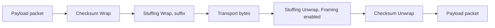
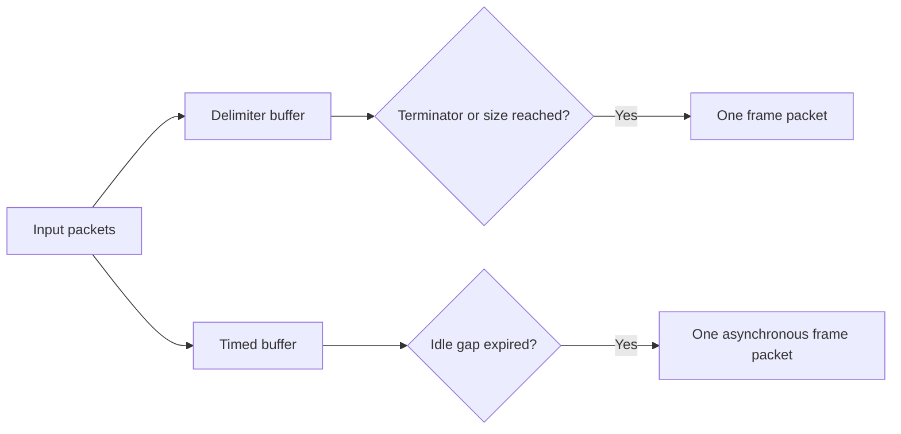

# Configurable processing nodes

Built-in processing implementations live in `src/Core/src/Processing/Nodes`.
Independent nodes own their algorithm, state, schema and factory. The six paired
families Length, Checksum, Stuffing, HEX, Base64 and Compression own their parameter
descriptors and direct/inverse factories in separate family source files. The shared
`Codec::Definition` assembles only the requested fields before a form is created.
Unary creation constructs only the selected implementation; duplex creation uses
one generic `Codec` containing two independent implementations. NativeProcessors
registers three distinct fixed-topology catalog entries for each family.

Descriptors expose `group` as a trimmed optional string of at most 128 characters,
with no NUL. Saved workspace definitions use the same field. An empty group is
presented as General. The catalog groups by origin (Native / Workspace), then
by this subgroup. Group headings are expandable and cannot be selected as
operations or dragged. Searching matches origin, subgroup, name and ID. Workspace
block groups can be edited beside the block selector and remain drafts until Apply.

## Bypass and Stub

`native.bypass` and `native.stub` are built-in Control processors with no editable
parameters. Both remain in Native. Bypass forwards binary bytes unchanged and
preserves packet boundaries, including empty packets. Stub completes every accepted
input with no output at all, including empty packets. It does not buffer input for
later release. Both enforce input limits and stop acceptance after cancellation.

An unnamed favorites section appears above the named origin branches, separated
by a dashed line. Its ordered IDs belong to the workspace document under
`content/state/processing/favorites`. A newly created workspace contains Bypass.
Context menus add/remove favorites and change their order. The same model is used
by Lineflow and terminal Rx/Tx selectors; unavailable favorite IDs remain saved.

## Gate

`native.gate`, group Control, has `enabled: true` by default. Enabled input is
forwarded as one unchanged packet. Disabled input
completes successfully with zero outputs: traffic is dropped, never queued for
later release. It therefore does not stall a Lineflow. Limits still apply while
disabled. Cancellation stops acceptance. Configuration changes follow the common
prepared-instance replacement contract rather than mutating another instance.

## Compress and Uncompress

`native.compress` and `native.uncompress`, group Compression, are unary packet
processors using Core's existing zlib dependency. zlib, gzip and raw are three
wrappers around the same DEFLATE algorithm. Each accepted packet is an independent
complete stream; separate invocations share allocation capacity but never a
dictionary or unfinished input. A framing stage must assemble complete compressed
packets before Uncompress when transport reads split them.

Compress settings:

| Field | Default | Values |
| --- | --- | --- |
| `format` | zlib | zlib, gzip, raw DEFLATE |
| `level` | -1 | -1 library default, 0 stored blocks, 1 fastest through 9 strongest |
| `windowBits` | 15 | 9–15, a 512-byte through 32 KiB history window |
| `memLevel` | 8 | 1–9 compression memory/speed trade-off |
| `strategy` | default | default, filtered, huffman, rle, fixed |

Filtered favors filtered data, huffman skips LZ matching, rle specializes in runs
and fixed uses fixed Huffman codes. Level 0 still emits a valid wrapped/raw
DEFLATE stream. A compressed packet may be larger than its input, including an
empty packet. See the [zlib API manual](https://www.zlib.net/manual.html).

Uncompress settings:

| Field | Default | Values |
| --- | --- | --- |
| `format` | zlib | zlib, gzip, raw DEFLATE |
| `autoDetect` | true | Accept either zlib or gzip for wrapped formats; raw remains explicit |
| `windowBits` | 15 | 9–15, maximum decompression window |
| `maxOutputBytes` | 1048576 | 1–67108864, additionally capped by the host limit |
| `concatenated` | false | Accept multiple complete streams into one output packet |

Checksums are verified when the selected wrapper supplies them. Every remaining
byte must belong to a complete stream; truncated packets, trailing junk and
unsupported preset dictionaries fail atomically. Concatenated mode does not
ignore incomplete final members. A valid compressed empty stream emits one
empty output packet; an empty compressed input is invalid. Raw DEFLATE has no
wrapper checksum and cannot provide equivalent integrity checks.

Output grows in bounded 16 KiB increments rather than trusting input size headers.
The host byte/step limits remain authoritative. Context pointers are cleared
before input callbacks finish and native resources are owned by the instance.
Execution is synchronous on the owning thread, as for the existing native codecs;
packet size and compression level determine the time spent in one invocation.
Processing errors follow the existing router failure path without closing the
terminal transport. Unknown configuration fields remain preserved.

FLOW-21 acceptance passed the complete MSVC x64 Debug build and all 52 CTest
suites. CompressionProcessorTests and ProcessingTests also passed in Release.
Independent Python zlib runtime 1.3.1.zlib-ng decoded all three captured native
formats with exact 16409-byte output. Fixed external fixtures cover binary bytes,
while the matrix covers wrappers, levels, strategies, windows and memory settings.
Truncation, checksums, dictionaries, concatenation, step/byte limits and buffer
ownership were checked. Native forms are captured in
[Compress](images/compression/Compress.png) and
[Uncompress](images/compression/Uncompress.png). No real-device acceptance was run.

Additional algorithm candidates, not implemented by these nodes yet:

| Algorithm | Parameters to expose | Intended use |
| --- | --- | --- |
| Zstandard | level/fast mode, window limit, dictionary, frame checksum | General-purpose compressed packet protocols |
| LZ4 Frame / HC | acceleration or HC level, block size, block/content checksum | Low-latency packet handling |
| Brotli | quality 0–11, window 10–24, generic/text/font mode | Brotli-compatible content |
| LZMA2/XZ | preset 0–9, dictionary and memory limits, check type | XZ-compatible content and larger blocks |

These require additional dependencies and distinct framing/limit validation.
Their APIs are documented by [Zstandard](https://github.com/facebook/zstd),
[LZ4](https://github.com/lz4/lz4), [Brotli](https://www.brotli.org/encode.html)
and [XZ](https://tukaani.org/xz/man/xz.1.html). They are candidates rather than
claims of measured performance in Termaster.

## Length Wrap and Length Unwrap

`native.length-wrap` and `native.length-unwrap`, group Framing, add and validate
an unsigned binary length field around one whole packet. They do not accumulate,
split or join packets. Assemble complete incoming packets with an explicit framing
stage before Length Unwrap when transport reads can split a message.

Both nodes expose the same generated settings:

| Field | Default | Values |
| --- | --- | --- |
| `encoding` | fixed | Fixed or Varint; selects the active settings branch |
| `position` (Fixed) | prefix | prefix or suffix, relative to the payload |
| `width` (Fixed) | 2 | Any integer from 1 through 8 bytes, step 1 |
| `endianness` (Fixed) | little | little or big byte order |
| `maxBytes` (Varint) | 10 | Maximum prefix width, any integer from 1 through 10 |
| `includeField` | false | Count the field's own width as well as payload bytes |
| `adjustment` | 0 | Signed integer from -2147483647 through 2147483647 |

The wire value is `payloadBytes + (includeField ? actualFieldWidth : 0) + adjustment`.
For example, default wrapping of `41 00 FF` produces `03 00 41 00 FF`;
a two-byte big-endian suffix with field counting produces `41 00 FF 00 05`.
The field is always unsigned. A negative result or a value that does not fit the
selected width fails before any output is emitted. Integer configuration accepts
finite whole numeric values and rejects strings, booleans and fractional values.
Unknown settings remain preserved. The generated root `oneOf` keeps `includeField`
and `adjustment` common. Fixed exposes only position, width and byte order; Varint
exposes only maximum bytes and always uses a prefix. Switching retains inactive
drafts until Apply; applied and factory configurations remove recognized inactive
fields while preserving unknown settings. Omitted encoding selects Fixed.

Varint uses canonical unsigned ULEB128, matching Protobuf uint64 encoding: seven
payload bits per byte, least significant group first, continuation in bit 7, at
most ten bytes. The tenth byte must be 0 or 1 without continuation; canonical
encoding of a ten-byte value ends in 1. Examples: 0 = `00`, 127 = `7F`,
128 = `80 01`, 16383 = `FF 7F`, 16384 = `80 80 01`, and UINT64_MAX =
`FF FF FF FF FF FF FF FF FF 01`. Truncated, overlong, noncanonical and overflowing
fields fail atomically, including a prefix exceeding `maxBytes`.

When counting the field, Wrap chooses the smallest width from 1 through `maxBytes`
whose adjusted value canonically encodes to that same width. A 126-byte payload
therefore gets prefix `7F`; a 127-byte payload gets `81 01`. At some boundaries a
wider self-consistent value also exists: `80 01` before 126 payload bytes is
rejected because the minimal layout uses one byte. Unwrap enforces the same
minimal solution against the observed prefix width and actual payload bytes.
If no solution exists, including adjustment underflow, the packet fails.

Length Unwrap computes the expected value from the actual packet payload size,
compares every field byte through unsigned 64-bit arithmetic, and strips the field
only after an exact match. Short packets, truncated payloads, trailing bytes,
length mismatch and adjustment overflow/underflow fail atomically. A hostile
fixed or varint field never determines an allocation size. A valid field-only packet emits
one empty payload packet. Cancellation and failure stop the instance; processing
errors follow the existing router contract without closing the terminal transport.

Host input/output byte limits apply, including the added field. Length field
encoding/decoding consumes one work step per field byte; insufficient maxSteps
fails atomically. Each successful invocation emits exactly one owned output packet.

FLOW-24 acceptance passed the complete MSVC x64 Debug build and ten affected
CTest suites. LengthProcessorTests covers all fixed widths, both byte orders and
positions, independent Varint vectors through UINT64_MAX, minimal field-counting
solutions, malformed/truncated prefixes, maxBytes/step/byte bounds, adjustment,
packet independence, owned output and cancellation. Actual Length node forms
verify Fixed/Varint field visibility, inactive draft restoration, normalized Apply
and registry factory creation. Native Windows Lineflow captures use the same
1100 by 760 logical window at scales 1 and 2; scale 2 captures remain temporary.
Reference captures: [Wrap Fixed](images/length/LengthWrapFixed.png),
[Wrap Varint](images/length/LengthWrapVarint.png),
[Unwrap Fixed](images/length/LengthUnwrapFixed.png) and
[Unwrap Varint](images/length/LengthUnwrapVarint.png). No real-device or
external-network acceptance was run.

## Checksum Wrap and Checksum Unwrap

`native.checksum-wrap` and `native.checksum-unwrap`, group Integrity, are unary
whole-packet processors. Wrap adds one checksum field; Unwrap validates and removes
it before emitting any payload. The checksum covers payload bytes only, including
NUL. Each invocation starts a fresh checksum. Framing must assemble complete
packets before Unwrap when transport reads split a message.

| Field | Default | Values |
| --- | --- | --- |
| `algorithm` | crc16-modbus | Sum 8, XOR 8, the five named CRC presets below, or Custom CRC |
| `position` | suffix | suffix or prefix, relative to payload |
| `endianness` | little | little or big; shown for 16/32-bit presets and Custom CRC |
| `width` (Custom) | 16 | 8, 16 or 32 bits |
| `polynomial` (Custom) | 32773 | Nonzero normal polynomial, excluding its top bit; must fit width |
| `init` (Custom) | 65535 | Initial normal register value; must fit width |
| `refin` (Custom) | true | Reflect each input byte before the normal-register recurrence |
| `refout` (Custom) | true | Reflect the final normal register before final XOR |
| `xorout` (Custom) | 0 | Final XOR value; must fit width |

Custom polynomial, initial register and final XOR use the descriptor-selected
`hexInteger` editor with uppercase `0x` values and numeric persistence. Their
defaults appear as `0x8005`, `0xFFFF` and `0x0`; CRC width remains a numeric
dropdown. Values through `0xFFFFFFFF` (4294967295) are exact. Width-specific
bounds are enforced both by the form schema and the factory; changing width may
require explicitly adjusting polynomial, initial register and final XOR. Even
nonzero polynomials are accepted as specified recurrences. They can have weaker
error detection properties than conventional CRC polynomials. Byte order affects
only serialization, independently of input/output reflection. It has no effect on
one-byte fields, including an 8-bit Custom CRC.


The SETTINGS-6 follow-up verified hexadecimal numeric persistence, retained
preset/custom drafts and matching native reset borders through the generated
form, actual Lineflow fixture and checksum runtime tests. The complete Debug
build and all seven affected suites passed; native forms were checked at scales
1 and 2. See [settings-form acceptance](settings-forms.md#hexadecimal-editing-and-reset-frame-verification).

The named parameters and ASCII `123456789` check values follow the
[CRC RevEng catalogue](https://reveng.sourceforge.io/crc-catalogue/all.htm).
Hexadecimal values in this reference are not configuration strings.

| Algorithm ID | Width | Polynomial | Init | RefIn / RefOut | XorOut | Check |
| --- | --- | --- | --- | --- | --- | --- |
| `crc8-smbus` | 8 | 07 | 00 | false / false | 00 | F4 |
| `crc16-modbus` | 16 | 8005 | FFFF | true / true | 0000 | 4B37 |
| `crc16-ibm3740` | 16 | 1021 | FFFF | false / false | 0000 | 29B1 |
| `crc32-iso-hdlc` | 32 | 04C11DB7 | FFFFFFFF | true / true | FFFFFFFF | CBF43926 |
| `crc32-iscsi` | 32 | 1EDC6F41 | FFFFFFFF | true / true | FFFFFFFF | E3069283 |

`sum8` adds unsigned bytes modulo 256, starting at zero; `xor8` XORs unsigned
bytes, starting at zero. Their checks for `123456789` are DD and 31. Empty input
produces 00 for these and CRC-8/SMBUS, FFFF for both CRC-16 presets, and 00000000
for both CRC-32 presets. For Custom CRC, empty input produces the initial register,
optionally reflected by `refout`, then XORed with `xorout`. No implicit zero-byte
augmentation is appended. The runtime precomputes a 256-entry table per CRC
instance; processing uses one lookup per payload byte.

For example, default wrapping of ASCII `123456789` appends `37 4B`. A big-endian
prefix instead produces `4B 37` before the same payload. Unwrap excludes the field
itself from checksum computation and emits one owned payload, including a valid
empty payload. Short fields, mismatches and host-limit violations
fail without partial output. Checksums are not authentication: collisions can
still make modified or extended packets pass verification.

The host byte limit includes checksum overhead: Wrap bounds payload plus field,
and Unwrap bounds the complete input packet. Work costs one step per payload byte
plus one per field byte for either direction. Table preparation and finalization
have a fixed bounded cost. Processing failure stops the processing chain through
the existing error path; it does not disconnect the terminal transport. Cancel
stops acceptance and does not flush packets. No drop-and-continue policy is added.

The generated root `oneOf` shows only active algorithm fields. Switching preserves
inactive drafts until Apply; Apply and factory normalization remove recognized
inactive keys while preserving unrelated settings. Presets use fixed exact
parameters, with no ambiguous generic CRC16 name or compatibility aliases.

### Checksum acceptance

Verified on 2026-11-10 with Qt 6.12 / MSVC2022 x64 Debug: the complete application,
modules and test build succeeded, and all ten affected CTest executables passed
in 21.75 seconds. Tests cover independent published checks, all field
positions and byte orders, empty and all-256-byte payloads, a separate bitwise
Custom CRC reference for all widths/reflection pairs and asymmetric initial
registers, even polynomials, corruption/truncation, limits, cancellation, ownership,
reentry, strict configuration, schema bounds and registered Lineflow composition.
The actual Lineflow forms verify preset/custom visibility, retained drafts, Apply
normalization and exact unsigned 32-bit editor values. Native Windows captures
at scales 1 and 2 each passed all three QtTest checks without skips. The two
1100 by 760 reference captures below and temporary 2200 by 1520 captures were
visually inspected. Changed C++ files were clang-formatted; documentation links
and `git diff --check` passed. No real device, external network endpoint, elevation
or dependency download was used. Release and the complete CTest suite were not run.

- [Checksum Wrap preset](images/checksums/ChecksumWrapPreset.png)
- [Checksum Unwrap custom](images/checksums/ChecksumUnwrapCustom.png)

## Stuffing Wrap and Stuffing Unwrap

`native.stuffing-wrap` and `native.stuffing-unwrap`, group Framing, transform one
complete binary packet per invocation when Unwrap's Framing checkbox is disabled.
Unwrap enables Framing by default for continuous incoming streams. Both use a
configurable fixed two-byte mapping: a payload delimiter becomes
`escape delimiterCode`, and a payload escape becomes `escape escapeCode`. Other bytes, including NUL and replacement-code
values appearing as ordinary payload, remain literal. Decoding consumes each pair
exactly once; decoded bytes are never interpreted recursively.

| Parameter | Default | Meaning |
|---|---|---|
| boundaryMode | `suffix` | `suffix` adds/requires a trailing delimiter; `both` also adds/requires a leading delimiter; `none` transforms the body only in packet mode |
| framing (Unwrap only) | `true` | Buffer stream chunks and decode complete delimiter-separated frames |
| delimiter | 192 (`C0`) | Reserved boundary byte |
| escape | 219 (`DB`) | Escape introducer |
| delimiterCode | 220 (`DC`) | Replacement code for a payload delimiter |
| escapeCode | 221 (`DD`) | Replacement code for a payload escape |

The four byte fields use the existing hexadecimal integer editor and persist as
numeric YAML values from 0 through 255. Strings, booleans, fractional/nonfinite
numbers and out-of-range values are rejected. `boundaryMode` must be a string.
Unknown settings are retained. The delimiter and escape must differ; replacement
codes must differ from each other and from the delimiter. A replacement code may
equal escape, because it is consumed as the second byte of one fixed pair. The
factory reports these cross-field constraints; Draft 7 schema provides individual
field bounds and types without nonstandard data references.

The defaults use the byte values specified by [RFC 1055](https://www.rfc-editor.org/rfc/rfc1055.html).
This is configurable byte stuffing, with strict packet validation; it does not
claim full SLIP protocol compatibility. For example, payload `00 C0 DB FF` with
default settings becomes `00 DB DC DB DD FF C0`. An empty payload produces `C0`
in suffix mode, `C0 C0` in both mode, and an empty packet in none mode. In packet
mode, each inverse operation emits exactly one empty packet.

With Framing disabled, Unwrap requires exactly the configured boundaries. It
rejects dangling escapes, unknown escape codes and every raw delimiter in the encoded body, including in
none mode. Missing boundaries, adjacent/extra delimiters and multiple stuffed
packets in one invocation fail atomically. Failure emits no partial output and
stops that processor instance; it does not close the terminal transport. With
Framing disabled, nodes do not accumulate partial escape pairs or split a stream.

Unwrap's **Framing** checkbox is enabled by default. It accumulates incoming byte
chunks, including split escape pairs, until complete frames arrive. Suffix and none modes consume
each delimiter and decode the preceding body. Each delimiter ends a frame,
including an empty one. Both mode strictly alternates an opening delimiter and a
closing delimiter; `C0 C0` is one empty frame, and bytes before an opening delimiter
are errors. Concatenated both-mode packets each carry their own pair of boundaries.
An incomplete body or escape pair remains pending across calls; an empty input
neither emits a frame nor flushes the buffer. Cancellation discards pending data.
A call can emit multiple owned packets. Every frame prepared in one invocation is
validated before any callback: a malformed later frame suppresses all that call's
outputs. Output from previously completed calls cannot be rolled back.

Alternatively, for a continuous incoming stream using suffix boundaries, place
Delimiter Framer before Unwrap with its Framing checkbox disabled. Configure
Framer `ending: '\xC0'` and keep its default `includeEnding: false`; select Unwrap `boundaryMode: none` because Framer has
removed the delimiter. Framer owns accumulation across arbitrary transport chunks,
including splits inside an escape pair. In both mode the extra leading boundary
would produce an additional empty frame unless handled by an explicit framing
configuration. The integrated Framing option handles both-mode boundary pairs
directly. Apply a checksum before stuffing when the checksum should cover
the original payload, and unwrap stuffing before checksum verification.



Both nodes process synchronously on the owning QObject thread. Outputs own their
storage, even when input is borrowed raw data.
Cancellation stops acceptance and suppresses pending completion/output callbacks;
reentrant acceptance during output returns WouldBlock. Empty valid packets remain
observable. No worker, protocol backend or transport lifecycle is introduced.

Allocation is bounded before output is prepared. Wrap checks `2*n + boundaries`
for size overflow, counts the actual expansion and rejects only when that actual
output exceeds the host byte bound. Ordinary unescaped packets can use the full
remaining byte allowance. Unwrap validates each complete packet/frame before
allocating output; decoded bytes cannot exceed that encoded body size. `maxSteps` measures
logical byte work: input bytes plus emitted output bytes, including boundaries.
With Framing enabled, the budget additionally counts the encoded body bytes
examined when each complete frame is decoded; this includes bytes retained from
prior calls. Pending body bytes and the current call's decoded output share one
`maxBytes` bound, and `maxChunks` limits the number of emitted packets per call.
The sizing/validation and output passes implement this logical budget; it is not
a count of CPU instructions or loop iterations. All size and budget comparisons
avoid addition overflow.

### Stuffing acceptance

Verified on 2026-11-10 with Qt 6.12 / MSVC2022 x64 Debug: the complete application,
modules and configured test build succeeded. All ten affected CTest executables
passed in 50.74 seconds. Coverage includes independent default vectors, every byte
value, nondefault NUL/FF mappings, a replacement equal to escape, all boundary
modes and empty packets, malformed escape/body/boundary rejection, exact byte/step
limits, borrowed input ownership, cancellation, reentry and strict configuration.
Stream tests cover every chunk split, bytewise input, split escape pairs, multiple
and empty frames, bounded incomplete frames, queue/step limits, callback-driven
destruction and atomic failure after a valid frame in the same invocation.
A direct factory test verifies fragmented input with the framing option omitted,
and catalog/default tests verify that framing is enabled. Packet tests explicitly
disable framing. Registered Lineflow compositions verify Wrap-to-Unwrap,
external Framer-to-Unwrap and integrated Unwrap framing. Actual Lineflow forms
verify hexadecimal editors, numeric Apply values, retained drafts and the
Unwrap-only Framing checkbox enabled by default.
Native Windows captures at scales 1 and 2 each passed three QtTest checks without
skips; both 1100 by 760 reference captures and temporary 2200 by 1520 captures were
visually inspected against the existing settings layout. Changed C++ files were
clang-formatted; local documentation links and `git diff --check` passed.
No real device, external endpoint, elevation or dependency download was used.
Release and the complete CTest suite were not run.

- [Stuffing Wrap](images/stuffing/StuffingWrap.png)
- [Stuffing Unwrap](images/stuffing/StuffingUnwrap.png)

## Timestamp

`native.timestamp`, group Timing, formats each accepted packet with a prepared
[Core Formatting](formatting.md) plan. It does not buffer packets. Place a Framer
before it to stamp whole frames rather than transport read chunks.

The separate `format` field applies only to `{datetime}` and uses Qt date/time
syntax, default `yyyy-MM-dd HH:mm:ss.zzz`, maximum 512 UTF-16 units. `timeZone`
is `local` by default or `utc`; it affects only calendar output. `template` is
at most 4096 UTF-16 units and defaults to `[{datetime}] {packet}`.

| Variable | Value |
| --- | --- |
| `datetime` | Calendar text using the separate Qt format and time zone |
| `unix` | Floating-point seconds from the Unix epoch |
| `unix_ms`, `unix_us`, `unix_ns` | Signed integer milliseconds, microseconds, nanoseconds from Unix epoch |
| `steady` | Floating-point boot-relative seconds, including system sleep |
| `steady_ms`, `steady_us`, `steady_ns` | Signed integer boot-relative values in the selected units |
| `index` | Unsigned packet index starting at 1 for each new instance |
| `packet` | Original raw byte view, preserving NUL and invalid UTF-8 |

Formats follow fmt: `{unix:.6f}` gives six decimal places, `{unix:.6g}` six
significant digits, `{index:3}` space-pads and `{index:03}` zero-pads. Exact
integer unit variables avoid the precision loss of a large epoch stored as a
double; decimal formatting never increases the accuracy of the system clock.

```yaml
format: 'HH:mm:ss.zzz'
timeZone: utc
template: '\e[90m[{datetime}]\e[0m #{index:03} {unix:.6f} {packet}'
```

Each packet uses one wall-clock sample for all wall-clock variables and one
boot-relative sample for all steady variables. Calendar conversion and individual
unit calculations happen only when the compiled plan uses the slot. The index
advances on every accepted packet, including empty packets and packets whose
output fails, even when `{index}` is absent. Rejected inputs do not advance it.
Recreating an instance resets its index. Output expansion errors stop the
processing lane through the existing router without closing the transport.

Windows uses QueryInterruptTimePrecise (100 ns units), Linux uses CLOCK_BOOTTIME.
These have boot-relative semantics, independent of civil-clock adjustments.
Other platforms currently report an explicit error when a steady field is used.
Unix nanoseconds use the signed 64-bit range of the platform duration conversion;
current supported runtime dates fit this range. Qt calendar output has millisecond
precision. No steady clock is read if the template does not request one.

The schema selects the `timestampPreview` auxiliary widget through `x-widget`.
It runs the real node and terminal renderer, with editable synthetic sample text.
It adds no syntax coloring; only output ANSI sequences affect colors. Samples
are neither saved nor sent. A visible preview refreshes at randomly chosen
100–1000 ms intervals, retaining its compiled node and counter until the draft
changes. Hidden widgets stop their timers. Output is bounded to 8192 bytes.

The current development format uses `{datetime}` and `{packet}`; previous
Timestamp dollar-brace templates are not compatibility aliases. Pattern Framer's
capture substitution language is separate and unchanged.

## Framers

Both framers belong to Framing and explicitly accumulate bytes across input
packets. Input packet boundaries do not flush their buffers. Each completed frame
becomes one independent output packet; UTF-8 is not decoded during framing.

### Delimiter Framer

`native.framer` collects bytes until a terminator is matched or an optional byte
count is reached. A configured `frameSize: 0` (default) disables size-triggered
emission, so accumulation continues until the terminator. It does not disable
host runtime memory bounds. Exceeding a runtime bound reports a processing error
without closing the transport.

| Parameter | Default | Behavior |
|---|---|---|
| frameSize | 0 | Zero waits only for the terminator; positive sizes also emit at this many raw bytes |
| ending | `\r` | Byte pattern with `\r`, `\n`, `\0`, `\xHH`, `\\` escapes; literal text is UTF-8 |
| includeEnding | false | Keep a matched ending in the emitted frame |
| emitEmpty | true | Preserve empty frames produced by a terminator |

Terminator bytes count toward the configured size. A complete terminator wins a
tie with the size rule and is removed only when includeEnding is false. A partial
terminator at a size boundary remains raw data in that frame. Matching is linear,
handles overlapping patterns and survives arbitrary input splits. The decoded
pattern contains 1 to 256 bytes. Cancellation discards any incomplete frame.
The previous mode, input-tail and per-node maximum controls are removed.

### Timed Framer

`native.timed-framer` collects nonempty input packets until the idle interval is
at least `gapMs` milliseconds. The default is 20 ms; the supported range is 1 to
60,000 ms. Each nonempty arrival restarts the deadline. Empty packets neither
create a frame nor postpone it. Host runtime byte bounds limit the buffer.

A monotonic clock measures the gap. If a packet arrives after the deadline before
Qt dispatches the timer, the previous frame is emitted first and the new packet
starts another frame. The timer also emits the buffered frame during silence;
there is no requirement for another input to trigger output. Input acknowledgements
complete immediately; frames use the Processor lifetime output channel. Timers,
state and callbacks use the owning QObject thread. Cancellation stops the timer
and discards buffered bytes, with no later output.



### Pattern Framer

`native.pattern-framer` uses PCRE2-8 JIT with hard partial matching to accumulate
binary packets and detect frames across input boundaries. Its two settings are:

| Parameter | Default | Behavior |
|---|---|---|
| pattern | `(?<payload>[^\r\n]+)\r?\n` | PCRE2 byte pattern defining a complete frame |
| outputTemplate | empty | Empty emits the complete match; otherwise composes one output packet from captures and literal bytes |

Example configuration:

```yaml
pattern: '<(?<header>[A-Z]):(?<payload>[^>]+)>'
outputTemplate: '${payload}abcdef${header}END\r\n'
```

Input `noise<H:123>tail` emits `123abcdefHEND` followed by CRLF. The whole matched
`<H:123>` and preceding noise are consumed; the trailing bytes remain pending.
An explicit `${0}` also emits the whole match. A whitespace-only template is a
literal template rather than an empty setting.

Capture references are `${name}` or `${number}`. Number zero is the complete
match; remaining numbers follow opening capturing parentheses from left to right,
including nested groups. For `(A(B))(C(D(E)))`, groups 1 through 5 contain AB, B,
CDE, DE and E. Noncapturing `(?:...)` does not allocate a capture number. Named
captures use `(?<name>...)` and may be nested. Optional groups that did not
participate substitute no bytes. Unknown/ambiguous names, nonexistent numbers,
incomplete references and malformed escapes reject instance creation before I/O.

`$$` emits one dollar. Supported byte escapes are `\\`, `\r`, `\n`, `\t`, `\0`
and `\xHH`. Other template text is encoded once as UTF-8; captured data is copied
as original bytes, including NUL and invalid UTF-8. No decoding/re-encoding of
captured payload occurs. The output template is parsed once into literal/capture
parts when preparing the instance.

Patterns use 8-bit byte semantics with dot matching every byte; UTF/UCP mode
switches are disabled. Patterns must compile for JIT and must not match empty
frames. Compilation is bounded to 4096 UTF-8 bytes / 64 nested parentheses;
templates are bounded to 16384 UTF-8 bytes. PCRE matching uses at most 100,000
match steps (also capped by maxSteps), a 128 KiB JIT stack cap and an 8 MiB heap
limit. Between searches, a 20 ms invocation watchdog bounds multi-match work.
It does not preempt an individual PCRE call; that call has its own match/stack
bounds. Input buffers, aggregate output bytes and packet counts retain the host
Processor limits. Failure suppresses this invocation's outputs and stops the
processor, while the terminal transport remains connected.

Pending input is retained for lookbehind/history within the current frame. Each
consumed frame starts a fresh logical subject, so anchors and lookbehind cannot
inspect an already consumed frame even when two frames arrive in one packet.
Hard-partial search resumes at its first viable start while keeping preceding
bytes for lookbehind; patterns containing `\G` retain offset-zero matching to
preserve that anchor's semantics. An unmatched prefix remains bounded by the
runtime buffer cap rather than being silently discarded. Frame/noise buffering
is discarded on cancellation, with no implicit end-of-stream flush.

The node follows PCRE2 ordered-alternative/greediness semantics. Prefer a finite
terminator or a lazy body such as `(?<payload>.*?)END` when a frame must be emitted
at its first ending. Greedy open-ended expressions and end-of-subject anchors can
keep waiting for more input. JIT partial matching can rescan long pending frames;
the [benchmark](regex-benchmark.md) records that performance tradeoff. Automatic
DFA fallback is not enabled because it supports a different pattern subset.

## Pacer

`native.pacer`, group Timing, schedules bytes asynchronously on its QObject thread.
Select it directly for Rx/Tx or include it in a Lineflow. It preserves byte order
and values, including NUL; byte spacing may split a UTF-8 character.

| Parameter | Default | Behavior |
|---|---|---|
| byteDelayMs | 0 | Minimum delay between byte emissions, 0 to 60,000 ms |
| lineDelayMs | 0 | Pause after a matched ending, 0 to 60,000 ms |
| ending | `\n` | Escaped byte pattern, decoded length 1 to 256 bytes |
| bytesPerSecond | 0 | Byte-rate limit, 0 disables it; maximum 1,000,000,000 |
| burstBytes | 64 | Rate burst allowance, 1 to 65,536 bytes, clamped to runtime maxBytes |

Ending escapes are `\r`, `\n`, `\0`, `\xHH` and `\\`; literal text uses UTF-8.
Matching survives stream input boundaries. Pauses follow this byte pattern only;
file-line metadata does not supply a separate boundary. Timing fences survive
invocation completion. Concurrent byte, ending and rate constraints use the latest
required emission time, rather than adding independent sleeps. A bounded rate
burst does not accumulate unlimited credit while idle.

With timing disabled, packets remain whole, including empty packets. Explicit byte
spacing emits byte packets, line timing emits at ending boundaries, and rate
limiting emits bounded bursts. These are deliberate node transformations; the
executor never splits packets. Ending matching and timing fences survive input
calls. Cancellation stops timers and suppresses pending output immediately.

These times govern Processor output emission into the next stage. They do not
establish physical transport timing or receiver delivery: downstream processors,
router queues and backend buffers can delay or accumulate bytes. Lineflow forwards
Pacer output before completion, so delays remain observable through a composition.
Its resident queue limits and bounded cumulative emission counters also apply.

## HEX

- `native.hex-encoder`: letterCase is upper (default) or lower; separator defaults
  to one space and accepts at most 16 Unicode characters of literal UTF-8 text.
  Separators occur only between bytes within one packet. Each invocation resets
  separator state.
- `native.hex-decoder`: ignoreWhitespace defaults to true and ignores ASCII
  space, TAB, CR, LF, VT and FF. Both letter cases decode. Non-hex bytes are errors;
  an odd nibble at packet end is rejected by default. `accumulate: true` explicitly
  retains one nibble across calls until a pair is complete. It defaults to false.

Both entries belong to Codecs. Non-whitespace encoder separators require a
separate transformation before the strict HEX decoder.

## Base64

- `native.base64-encoder`: alphabet is standard or url, padding defaults true,
  lineLength defaults zero (no wrapping) or a multiple of four up to 4096, and
  lineEnding is lf or crlf. Each packet is encoded independently, including its
  final one/two-byte unit and optional padding. For example, separate packets
  `f`, `o`, `o` produce `Zg==`, `bw==`, `bw==`, rather than `Zm9v`.
- `native.base64-decoder`: alphabet is standard or url, ignoreWhitespace defaults
  true and requirePadding defaults true. Each packet must contain complete encoded
  data; quartets are not accumulated across calls.
  Invalid alphabet bytes, misplaced/incomplete padding, data after padding and
  noncanonical unused bits are errors. With requirePadding false, a two/three-digit
  tail may finish at Packet end; a one-digit tail is always invalid.

## Duplex codecs

All six families expose direct and inverse unary entries plus one elementary
native 2x2 Codec entry. Existing unary IDs/titles remain unchanged. Codec port 0
runs the inverse operation from device wire data toward terminal payload; port 1
runs the direct operation from payload toward the wire. Rotating a Lineflow
occurrence changes its existing port mapping, without changing either operation.

| Family | Codec ID | Group | Wire / payload names |
| --- | --- | --- | --- |
| Length | `native.length-codec` | Framing | Packet / Payload |
| Checksum | `native.checksum-codec` | Integrity | Packet / Payload |
| Stuffing | `native.stuffing-codec` | Framing | Packet / Payload |
| HEX | `native.hex-codec` | Codecs | HEX / Bytes |
| Base64 | `native.base64-codec` | Codecs | Base64 / Bytes |
| Compression | `native.compression-codec` | Compression | Compressed / Bytes |

The creation choice belongs to the catalog. There is no Operation field. A unary
schema contains common fields plus the chosen direction's fields; fields and
editors for the unused direction are absent. A Codec contains common fields once
and both directional groups. Length/checksum wire parameters are entirely common.
Stuffing mapping and `boundaryMode` are common; `unwrapFraming: true` is inverse-only.

| Codec | Common defaults | Inverse defaults | Direct defaults |
| --- | --- | --- | --- |
| HEX | None | `decodeIgnoreWhitespace: true`, `decodeAccumulate: false` | `encodeLetterCase: upper`, `encodeSeparator: ' '` |
| Base64 | `alphabet: standard` | `decodeIgnoreWhitespace: true`, `decodeRequirePadding: true` | `encodePadding: true`, `encodeLineLength: 0`, `encodeLineEnding: lf` |
| Compression | `format: zlib`, `windowBits: 15` | `uncompressAutoDetect: true`, `uncompressMaxOutputBytes: 1048576`, `uncompressConcatenated: false` | `compressLevel: -1`, `compressMemLevel: 8`, `compressStrategy: default` |

Compression's shared `format` selects the direct wire wrapper. Inverse
`autoDetect` accepts zlib/gzip wrappers when enabled, while raw DEFLATE always
requires explicit raw format. Disabling detection enforces the shared wrapper.
Independent per-direction compression contexts, pending framing state and host
limits remain separate. Stuffing can accumulate split incoming frames while
wrapping outgoing packets, and can emit several frames from one input.

The current development format replaces Base64 Codec's duplicated directional
alphabet fields with one `alphabet`. Uncompress replaces `format: auto` with
`format: zlib` and `autoDetect: true`; Codec uses the directional prefix only for
inverse-specific options. No compatibility reader or migration is provided.
Existing local development fixtures must be recreated or explicitly edited;
application and workspace files are not rewritten automatically.

The algorithms reuse the corresponding unary implementations and their validation,
expansion limits and independent directional state. Packet algorithms finalize each packet independently. Explicit HEX accumulation
retains a partial pair; Stuffing framing retains bounded incomplete frames.
There is no implicit flush on transport closure. Configuration snapshots include
resolved defaults and preserve unrelated fields. Non-whitespace HEX separators
remain invalid input to the strict decoder without an additional transformation.

Invalid ports and oversized input are rejected without consuming state or invoking
callbacks. A processing error stops new acceptance on both directions and suppresses
subsequent output; every invocation already accepted still completes with the
failure, including opposite-port reentry from an output callback. Explicit cancel
instead clears both unary states and suppresses pending callbacks before its
quiescence acknowledgement after both children acknowledge cancellation. Repeated
cancel callers wait for the same quiescent state. Instances, state and callbacks stay on the owning
QObject thread. No new transport or background worker is introduced.

### Duplex codec verification

Verified on 2026-11-10 with Qt 6.12.0 / MSVC2022 x64 Debug; the application,
bundled modules and tests built successfully. The complete CTest run passed 46
of 47 executables in 113.64 seconds; its editor failure was an outdated filtered
catalog count after adding the new entries. After correcting that expectation,
LineflowEditorTests passed in 11.73 seconds, completing verification of all 47
configured executables. Production code was unchanged after the full run.

Codec coverage includes all 256 byte values, bytewise interleaved streams,
independent packet resets, defaults and invalid options, invalid port rejection,
output bounds, malformed tails, cross-port/same-port reentry, error completion of
in-flight peers, cancellation, destruction from output callbacks and both 2x2
Lineflow orientations. Native Windows captures at scales 1 and 2 each passed three
QtTest checks without skips; both real settings forms and named ports were inspected.
Changed C++ files were clang-formatted and `git diff --check` passed. No real device,
external endpoint or elevation was used. Release was not rebuilt.

- [HEX Codec](images/duplex-lineflow/HexCodec.png)
- [Base64 Codec](images/duplex-lineflow/Base64Codec.png)
- [HEX Codec at scale 2](images/duplex-lineflow/HexCodec2x.png)
- [Base64 Codec at scale 2](images/duplex-lineflow/Base64Codec2x.png)

Data after Base64 padding within the same packet
is invalid. An empty valid packet is preserved. Put a Framer before
an encoder/decoder when input is a continuous transport stream requiring explicit
message boundaries. Cancellation is not a request to flush or encode a tail.

## Limits and configuration

Each implementation receives independent state and resolved schema defaults.
Factories reject malformed options and guard input, output and persistent state
against runtime bounds. A processing error stops that instance and suppresses
future output. Synchronous nodes validate before emission where applicable, but
asynchronous compositions can already have emitted a prefix before a later error.
Previously emitted bytes and completed invocations cannot be rolled back. Output and error data own their storage. Reentrant input during an
output callback returns WouldBlock; completion releases the invocation slot.

Schemas are consumed by the existing generated settings forms and `x-widget`
registry. Numeric settings persist as numbers and booleans as booleans. Unknown
configuration is preserved. Current development IDs are native.gate and
native.framer; Identity and the fixed CR-only node are removed without aliases.
HostedPlugin IID 11 uses packet-only Chunk layout with descriptor port counts and lifecycle output/error handlers; native modules must be
rebuilt against the generated SDK.

## Verification

Verified on 2026-11-09 with Qt 6.12.0 / MSVC x64 Debug. The application and native
modules built successfully; all 42 configured CTest targets passed (72.82 s).
After the requested name-column refinement, affected App and editor targets passed
again (27.84 s combined). Node tests cover all 256 byte values, incremental splits,
multiple/empty frames, binary and overlapping endings, packet policies, canonical
Base64 bits/padding, malformed data/configuration, output/state bounds, cancellation,
reentrant input and destruction during callbacks. Registered Lineflow roundtrips
and a disabled Gate verify zero-output completion without blocking downstream.

Metadata tests verify group type/length/ownership, raw-storage deep copies,
publication atomicity and change notifications. GUI acceptance checks both origin
roots, non-draggable subgroup headings, subgroup editing, filtering, real encoder
and Gate controls, and stable name/class column proportions after graph resets.
The name column stretches; the class column starts compact, is resizable and is
capped to 40 percent of the viewport. Full names remain available in tooltips.

Native Windows screen-fit, column-reset and visual checks passed at scales 1 and 2
(five QtTest passes without skips per scale). HEX and Framer captures use logical
1100 by 760 client areas and were visually inspected. The separately clean-built
SDK consumer passed its explicit acceptance with three passes and no skips.
Changed C++ files were clang-formatted; documentation links, captures and diff
checks passed. No real-device or external endpoint acceptance was performed.

- [HEX encoder and grouped catalog](images/lineflow-editor/Editor.png)
- [Framer settings](images/lineflow-editor/Framer.png)
- [Framer at scale 2](images/lineflow-editor/Framer2x.png)

## FLOW-12 packet acceptance

The complete Qt 6.12/MSVC Debug build includes the application, hosted modules
and test fixtures rebuilt against HostedPlugin IID 11. All 47 configured test
executables were verified: the full run passed 46; its remaining AppTests failure
was an obsolete Base64 fragment in a fixture intentionally testing explicit HEX
accumulation. After correcting the fixture, AppTests passed in 43.24 seconds;
production code was unchanged. Packet codec tests cover every byte and split,
explicit HEX accumulation, malformed tails, empty packets, independent ports,
bounds, reentry and cancellation. Router tests verify whole-packet admission,
borrowed-byte ownership and absence of automatic 1024-byte fragmentation.

Native Windows editor captures at scales 1 and 2 passed without skips and show
the default-disabled HEX accumulation option. No serial hardware, external
network endpoint or elevated shell was used. Release was not built.

## FLOW-13 framer acceptance

The complete Qt 6.12/MSVC Debug build succeeded. Direct delimiter and timed-node
tests cover binary data, split terminators, zero/default size behavior, positive
size triggers, delayed timer dispatch, empty input, exact resource limits,
independent instances, cancellation and destruction/reentry from callbacks.
Composition and router checks verify asynchronous frame output after input
acknowledgement and cancellation of buffered data. Native Windows editor captures
at 100% and 200% scale show both generated forms; all capture checks passed.

The full 48-executable run passed 46. ProcessingTests initially submitted a second
packet while the composition was still busy; the fixture now waits for the first
acknowledgement, and all five affected processing/editor executables passed.
ConsoleElevationTests encountered a heap-corruption exit in the parallel run;
its isolated rerun passed. No console production code was changed, and this
intermittent failure remains a verification limitation. No real serial device,
external endpoint or elevated shell was used. Release was not built.

- [Delimiter Framer](images/framers/Framer.png)
- [Timed Framer](images/framers/TimedFramer.png)
- [Delimiter Framer at scale 2](images/framers/Framer2x.png)
- [Timed Framer at scale 2](images/framers/TimedFramer2x.png)

## FLOW-15 pattern framing acceptance

PCRE2 10.49 and the pinned SLJIT submodule were initialized as real Git submodules;
upstream sources remain clean. The complete MSVC/Qt 6.12 Debug build succeeded,
with `SUPPORT_JIT=1` in the generated PCRE2 configuration. Direct tests cover every
binary split, nested named/numeric capture composition, default whole matches,
optional groups, escaped byte literals, borrowed input ownership, invalid templates,
lookbehind history, fresh-subject anchors, `\G` start-offset semantics, resource
bounds, atomic failure, cancellation, reentry and callback-driven destruction.

A composition test verifies binary templating across input invocations. The App
fixture exercises Pattern Framer on both Rx and Tx through the existing synthetic
terminal host and keeps the device connected. Native Windows generated-form
captures at scales 1 and 2 passed without skips.

The complete test run passed 48 of 49 executables, including all new/affected
processing, editor and App suites. The pre-existing ConsoleElevationTests crash
recurred in both the full run and an isolated retry (invalid-parameter/heap exits).
Console production code was unchanged; the failure remains an unresolved
verification limitation rather than a green full-suite claim. No real serial
hardware, external endpoint or elevation was used. Release was not rebuilt for
this feature.

- [Pattern Framer settings](images/framers/PatternFramer.png)
- [Pattern Framer settings at scale 2](images/framers/PatternFramer2x.png)


## FLOW-27 family acceptance

The complete Qt 6.12.0 / MSVC x64 Debug build succeeded. All 54 configured CTest
executables passed in 204.89 seconds after correcting common-field normalization
to project the valid assembled descriptor. An earlier full run exposed that
integration defect in App, Codec and Family tests; the exact App regression and
both affected processor suites passed before the successful complete run.

The final Base64/Compression presentation annotation places common wire settings
in the first Format group. The complete incremental Debug build, including
Termaster and hosted modules, and the four affected Codec, Compression, Family and
Lineflow editor suites passed in 53.52 seconds after that annotation.

ProcessorFamilyTests verifies all 18 schemas and generated editor counts, absence
of unused direction editors, counted factories constructing one selected unary
implementation or two Codec implementations, fixed topology/port metadata and all
six bidirectional roundtrips. Lifecycle cases cover same-port backpressure,
cross-port progress, bounds, malformed input, cancellation, callback-driven
destruction and owned output. Deferred test children verify that repeated cancel
callers wait for both child acknowledgements. Additional cases cover chunked
Stuffing with simultaneous wrapping, shared compression wrapper/detection policy,
known inactive common-field pruning with unknown-field retention and a duplex
Lineflow chaining all six families in reverse directional order. Native selector
checks verify 20 unary entries and six duplex entries; a duplex Lineflow catalog
exposes all 26 native entries.

Native Windows captures at scales 1 and 2 each passed three QtTest checks without
skips. Visual inspection confirms two HEX Encoder controls, four HEX Codec
controls, and one shared Base64 alphabet followed by the directional groups.
Scale-2 captures remain temporary verification artifacts; scale-1 references are
tracked below. Changed C++ files were clang-formatted; changed documentation file links and
`git diff --check` passed. No real device, external endpoint or elevation was
used. Release was not rebuilt.

- [HEX Encoder](images/processor-families/HexEncoder.png)
- [HEX Codec](images/processor-families/HexCodec.png)
- [Base64 Codec](images/processor-families/Base64Codec.png)

## PERF-9 Pattern Framer completion prefilter

Pattern Framer retains the full PCRE2 syntax and output-template behavior. An
optional internal recognizer accelerates consuming concatenations with literal
bytes, single-byte classes, plain/named/noncapturing groups and atom repetition.
It requires a non-repeated suffix barrier that no repeated atom can consume, and
a small non-repeated final byte set. New packets containing no possible final
byte cannot complete such a frame, so they are appended and bounded without
rescanning the retained prefix. Default CRLF framing and disjoint payload/ending
patterns benefit. Unsupported constructs always use the existing general matcher;
the recognizer never rejects an otherwise valid PCRE2 expression.

Assertions, anchors, alternation, repeated groups, flags, backreferences, verbs
and unknown escapes are excluded. Classes are checked by PCRE2 for exact
single-byte consumption; POSIX/assertion-shaped classes are excluded. Recognition
is bounded to 64 atoms. This is an optimization, not another regex engine.
Capture extraction and output construction still use the original JIT code.

Buffer/output bounds and accepted-call completion remain enforced on every
packet. Matching/search budgets apply when matching is needed: skipped calls can
avoid or defer PCRE2 resource errors that an eager failing search would have
raised. Arbitrary expressions retain their previous matching complexity and
bounds; this does not promise universal incremental matching.

The Release PatternFramerProcessorTests, ProcessingTests and DuplexProcessorTests
passed. Differential coverage compares each packet's output/captures/completion
against semantically identical PCRE2 patterns with a leading comment that disables
the recognizer. It covers every split and bytewise input for consuming, binary,
lazy/possessive, finite/open repetition and fallback assertion/backreference
patterns. A 64 KiB bytewise partial capture is retained and emitted exactly when
its final marker arrives.

Five filtered microbenchmark repetitions measured the 64 KiB growing partial
case at about 16 ms total for one-byte packets, versus the original approximately
995 ms. The delimiter control remained about 17 ms. This roughly 60-fold gain is
specific to the recognized no-ending workload, not a general regex speed claim.
Raw results and binary/source provenance are under
`docs/benchmarks/pattern-completion/`. The standalone probe accepts
`TERMASTER_PROCESSING_PROFILE_CASE` to select matching case-name substrings.
