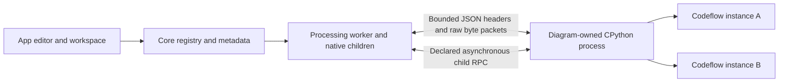

# Python processors and Codeflow

Status: the declarative SDK, external-process runtime, workspace publication,
Codeflow editor, isolated packet tests and declared child RPC are implemented.
Release acceptance results and measured limits are recorded below and in
[FLOW-6](roadmap.md#flow-6-python-processors-and-codeflow). General application
scripting is separate from the processing SDK.

## Ownership and execution

Codeflow is a Python-authored Processor in the existing registry. It can occur in
Lineflow and Tap, including a terminal-compatible paired interface. Native-only
processing never starts Python. Core owns the asynchronous Processor adapter and
protocol; App owns the editor, workspace publication and environment actions;
`src/Python/Runtime/termaster` owns the SDK. CPython is an external executable,
not an embedded Core dependency or a persistent service.

Each independent instantiated processing diagram owns a separate helper process.
Codeflow occurrences within that diagram share one interpreter/environment and
own independent instances. Creating the same prepared diagram twice creates two
helpers. Mixing Python executables within one diagram is rejected. Compatible
standard-library, installed third-party and native extension modules can import
normally. This does not guarantee compatibility with every wheel or Python ABI.



Python and imported modules run with normal user permissions: this is not a
sandbox. Script file/network side effects cannot be rolled back. Host termination
bounds blocked Python/native-extension execution, not arbitrary Python heap
allocation. There is no general Python memory quota. Windows host descendants are
owned through a kill-on-close job. Native child cancellation remains authoritative;
killing Python does not forcibly interrupt a C++ child.

## Author API

```python
import zlib
from termaster import Processor, Property, Input, Output, handles

class ZlibCodec(Processor):
    level = Property(int, default=6, minimum=0, maximum=9,
                     title="Compression level", group="Compression")
    rx_in = Input(bytes, title="Compressed", flow="rx")
    rx_out = Output(bytes, title="Payload", flow="rx")
    tx_in = Input(bytes, title="Payload", flow="tx")
    tx_out = Output(bytes, title="Compressed", flow="tx")

    @handles(rx_in, output=rx_out)
    def decode(self, data):
        return zlib.decompress(data)

    @handles(tx_in, output=tx_out)
    def encode(self, data):
        return zlib.compress(data, level=self.level)
```

Descriptor names are stable IDs; titles are labels. Inherited descriptors and
handlers are collected without constructing an instance. A named `className`
selects a concrete subclass; otherwise discovery requires one unambiguous concrete
leaf subclass. Imports execute during deliberate Check/Test/Apply, never merely
to browse catalog metadata. Custom constructors are rejected: use `start()`.
The optional `@processor(title=...)` decorator supplies the display title;
the class name is the default title.

The first release supports one input/output or paired two-input/two-output byte
ports. Paired ports require one Rx and one Tx in each direction; runtime index 0
is Rx and index 1 is Tx, regardless of declaration order. Rx means device to
terminal; Tx means terminal to device. Canvas rotation does not rename these lanes.
Every input requires exactly one handler. General N/M and structured ports remain
outside this editor/runtime contract.

| Handler result | Packet effect |
| --- | --- |
| `bytes`, `bytearray`, `memoryview` | One owned packet. |
| `b""` | One explicit empty packet. |
| `None` | No packet. |
| `list` or `tuple` of byte buffers | Several distinct packets, in order. |
| `self.outgoing.emit(data)` then `None` | Explicit routing on a declared output. |

Sync and async handlers share this contract. Strings, generators and arbitrary
objects are errors. Mixing returned packets with explicit emission is an error;
per-invocation outputs are validated before publication. NUL bytes and packet
boundaries are preserved. Transport chunks are not automatically whole protocol
messages: explicit framing or bounded instance state performs accumulation.

## Properties and generated settings

```python
from enum import Enum
from pathlib import Path
from termaster import Property

class Encoding(Enum):
    FIXED = "fixed"
    VARIABLE = "variable"

encoding = Property(Encoding, default=Encoding.FIXED)
width = Property(int, default=2, minimum=1, maximum=8, step=1,
                 when=encoding.is_(Encoding.FIXED))
output_file = Property(Path, default="packets.bin", mode="save")
working_directory = Property(Path, default=".", kind="directory")
polynomial = Property(int, default=0x1021, minimum=0, maximum=0xffff,
                      widget="hexInteger", title="Polynomial")
```

Place those declarations inside the Processor class. Supported types are `bool`,
`int`, `float`, `str`, `Path` and scalar-valued Enum classes. Configuration is typed
and immutable per instance; assigning to a Property raises an error. Paths retain
raw relative defaults/settings and resolve to runtime `Path` values from the
workspace directory. Process-wide cwd is unchanged.

Properties support `choices`, `minimum`, `maximum`, `step`, `title`, `group`,
`help`, `order`, `read_only`, `widget` and widget options. Numeric settings and
constraints stay within the exact numeric range of the shared schema validator;
ordinary Python computations can still use larger integers. Conditions support
one unconditional finite string/enum selector and equality via `selector.is_(...)`.
Arbitrary expressions or several discriminators receive a descriptor error.

Discovery returns a Draft 7 root schema and a version-1
`termaster.settings-schema` envelope, plain defaults, ports and declared child
metadata. The existing settings forms render these descriptors. A running revision
is replaced rather than mutated. Source descriptor drift requires another explicit
check/publication before the changed revision can run.

## Lifecycle, context and child processors

The SDK binds configuration, ports and `self.ctx` before `start()`. `start()` and
`stop()` can be async. Packet admission waits for startup. Different input lanes
may interleave at await points; Python does not introduce a thread per node.
Cancellation stops admission, cancels/joins startup, packet invocations and owned
tasks, and awaits `stop()` before acknowledging Python quiescence. A noncooperative
hook or handler is terminated by the application-side host watchdog.

`ctx.currentpacket` is an immutable map of `request`, `port` and owned `data` during
a handler. `ctx.log(message, level="info")` emits bounded diagnostics.
`ctx.create_task(coroutine)` owns async work; `ctx.timer(seconds, callback,
repeat=False)` owns a positive-delay timer. Owned tasks can emit unsolicited output;
they must keep their own buffering bounded. `ctx.cancelled` reports stopping state.
Raw payloads are not automatically logged. stdout/native fd-1 output is redirected
to diagnostics before user imports and cannot corrupt the dedicated binary channel.

```python
from termaster import Processor, Input, Output, Node, handles

class DecodeAndPace(Processor):
    incoming = Input()
    outgoing = Output()
    decoder = Node("native.hex-decoder")
    pacer = Node("native.pacer", byteDelayMs=10)

    @handles(incoming, output=outgoing)
    async def process(self, data):
        decoded = await self.decoder.process(data)
        result = []
        for packet in decoded:
            result.extend(await self.pacer.process(packet))
        return result
```

`Node` declares a catalog dependency and fixed child configuration. Registry
preparation retains factories/plugin leases before execution. `Node.process(data)`
returns a bounded list of owned bytes, including zero outputs. Explicit paired
calls use `await self.child.process(data, port=1, with_ports=True)` and return
immutable objects with `.data` and `.port`. Calls can be awaited from `start()`;
the host continues servicing RPC while lifecycle operations are pending. Temporary
child backpressure is retried fairly on the graph worker, with at most 256 pending
calls and four packet byte budgets in the queue. Invocation/startup deadlines still
apply. Await sequential calls when their order matters.
Undeclared dynamic registry access is not exposed.

Protocol version 1 uses a bounded JSON header followed by raw bytes, with no pickle
or base64 packet encoding. Header/source/description bounds are 4 MiB/2 MiB/1 MiB;
default Processor limits are 1 MiB and 1,024 output chunks. Admission, diagnostics,
unsolicited output and IPC queues are bounded. Startup, packet and stop grace
budgets are configurable from 20 to 30,000 ms. A timed-out shared helper faults
its diagram; terminal transport remains separate.

## Editor, environments and persistence

Open **Tools / New Codeflow…**, the Lineflow Codeflow creation action, or the
existing node's composition editor. Choose a source file and Python executable,
set the class name, and edit the source. The native Qt editor provides line
numbers, Python highlighting, indentation, comment toggle, bracket matching,
find/replace, zoom and clickable traceback lines. It uses QPlainTextEdit-based
editing; QScintilla and language-server completion are not dependencies.

Check loads a descriptor and refreshes Properties/Ports. Test runs a separate
instance with HEX or UTF-8/Latin-1 text, selected Rx/Tx input, explicit empty/NUL
packets and separate output/diagnostics. Tests do not access terminal transport.
Save writes source atomically with external-change detection; Apply checks, saves
and publishes the catalog revision. Restart/Stop target affected processing through
App without transferring transport ownership. Save can succeed while publication
fails; that partial outcome is reported. Source and catalog files are not one
cross-file atomic transaction.

The source file field is an explicit managed or external location; browsing an
external file does not silently copy it. Catalog definitions live under
`<workspace-file>.d/processors/` and keep source snapshot, digest and checked metadata.
Relative source references resolve from the workspace directory. Saved external
files are checked against their published digest before execution. Imported helper
files and dynamic external reads are not immutable source snapshots. Relative
imports such as `from .helpers import decode` use a private package namespace per
entry revision, preventing two local helper packages from aliasing accidentally.

The Python field selects an existing interpreter/venv. The environment action runs
that interpreter's `-m venv` and selects the resulting executable. Local package
installation runs the selected interpreter's `-m pip install --no-index --no-deps`
with explicitly selected distribution files. Dependencies must already be installed
or supplied separately. There is no automatic registry download, environment
creation on workspace opening, bundled interpreter or runtime module allowlist.
Package building/import still executes ordinary package code with user permissions.

## Verification and remaining scope

Acceptance fixtures are `tools/tests/Python/SdkTests.py` and
`tools/tests/Processing/CodeflowTests.cpp`; the Release benchmark is
`tools/benchmarks/Codeflow/CodeflowProfile.cpp`. They use synthetic packets and local
fixtures. On 2026-11-18, all 65 configured Release CTest suites passed (111.28 s).
After the final source-list canonicalization, all seven affected runtime, catalog,
workspace and editor suites passed again. The final editor adjustment was checked
with both App/editor suites. SDK tests also passed separately on CPython 3.14.4;
the configured runtime/profile used CPython 3.13. Native Windows editor captures
were inspected at 100% and 200%, and all App Codeflow acceptance cases passed on
the Windows platform plugin.

The acceptance covers binary NUL/0xff, empty and multiple output packets,
independent/shared host identity, blocked Python/native-extension deadlines,
owned Windows subprocess cleanup, startup RPC, nested child readiness/backpressure,
cooperative cancellation, mutable external-source conflicts, repeated publication,
workspace reload, and transport continuity through processing Stop/fault/Restart.
Release and Debug applications build with Qt 6.12/MSVC2022. No real-device commands
or external network acceptance were used.

Three Release runs of the synthetic profile produced these medians. Times include
adapter/event-loop overhead; they are not terminal rendering or hardware throughput.

| Path | 1 KiB packet p50 / p95 | 64 KiB throughput | Startup / stop |
| --- | --- | --- | --- |
| Native Bypass | 0.134 / 0.180 ms | 284.2 MiB/s | 0.87 / 2.48 ms |
| One Python occurrence | 0.404 / 0.540 ms | 104.7 MiB/s | 162.9 / 3.15 ms |
| Two Python occurrences, shared process | 0.746 / 0.892 ms | 54.2 MiB/s | 162.3 / 3.32 ms |

Cold metadata inspection was 164.3 ms. The separate zlib cold-import timer measured
only the import inside Python (0.065 ms), not interpreter startup. Paired Rx/Tx
completed about 3,270 packets/s with 250 verified packets per lane per run.
Raw runs are [Run 1](benchmarks/codeflow/Run1.json),
[Run 2](benchmarks/codeflow/Run2.json), and [Run 3](benchmarks/codeflow/Run3.json).

Deferred work includes general application scripting, general N/M typed ports,
computed visibility, mutable live settings, generators/streaming, language-server
completion, automatic package resolution and general OS memory quotas. Stream
codec routing continues through the existing
[terminal processing](terminal-processing.md) packet contract.

## Stream codecs and packet input

Codeflow currently consumes whole byte packets through the processing contract.
Existing native framing and codec nodes can be declared as children or composed
in Lineflow. The separate P8 command-input codec selector and general stream-codec
integration remain planned; this implementation does not add that input UI.
