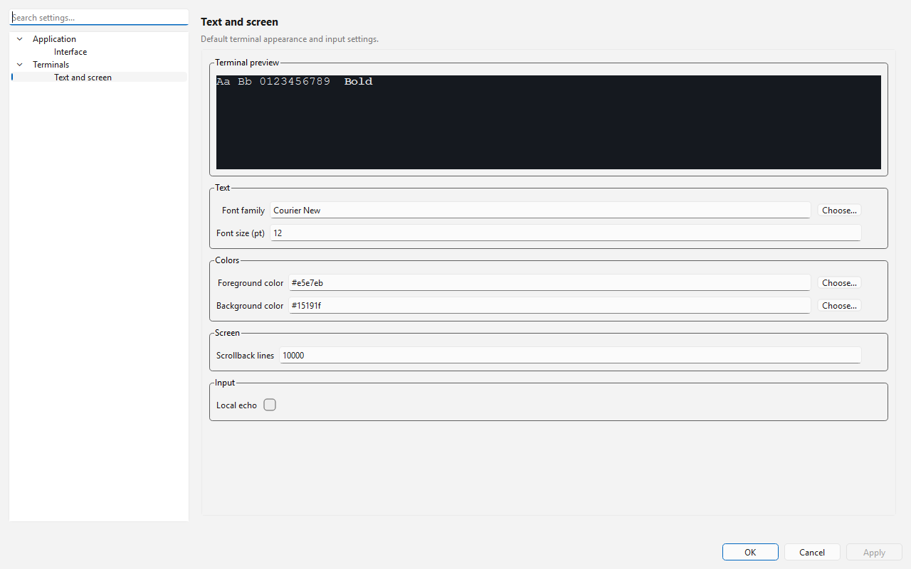
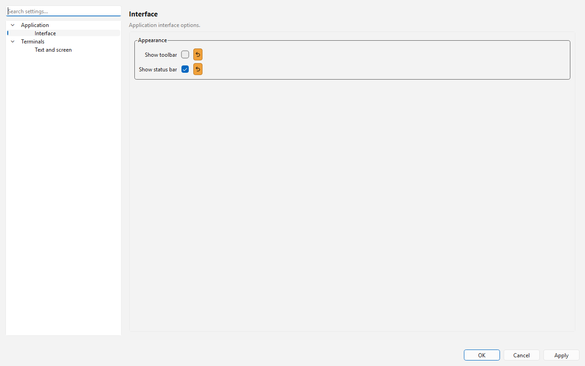
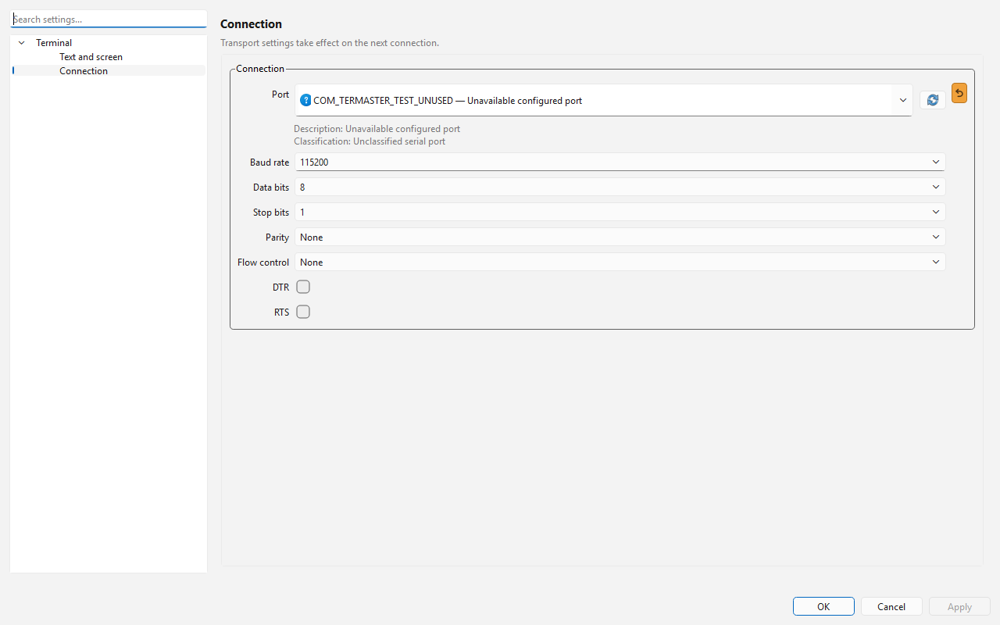

# Settings forms

Settings forms are generated from bounded YAML descriptors. Core owns the immutable
schema, draft model, editor registry and form widget. App owns the application dialog
and persistence callback. This keeps schema validation and presentation reusable
without making a generic widget perform file I/O.

## Descriptor contract

A descriptor is a YAML document with the standard versioned envelope. The only
supported schema descriptor type is `termaster.settings-schema`; its description
is required and `content` contains a JSON Schema Draft 7 object schema.

```yaml
version: 1
type: termaster.settings-schema
description: Serial port preferences
content:
  $schema: http://json-schema.org/draft-07/schema#
  title: Serial port
  type: object
  additionalProperties: false
  required: [baudRate]
  x-groups:
    - id: connection
      title: Connection
      order: 0
  properties:
    baudRate:
      type: integer
      minimum: 300
      maximum: 4000000
      enum: [9600, 19200, 115200]
      default: 115200
      title: Baud rate
      description: Serial line rate to use when a serial backend is configured.
      x-settings-path: transport/serial/baudRate
      x-group: connection
      x-order: 0
      x-widget: enumCombo
      x-widget-options:
        compact: true
```

Each root `properties` member is one editable field. Its property key is a literal
field identifier and may contain `/`; it is not expanded as a nested form path.
`x-settings-path` binds the field to a key relative to the `Settings::Node` or
`SettingsOverlay` passed to the model. If omitted, the property key is the settings
key and must itself meet the settings path rules. Field paths must be unique and
must not overlap as parent and child paths. Draft 7 `required`, `default`, `readOnly`,
`title`, `description`, and validation keywords apply to the field. Defaults seed
the draft and are written only when Apply is used.

The root and field validation uses Draft 7 with strong QVariant types. Schema
references may be local JSON Pointers only; unresolved or cyclic references are
rejected. External references are unsupported. YAML aliases, duplicate mapping
keys, non-scalar mapping keys, multiple documents and unsupported explicit scalar
tags are rejected. YAML values are converted through a Qt QVariant adapter because
the upstream YAML adapter does not preserve the required strong scalar types.
Valijson is pinned under `components/valijson` at
`af2383509277f8e8051acbb3e4b3060f4779aa10` as a Git submodule. Initialize dependencies with
`git submodule update --init`; configuration never downloads dependencies.

Parsing and serialization are bounded to 4 MiB, depth 64 and 100000 nodes. YAML
aliases and non-finite numbers are rejected. JSON Schema expansion is also bounded
to depth 64 and 100000 nodes. JSON Schema numeric validation uses Valijson's
`BasicAdapter` and may round integers through `double`; therefore schema numeric
constants and form values that are integers, including integral-valued floating
point values, must be within the inclusive exact-double range
`-9007199254740991` through `9007199254740991`. YAML parsing itself preserves
supported 64-bit integers, but this does not mean all such integers can be
validated against a schema. These limits apply to descriptor and form YAML values.

## Discriminated variant forms

Status: implemented for the bounded root `oneOf` subset below. The form still
represents a single flat object; it does not create recursive property layouts.
Common root `properties` remain visible, and each branch contributes its own
independent fields. For example, a descriptor without root `properties` is valid:

```yaml
version: 1
type: termaster.settings-schema
description: Packet encoding configuration
content:
  type: object
  oneOf:
    - title: Fixed width
      required: [encoding, width]
      properties:
        encoding: {const: fixed, title: Encoding, x-order: 0}
        width: {type: integer, minimum: 1, maximum: 8, default: 2, x-order: 1}
    - title: Variable width
      required: [encoding, maxBytes]
      properties:
        encoding: {const: varint}
        maxBytes: {type: integer, minimum: 1, maximum: 10, default: 5, x-order: 1}
```

Every branch must require the same explicit property with a unique string
`const`. There must be exactly one such shared discriminator and at least two
branches. Numeric, boolean and null discriminator constants are outside this
initial GUI subset. The selector is a normal enum editor whose values are the
constants and whose labels are branch titles, falling back to the constants.
Its annotations come from the root property when declared, otherwise from the
first branch's discriminator. A missing default selects the first branch only
when no configured value exists. An unknown or incorrectly typed loaded selector
is retained and fails validation until explicitly changed. A declared selector
default must name a branch; its optional enum must list every branch constant in
branch order. The selector is editable and cannot have a root `const`. Without
an explicit `x-order`, it precedes other fields in its group.

Local `$ref` resolution, `x-settings-path`, `x-widget`, `x-widget-options`,
`x-group` and `x-order` retain the existing field contract. Root and branch
`x-groups` are merged; repeated group IDs must have identical titles and order.
A field repeated across branches or in common root properties must have an
identical resolved definition, including binding and presentation annotations.
Repeated branch fields must also agree on required status. Required status of a
common field belongs to the root. Unsupported overlap is rejected when loading
the descriptor instead of choosing an arbitrary editor or silently ignoring it.
Field paths remain globally unique and cannot overlap as parent and child paths.

The original Draft 7 schema remains authoritative. Validation receives the
common fields, discriminator and selected branch fields. Inactive known fields
are excluded; `oneOf`, branch `required`, bounds and closed-object constraints
are checked by Valijson. Draft 7 `additionalProperties: false` at the root cannot
admit properties declared only inside a branch, so that layout is rejected.
Closed branches may use `additionalProperties: false`, but must redeclare all
common root fields identically. Unknown settings outside the recognized field
projection retain the existing persistence contract and are not deleted to make
a schema validate.

Switching branches keeps existing editor instances, draft values and invalid
editor text alive. Inactive editor errors do not block Apply. Returning to a
branch restores its draft and errors. Search and group visibility include only
active fields. Hidden custom editors retain their registry/provider lifetime
protection until destroyed. Apply validates the active projection atomically,
writes active changes, and removes recognized inactive values owned by the active
scope, including inactive read-only fields. It preserves inherited owners and
unrelated unknown settings. Apply or explicit reload replaces the retained draft
from the resulting settings. A concurrent selector or selector-ownership change
requires reload before any patch; concurrent changes at fields being written or
removed retain the existing conflict checks.

Processor registration, resolution, preparation, per-occurrence properties,
Lineflow node forms and terminal quick properties use the same active projection.
Factories receive selected-branch defaults and values. Terminal effective copies
remove inactive known binding paths while retaining unknown sibling keys; the
borrowed settings layers are unchanged by that projection. No processor backend
or encoding algorithm is added by this form-generation feature.

Nested variant layouts, branch-dependent definitions for the same field,
`anyOf` layouts and `if`/`then`/`else` layouts are unsupported. Layouts introducing
undeclared fields through these constructs are rejected. Existing flat schemas
may continue using combinators to constrain already declared fields, and complex
object/array fields continue using YAML or custom editors. No `x-visible-if`
annotation or conditional-expression language is introduced.

### Variant form verification

Verified on 2026-11-10 with Windows x64, Qt 6.12.0 and MSVC 19.44 Debug.
The complete Debug build passed, including Termaster and all configured test
targets. All 12 affected CTest suites passed: SettingsSchemaTests,
SettingsFormTests, AppTests, ProcessingTests, ProcessorDefaultsTests,
ProcessorCatalogTests, ProcessorRefactoringTests, ProcessorPropertiesTests,
ProcessingRoutingTests, LineflowPersistenceTests, LineflowEditorTests and
TerminalProcessingTests. Initial full-build attempts encountered transient
LNK1104 locks on unrelated test executables; the final serial build succeeded.
The remaining configured suites and Release were not rerun for this change.

Regression checks cover propertyless branch schemas, common properties, local
references, branch groups, ambiguous/unsupported layouts, closed branches,
strong selector types, unknown configured selections, both switch directions,
invalid YAML drafts, inactive read-only cleanup, inheritance/reset, selector
concurrency, unknown setting preservation, custom-editor unload protection,
processor resolution/preparation/instantiation, actual Lineflow forms and nested
terminal backend configuration projection. Transport acceptance uses an in-memory
backend; no real device or external endpoint was opened.

Native Windows SettingsFormTests passed at scale factors 1 and 2. The native
Lineflow variant fixture also passed at both scales, using the same 1100 by 760
logical-pixel dialog and a resized properties panel. The compact fixture shows
common label settings and integer branch fields; YAML draft retention is covered
separately by the generated-form regression. Both variants were visually inspected
for readable labels, selector titles, active rows, groups, reset placement and
layout. Scale 1 references are [Fixed width](images/preferences/VariantForms/Fixed.png)
and [Variable width](images/preferences/VariantForms/Variable.png). Scale 2
captures were checked from the temporary acceptance directory and are not tracked.
The initial fixed-branch form at scale 2 retains the existing minimum-geometry
scrollbars in the properties viewport; all labels and controls remain readable.
The variable branch fits after selection. No general form-layout change is included.
No dependencies were added or downloaded.

## Presentation annotations and editors

Root `x-groups` is an ordered sequence of `{id, title, order}` mappings. A field's
`x-group` selects a group, `x-order` orders the field within that group, and
`x-widget` selects an editor hint. `x-widget-options` is a mapping forwarded in
the field's presentation data for a custom editor. Missing groups are created using
their IDs as titles. Built-in hints include `boolCheckBox`, `stringLineEdit`,
`enumCombo`, `integer`, `hexInteger`, `number`, `password`, `multiline`, `yaml`, `fontFamily`, and `color`; field types
and `enum` can also select standard controls automatically. These flat annotations
are presentation hints; JSON Schema remains authoritative for validation. The old
nested `x-ui` annotations are rejected and are not aliases for the flat names.

The `fontFamily` editor uses a native dropdown of installed font families and a
presentation-only All fonts / Monospaced / Proportional filter. Each row shows the
family in the UI font, a circular separator and the same name in its own font at
the UI point size. The selected label uses the same delegate when both names fit;
otherwise it retains the readable UI-font name. Popup widths account for both
names and their font metrics. Font classification uses `QFontDatabase::isFixedPitch`.
The current configured family remains visible when unavailable or excluded by the
filter, with an explanatory tooltip. Filtering never edits the draft or establishes
an override. An explicit family selection, including the inherited value, creates
an override. Font size remains a separate field; no font dialog is opened.

The `color` editor uses one compact color-code button with an inline swatch.
Selecting it opens the color picker; cancellation preserves the draft, while
acceptance creates an explicit override even when the selected value equals the
inherited value. Loaded unknown values remain unchanged until explicitly replaced.

Object and array fields use a YAML value editor. This is also available as the
`yaml` hint. The form does not recursively lay out nested `properties`; complex
structures use the YAML editor or a custom field editor. Register custom editor
factories explicitly in `SettingsWidgetRegistry` and use their `x-widget` name.
A factory must remain loaded while any editor it created is alive. Unregistering a
factory with live editors fails, so a plugin owner must close forms before unloading
its editor implementation.

## Use from a component

```cpp
auto schema = std::make_shared<SettingsSchema>(descriptorYaml);
auto* model = new SettingsFormModel(schema, settings.node("terminals/primary"), dialog);
auto* form = new SettingsFormWidget(*model, registry, dialog);
```

For the descriptor above, the baud-rate field resolves to
`terminals/primary/transport/serial/baudRate`. The caller places the form in its
layout, invokes `model->apply(&error)` on Apply and asks the settings owner to
persist when appropriate. The same API accepts a live `SettingsOverlay`.

```cpp
registry.registerWidget("serialPort", [](const SettingsSchema::Field& field, QWidget* parent) {
    return new SerialPortEditor(field.presentation, parent);
});
```

`SerialPortEditor` implements `SettingsFieldEditor`: `value()`, `setValue()` and
`valueChanged()`, with optional local-input diagnostics. It owns its view/model
using normal Qt parent ownership. A descriptor selects it with
`x-widget: serialPort`; `x-widget-options` reaches `field.presentation`. The
serial selector in automated GUI checks uses synthetic entries and icons only.

## Draft, apply and persistence

`SettingsFormModel` reads from its borrowed live scope and keeps original and draft
values separately. Editing and validation do not write settings. Apply validates
the complete draft, checks that edited keys have not changed since the draft was
loaded, then applies one patch to the highest active scope. Removal reveals an
inherited value in an overlay. The settings owner prepares and atomically applies
the patch while retaining unknown data and concurrent unrelated changes. Reload is
explicit and discards a draft.

App supplies separate pages for application settings and available workspace/
session configuration overlays, together with a persistence callback. The dialog provides Apply, OK
(apply and close), and Cancel. A scope change closes the dialog to avoid applying
a draft against a different workspace or session. Generic Core widgets do not open
files or persist documents; App chooses the owning settings file and performs the
save after a successful model patch.

The sample application descriptor controls toolbar and status-bar visibility in
the active scope. The serial example above documents a schema capability only; it
does not indicate that a serial terminal backend is implemented.

## Preferences navigation

The primary layout remains a two-level category/page tree, generated forms on
its right and shared search. Each settings window is scoped to one target:
Tools / Settings for application configuration and global component defaults,
File / Workspace settings for workspace defaults, Session / Session settings
for session defaults, and Terminal / terminal-specific Settings for the selected
terminal's applicable display/input and connection parameters.

Each context has its own window and drafts. Switching contexts does not discard
pending edits. Changes apply only to that context's settings owner. Clean forms
in other windows reload inherited values after Apply; dirty forms retain their
snapshots and use the existing conflict check before Apply. Scoped windows close
before their target is released, and plugin-dependent forms close before factory
unregistration. The former example-only preference pages and serial combo were
removed together with their resources and preview-cache persistence path.

Search filters categories, pages, groups and fields without changing drafts or
validation. It is case-insensitive and includes labels, descriptions and settings
paths. Invalid hidden drafts remain invalid; Apply reveals their page. Persistence
failures keep the window open for retry. Multi-page settings and file writes do
not form a cross-file transaction.

### Descriptor-selected appearance widgets

Field hints `x-widget: fontFamily` and `x-widget: color` select the registered Qt
font dropdown and color picker. Filtering fonts and cancelling a color picker leave
drafts unchanged; neither interaction saves settings. Font-family selection changes
only the family; the point-size field remains independently editable.

A root `x-widget: terminalPreview` explicitly selects the auxiliary preview, with
its title in root `x-widget-options`. SettingsSchema exposes these annotations;
the generic form creates the registered widget and calls `setContext()` with the
effective draft values keyed by each field's `x-settings-path`. The auxiliary
widget has no persisted field or write callback. Terminal-specific rendering is
owned by the preview editor, not by the generic form. The same TerminalDisplay
renders a bounded synthetic sample without transport, focus or editable input.

The preview follows font family, point size, foreground and background drafts,
including inheritance resets, before Apply. Compact checkboxes keep reset buttons
immediately beside their controls, reserving button space when hidden. Technical
subtitles are muted while inherited/local parameter text retains the same color.

## Earlier verification status

`TERMASTER_BUILD_SCHEMA_TESTS` enables `SettingsSchemaTests` and
`SettingsFormTests`. The schema suite covers typed YAML, schema validation,
references and bounded/rejected input. The form suite covers defaults, deferred
writes, atomic apply, scope overlays, external-change guards and custom editor
lifecycle.

Verified on 2026-11-08 with Windows x64, MSVC 19.44, Qt 6.12.0 and Ninja Debug.
The application and affected test targets built; all eleven CTest suites passed,
including the independent external plugin SDK consumer. SettingsSchemaTests
passed 17 results and SettingsFormTests passed ten. AppTests passed eleven results,
including generated dialog cancellation, scoped apply/persistence and automatic
closure when the active settings scope changes. Atomic patch checks include
rollback, unknown metadata, aliases, expired owners and overlapping paths.

Native AppTests and SettingsFormTests passed without skips at scale factors 1
and 2. Application preferences and the custom synthetic port selector were
visually inspected: labels, controls, Unicode and model-provided icons rendered
correctly. The optional action-container capture and three existing workspace/
session symbolic-link cases remain skipped by regular CTest; this Windows user
cannot create the required symbolic links. No devices were scanned or opened,
no external connections were made, and no dependencies were downloaded.
Release was not rebuilt for this feature.

### Earlier preferences MVP acceptance

Verified on 2026-11-08 with Windows x64, MSVC 19.44, Qt 6.12.0 and Ninja Debug.
The application and affected tests built. All eleven CTest suites passed,
including the independent plugin SDK consumer. AppTests passed twelve results;
SettingsFormTests passed eleven. Checks cover exactly two navigation levels,
page/parameter/group search, empty results, clearing a filter without losing
invalid drafts, isolated preview edits, hidden-page validation and dependent
scope apply/reload behavior. Existing optional action capture and three
symbolic-link cases remain skipped by regular CTest.

Native AppTests passed all twelve results without skips. Four inspected captures
were generated at one size, 1020 by 720 pixels at scale 1:
[Workspace](images/preferences/Workspace.png),
[Session](images/preferences/Session.png),
[COM-port terminal](images/preferences/Serial.png), and
[Search](images/preferences/Search.png).
No serial hardware was enumerated or opened. Release was not rebuilt.

## Inherited terminal settings

Overlay-backed fields are immediately editable, including inherited required values.
Editing establishes a local override. A small reset button to the right removes
only that override and displays the inherited value or descriptor default; its
tooltip shows the fallback. The reset button uses a palette-aware return arrow
on a compact orange button with a dark arrow, matching the actual adjacent control height.
The height follows layout and font changes. It is visible only for a local override; its space remains reserved to keep fields
aligned when editing or resetting. Inherited and local values use the same text
color. Required values without any fallback cannot be reset.
An explicit equal value remains an override. Validation checks the effective
projection, and concurrent changes to ownership conflict even when effective
values are equal. Defaults remain virtual until explicitly overridden.
Application, workspace, session and selected-terminal pages use this behavior;
see [terminal settings](terminals-and-serial.md).

The terminal scope category is titled `Terminal`. The reset presentation update
was verified with the MSVC Debug build, SettingsFormTests and AppTests. Native
application checks passed at scale factors 1 and 2. Tests cover reset visibility
through edit/apply/reset and equal inherited/local text colors; the updated
1280 by 800 reference is [Serial terminal settings](images/preferences/SerialTerminal.png).

The previous orange reset-button presentation used a project-owned SVG. It has
been replaced by the shared palette-aware icon family described in
[command iconography](iconography.md). The earlier symbol
passed the affected Debug tests and native application checks at scales 1 and 2;
the reference capture above reflects the rounded-button variant.

## Terminal appearance behavior

Status: implemented through descriptor-selected editors and the terminal preview.

Terminal appearance forms use a font-family dropdown with font-type filtering and
foreground/background color selection buttons, using native Qt Widgets controls
instead of requiring manual entry of font names and color codes. Preserve explicit font-size editing
and the existing settings inheritance, validation and reset behavior.

A terminal preview must show how the selected font, size and colors render text.
It must update from the form's effective draft values, including inherited
values and resets, before Apply. Previewing must not change a live terminal's
configuration, persist settings or open a connection. Reuse the same appearance
editors and preview behavior across settings scopes.

## Reset button placement

Status: implemented.

Place the reset-to-inherited/default button directly beside its parameter's
editor, with a small consistent gap. Compact controls such as checkboxes must
not push the button to the distant right edge of an expanded form row. Keep
the control and reset affordance visually grouped across all settings scopes.
Preserve the approved orange button, its override-only visibility and stable
alignment when the button is hidden.

## Application settings scope

Status: implemented.

Tools / Settings must open application settings only, including application-wide
defaults for serial ports and other configurable components. Workspace, session
and individual-terminal overrides must not be mixed into this application
settings entry point. Keep the distinction between global defaults and settings
of a specific workspace, session or terminal explicit in navigation.

## Context-specific settings visibility

Status: implemented. This refines the application settings scope contract above.

Application, workspace, session and individual-terminal configuration are distinct
settings contexts, rather than categories combined in every settings window.
Each entry point must show only settings belonging to its target context.

A terminal settings window must contain only sections applicable to that specific
terminal and its registered capabilities: text/screen, supported input options
and the actual connection backend's configuration. A serial terminal exposes
serial connection parameters; unrelated terminal types and example/preview pages
must not appear. Application, workspace and session settings must not appear in
that window's navigation tree. Apply and reset must target only the chosen
terminal's overrides while preserving inherited effective values.

Session settings must similarly expose session-owned options and defaults
applicable within that session. Application settings expose application options
and global component defaults. Context-specific navigation must remain separate
from the underlying settings inheritance chain; hiding ancestor pages does not
remove inheritance or the ability to reset to an inherited value.

## Contextual settings acceptance

The complete Debug build and all 19 CTest suites passed on Qt 6.12.0 / MSVC
19.44 x64. Affected application/schema/form/serial suites passed again after
the final changes. Native Windows application checks passed at scale factors
1 and 2, including context isolation, draft retention, picker/reset behavior,
session identity and production-plugin teardown. Picker acceptance of an equal
inherited value creates an explicit override; cancellation does not. Destroying
a form inside either picker loop releases the dialog without accessing the
dead editor. Native picker checks also passed at scale 2.

Visual inspection covered the actual generated pages, compact reset placement,
the device identity popup and muted session IDs. Selected rows use a matched
palette highlight/text pair so native style painting cannot make text unreadable.
All reference exports below use a 1280 × 800 canvas; smaller native widgets are
placed on the same canvas. No real serial port was opened. Release was not rebuilt.







## Numeric controls

Numeric fields use spinboxes unless an enum dropdown or a custom editor is
selected. Integer ranges fitting int use QSpinBox; wider exact integers use a
zero-decimal QDoubleSpinBox. Number fields use a precision-preserving
QDoubleSpinBox with C-locale numeric/scientific text. Inclusive and exclusive
schema bounds constrain stepping; schema validation remains authoritative.
Loaded values retain their original QVariant and text until edited, including
invalid inherited values. Focus changes and confirmation alone must not clamp
such a value or create an override. Arrow stepping and explicit edits create
drafts; Apply remains atomic and rejects invalid values.

The `hexInteger` hint selects a reusable hexadecimal line editor for nonnegative
exact integers. It displays uppercase digits with a `0x` prefix; input accepts either
letter case with or without that prefix. Values remain numeric QVariants and YAML
numbers, including the complete uint32 range. Schema inclusive/exclusive bounds
remain authoritative, and the editor diagnoses invalid text and out-of-range input
without clamping. Loaded values retain their original types until explicitly edited.
Defaults, inherited values, branch drafts and reset use the same numeric model.

Reset buttons align to the visible primary control rather than a compound editor's
stretched height. Checkboxes use the style's indicator rectangle. Qt's Windows 11
style paints combo, spin and line-edit frames inside the widget rectangle, while its
public frame subrects still report the full rectangle. The shared editor helper
accounts for this paint margin only for those unstyled Windows 11 controls; other
styles keep their own geometry. See the upstream
[Qt Windows 11 style implementation](https://github.com/qt/qtbase/blob/6.10/src/plugins/styles/modernwindows/qwindows11style.cpp).
Form rows and terminal quick properties share this alignment, including initial
show, branch changes, reset visibility and font/layout changes. Small checkbox
reset icons shrink to fit their indicator-height buttons.

### Hexadecimal editing and reset-frame verification

Verified on 2026-11-10 with Windows x64, Qt 6.12.0 and MSVC 19.44 Debug.
The complete Debug build passed. All seven affected CTest suites passed:
SettingsSchemaTests, SettingsFormTests, AppTests, ChecksumProcessorTests,
LineflowPersistenceTests, LineflowEditorTests and TerminalProcessingTests.
The final serial run completed in 106.98 seconds. Other suites and Release were
not rerun. A running workspace Termaster executable initially blocked linking;
the verified build-path processes were closed and the complete build then passed.

Native Windows SettingsFormTests passed all 30 results at scales 1 and 2, and
the actual Lineflow checksum fixture passed at both scales. Checks cover zero,
uint32 maximum, uppercase/lowercase and optional-prefix input, malformed/range
errors, typed numeric persistence/reload, untouched invalid loaded types,
inheritance/reset and retained Custom CRC drafts. Reset checks cover combo,
line, spin and checkbox controls, initial show, override hide/show, repeated
reset and font/layout changes. A native style alpha-render check establishes
the painted combo-frame extent independently of QWidget geometry.

The same 1100 by 760 logical-pixel checksum dialogs were visually inspected
at scales 1 and 2. The updated [Custom CRC reference](images/checksums/ChecksumUnwrapCustom.png)
shows hexadecimal inputs and matching reset/control borders. Scale 2 captures
remain temporary acceptance artifacts. Changed C++ files were clang-formatted;
local documentation links and `git diff --check` passed. No downloads, device
access, external endpoint acceptance or elevation were used.

The 2026-11-09 Qt 6.12.0 / MSVC Debug verification passed all 26 configured CTest
suites, including numeric stepping, scientific notation, wide exact integers,
untouched invalid-value focus/confirmation, direct and accessibility setters,
enum precedence and reset alignment. Native reset/spinbox captures at scales
1 and 2 were visually checked; see [command iconography](iconography.md#verification).

## Settings presentation and global shortcuts

Navigation keeps two category/page levels and shared settings search. Category and
page icons use distinct, palette-aware semantic symbols. Selected rows use a
matched palette highlight/text pair, including their icons. Navigation extends the
pinned Lucide subset with application-window, keyboard, interface-layout, text-cursor
and console-prompt symbols.

Color editors display the editable code beside a synchronized color sample.
Loaded, typed, picked and reset values update the sample; invalid codes show a
question mark and remain subject to schema validation. Reset buttons follow the
actual primary control's height after resizing and font changes. Their reserved
space and six-pixel gap remain stable when the override disappears.

`x-widget-options: {fullWidth: true}` makes an editor span the form row, with its
field title provided as its accessible name. The application-only shortcut map
uses this option with `x-widget: commandShortcuts`. Other scopes do not expose the
map and cannot override effective application command shortcuts.

The native shortcut table searches stable command IDs, labels and shortcuts.
QKeySequenceEdit records sequences; Clear explicitly disables a binding, Reset
restores the selected command's default, and Reset all restores defaults for
currently registered commands while retaining assignments for unavailable plugins.
The table is a presentation model over borrowed registry IDs and a local draft;
it does not retain plugin command pointers or write files.

Application settings persist the map at `content/settings/shortcuts`, using
PortableText strings keyed by stable command ID. An absent key selects the default;
an empty string disables it. Core's CommandShortcuts owner applies the map to
current commands and later registrations, including plugin unload/reload. Unknown
command assignments remain available. Duplicate and sequence-prefix conflicts
identify both command IDs and sequences and block Apply. A newly registered command
that conflicts with an active binding is temporarily disabled, with a concrete
status message; its configured assignment/default is retained and retried when the
conflicting command unloads. Persisted defaults and assignments are not rewritten
by this suppression.

Editing, filtering, clearing and resetting remain drafts. Cancel discards unapplied
changes. App persists through the existing Settings owner before applying shortcut
side effects to Commands and their QActions. Persistence failures retain the dialog
for retry, following the existing settings workflow. Registry changes refresh
validation without establishing an override or dirtying an untouched draft.

The real TerminalDisplay preview now renders seven bounded lines: uppercase and
lowercase text, digits, punctuation, Cyrillic, box drawing, bold, italic, underline,
strikeout and reverse text, plus sixteen ANSI foreground and background samples.
The default text uses draft foreground/background colors. Queued regeneration after
terminal-size changes restores content clipped by an earlier narrow layout. The
preview has no transport and emits no outgoing bytes.

### P3 verification

Verified on 2026-11-09 with Windows x64, MSVC 19.44, Qt 6.12.0 and Ninja Debug.
The complete Debug build passed. A final serial CTest run passed all 28 configured
suites in one run. AppTests passed 22 results, CommandTests passed 13 and
SettingsFormTests passed 22. The optional action capture and three existing
symbolic-link cases retain their documented skips. An earlier parallel run hit an
unrelated ConsoleElevationTests crash; both its isolated retry and the final
complete serial run passed.

Coverage includes actual QAction key dispatch after reassignment and clearing,
conflict/prefix rejection, assignment swaps, late registration and unload/reload,
late-conflict suppression and recovery, unknown IDs, draft cancellation, command
ID/label/shortcut search, Reset/Clear, persistent map reload in a fresh process,
and registry changes without dirtying untouched drafts. Form checks cover color
samples, reset geometry after font/layout changes, rich preview screen attributes,
resize recovery and absence of output or persistence during preview edits.

Native Windows SettingsFormTests passed all 22 results at scale factors 1 and 2.
The native application shortcut fixture passed at both scales and exported the
same logical 1100 by 760 settings window at each scale. Both sets were visually
inspected for navigation contrast, table layout, color samples, adjacent reset
height and rich Unicode/style/color preview rendering:

- Scale 1: [Shortcuts](images/preferences/P3Scale1/Shortcuts.png),
  [Appearance](images/preferences/P3Scale1/Appearance.png),
  [Reset](images/preferences/P3Scale1/Reset.png).
- Scale 2: [Shortcuts](images/preferences/P3Scale2/Shortcuts.png),
  [Appearance](images/preferences/P3Scale2/Appearance.png),
  [Reset](images/preferences/P3Scale2/Reset.png).

Only five pinned upstream icon files were downloaded, through the physical
Ethernet adapter with destination routes verified. No serial hardware was opened,
no external endpoint acceptance was performed, and no elevation was requested.
Release was not rebuilt.

### Compact picker button verification

Verified on 2026-11-09 with Windows x64, MSVC 19.44, Qt 6.12.0 and Ninja Debug.
The full Debug build, including Termaster.exe, and all 28 configured CTest tests
passed. Native Windows picker checks passed at scale factors 1 and 2, covering
acceptance, cancellation, same-value inherited overrides, draft previews and
form destruction during a picker loop. Loaded unknown values retain their original
QVariant until explicitly replaced. Formatting and `git diff --check` passed.

The 1100 × 760 logical-pixel captures were visually checked at
[scale 1](images/preferences/PickerButtons1x/Appearance.png) and
[scale 2](images/preferences/PickerButtons2x/Appearance.png). Both show a single
font-family button and single color-code buttons with inline swatches.


### Font-family dropdown verification

Verified on 2026-11-09 with Windows x64, MSVC 19.44, Qt 6.12.0 and Ninja Debug.
The complete Debug build, including Termaster.exe, and all 28 configured CTest
suites passed. SettingsFormTests passed 23 results on native Windows at scale
factors 1 and 2; the native application preferences fixture passed at both scales.
Coverage includes all three filters without draft changes, equal inherited
selection creating an override, Apply/reset, unknown and non-string loaded values,
independent font size, delegate metrics and reset height after font changes.
The offscreen form suite loads two installed Windows fonts only when its platform
has no system font discovery. The color picker acceptance, cancellation and
form-destruction lifecycle checks remain covered.

The selected family uses the same normal-name / circular-separator / font-sample
presentation as popup rows when space permits. Selected popup rows use a matched
palette highlight/text pair. The following native captures use the same
1100 × 760 logical-pixel window and were visually inspected:

- Scale 1: [Appearance](images/preferences/FontDropdown1x/Appearance.png),
  [Font dropdown](images/preferences/FontDropdown1x/FontPopup.png).
- Scale 2: [Appearance](images/preferences/FontDropdown2x/Appearance.png),
  [Font dropdown](images/preferences/FontDropdown2x/FontPopup.png).

No files were downloaded, no hardware was opened and no elevation was requested.
Release was not rebuilt. Earlier font-button captures document the superseded UI.
