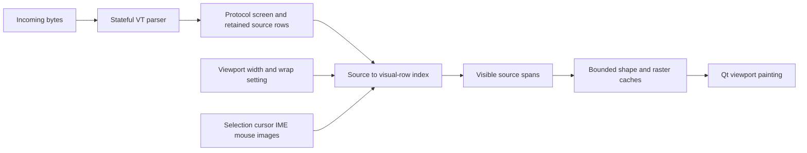

# Terminal display model and layout

## Delivered model

The production display uses the project-owned VT screen, Qt Widgets and cached
QTextLayout/glyph runs. The experimental QPlainTextEdit and QTermWidget variants
remain only in the historical `codex/VIEW-1-qtextlayout-experiment` branch.
Development of the model/layout change starts directly from dev on VIEW-2.

History rows retain their cell arrays and revisions when viewport width changes.
Configured row retention and the actual stored-cell budget still apply. Widening
no longer derives a smaller history count from the new column count. Storage
accounting includes the hidden primary buffer while the alternate screen is active.
Only active rows acquire cells needed for newly addressable protocol columns.
Primary active rows retain populated right-hand suffixes when narrowed; pristine
blank padding may shrink. Alternate-screen rows remain a strict VT grid and may
truncate on narrowing. The live protocol cursor remains clamped to the new grid dimensions; visual reflow
does not relocate protocol cursor addresses. Height changes preserve the existing cursor-relative VT
resize policy, including removal of active rows below the cursor when appropriate.

Automatic wrapping records both continuation and its exact original cell boundary.
A hard line feed ends the continuation. This avoids treating padding added by a
later resize as original text and avoids inferring soft wraps from spaces.

## Visual wrapping and interaction

Terminal settings / Screen / **Wrap lines to window width** controls visual wrapping
(`appearance/wrapLines`, default true). This is independent of remote DECAWM mode 7.
Primary source continuations form logical display lines. Wrapping splits them to
current viewport columns without changing the stored rows. With wrapping disabled,
long logical lines use a horizontal scrollbar. Alternate-screen applications keep
their protocol grid presentation.

Visual rows reference source spans rather than copying the complete history into
a text document. Row extents are cached by content revision; width changes rebuild
lightweight mapping metadata. Only visible text is prepared for drawing. This is
O(retained rows/spans) metadata work on a width change, not an O(all retained cells)
rewrite or complete-history text shaping. Incoming data normally rebuilds only the
active tail and its logical continuation chain, retaining the immutable prefix.
Trimming, resets and topology/wrap/width changes rebuild the lightweight index. It is not yet a paged or incremental
prefix-tree index.

Selection remains in source coordinates across width/wrap changes. Copy suppresses
newlines at automatic continuations; visual wraps add no copied newline. Cursor,
IME, mouse reports, hyperlink hit testing and image origins use the same mapping.
Manual scrolling keeps a source anchor; follow-bottom remains explicit. Protocol
mouse coordinates still describe the original VT grid, not visual row numbers.
Images keep their pixel geometry and mapped source origin; image pixel strips are
not split and rearranged across text wraps.

## Reference analysis and remaining scope

[VS Code and Notepad++ measurements and sources](editor-rendering-reference.md)
explain the reference workloads and timing limits. Transferable techniques are
stable source storage, separate document/display mapping, viewport-only drawing
and bounded reuse of shaped text. Neither an editor document nor its renderer
replaces terminal protocol coordinates.

Future work includes an incremental/paged index, configurable file-backed unlimited
history, cancellable whole-history search, word/line/rectangular selection, font
zoom, and whitespace/control visualization. Existing storage remains bounded.
Continuous human drag and input-to-photon latency are separate from the automated
Qt event/paint completion measurements.

## Verification

Qt 6.12.0 / MSVC2022 x64 Debug and Release application builds pass. All five
affected test executables (display, screen, parser, input and graphics) pass in
both configurations. Native wrap/resize tests and screenshots were checked at
100%, 125% and 200% scale. Cases cover immutable history/revisions, actual cell
budgets including alternate-screen retention, soft/hard boundaries, Unicode,
selection/copy, horizontal scrolling, incremental tail updates and mouse mapping.

The full Release run passed 39/40 executables. The unchanged ProcessingTests
`savedPacerPreservesPacketErrorsAndLineFence` fixture intermittently observed two
completions after its 50 ms wait while expecting one (line 965). Its isolated run
passed all 20 cases. No processing implementation/test files were changed; the
full-suite timing failure remains an explicit verification limitation.

Sixteen native benchmark processes (eight per configuration) restored disconnected
sessions from isolated copies of `G:/TMP/Tmaster`. Every run exited normally,
validated content hashes/paint/scroll movement and preserved original workspace
hashes. No hardware connection was opened. Each fixture contributes 60 width,
height and diagonal resize samples, plus line/page/jump/wheel traversals.

Median milliseconds, visual wrap enabled:

| Workload | Release ASCII | Release Unicode | Debug ASCII | Debug Unicode |
| --- | ---: | ---: | ---: | ---: |
| Width resize | 5.85 | 6.84 | 25.98 | 29.84 |
| Large resize | 8.18 | 9.31 | 40.60 | 49.57 |
| One-line scroll | 0.75 | 0.98 | 3.68 | 7.48 |
| Page scroll | 2.85 | 2.29 | 31.51 | 24.24 |

Release large-resize medians with wrap disabled are 8.01 ms ASCII and 8.73 ms
Unicode. The historical project renderer measured 10.72/11.70 ms for this workload;
this is directional evidence rather than a fresh paired build comparison. Debug
large-resize results remain around 40–50 ms and are not uniformly faster than the
historical grid. Removing destructive history updates and retaining correctness
is the model change; Release timings establish the current interaction cost.

[Raw reports and environment](benchmarks/terminal-wrap/Environment.json),
[Release summary](benchmarks/terminal-wrap/Release/Summary.json),
[Debug summary](benchmarks/terminal-wrap/Debug/Summary.json),
[historical grid baseline](benchmarks/terminal-wrap/HistoricalGridBaseline.json).
Reproduction is in the [benchmark instructions](../tools/benchmarks/ApplicationProfile/README.md#project-renderer-and-visual-wrapping).

Native captures: [wrap at 125%](images/terminal-wrap/Wrapped125.png),
[horizontal selection at 200%](images/terminal-wrap/Horizontal200.png),
[styles and Unicode at 125%](images/terminal-wrap/Styles125.png).

## Next performance work

1. Replace front-removal/index renumbering with stable absolute row identities and
   a ring/paged owner; current history trimming still rebuilds the visual index.
2. Use a compact prefix index and binary span lookup for very long logical lines;
   current metadata work can follow a long soft-wrap chain back into history.
3. Coalesce display presentation updates independently of parser/packet ordering.
4. Add bounded file-backed paging and 64-bit logical positions before offering
   unlimited history. None of these stages requires another rendering engine.
