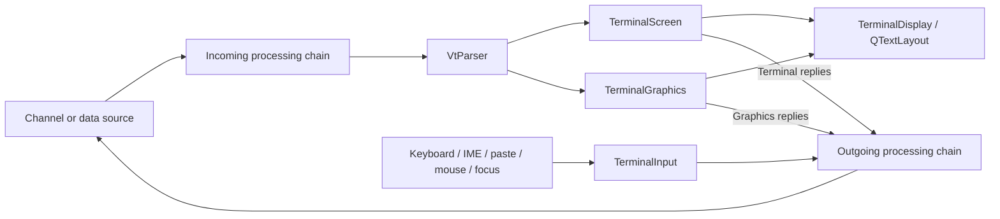
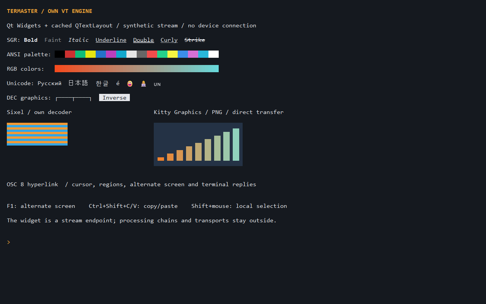

# Terminal emulation and the Widgets endpoint

## Implementation boundary

The VT parser, Unicode decoder, screen, input encoder and terminal graphics are
project-owned C++20 code. No ready-made terminal engine is linked or vendored.
External implementations and protocol documentation serve as reference material.
Qt remains responsible for Widgets, font shaping, images and painting. Standard
zlib supplies the bounded DEFLATE primitive used by Kitty compressed transfers;
CMake uses system zlib or the selected Qt kit's bundled private zlib headers.
The Qt-private fallback must be reverified when changing Qt kits.

`TerminalDisplay` is a stream-processing endpoint, independent of concrete devices.
It receives the output of an incoming processing chain and emits outgoing data
before the outgoing processing chain. App currently connects this boundary to the
serial runtime. Script execution and configurable processing graphs are future
work, rather than responsibilities of the widget or protocol parser.



The processing-chain boxes describe the integration boundary, not a delivered
script engine. All current model, rendering and callback operations execute on
the owner's GUI thread. Future worker-based processing must deliver ordered,
bounded data to that owner using queued connections and explicit backpressure.

## Components

- `VtParser` consumes arbitrary byte chunks into printable data, controls, ESC,
  CSI, OSC, DCS and APC sequences. It retains incomplete sequences, accepts colon
  subparameters, handles cancellation, and quarantines oversized strings through
  their terminator. UTF-8 mode does not confuse continuation bytes with C1 controls.
- `TerminalScreen` owns its incremental UTF-8 decoder, grid, attributes, modes,
  cursor, margins, saved state and in-memory history. It has no widget dependency.
  Alternate and primary buffers have separate state; resize and palette changes
  preserve their invariants. A monotonic reset revision invalidates view resources.
- `TerminalInput` encodes semantic Qt key events and committed text according to
  current VT/xterm/Kitty modes. Mouse and focus reports use their own output kinds.
- `TerminalGraphics` decodes bounded Sixel and Kitty direct-data images into
  placements. It never opens files, shared memory, processes or devices.
- `TerminalDisplay` renders the model, images, selection, cursor and IME preedit.
  QTextLayout caches are limited to visible rows; fixed-width ASCII is coalesced,
  while other graphemes retain explicit terminal-cell coordinates. Unicode width
  is independent of fallback-font advance. Font kerning is disabled for the grid.

The generated cell-width table uses Unicode 16.0.0. Ambiguous characters occupy
one cell. Combining marks, variation selectors, emoji modifiers, ZWJ sequences,
regional-indicator pairs and wide-cell continuations receive explicit handling.
Actual glyph availability and color emoji depend on the installed Qt/font stack.
This is not a claim of complete Unicode grapheme/BiDi conformance. The table is
regenerated with Python 3.14 and `tools/GenerateTerminalUnicode.py`, then formatted
with the repository clang-format configuration. The Unicode data license is kept
beside the generated header.

## Implemented compatibility

The table lists concrete behavior, not certification of every DEC terminal model
or every extension ever introduced by a Unix terminal.

| Area | Implemented scope |
| --- | --- |
| VT52 | Basic addressing, movement, erase, reverse index, identify, graphics and keypad; ANSI return. |
| VT100-style screen | CR/LF/BS/HT, tab stops, auto-wrap, cursor addressing, origin mode, scrolling margins, save/restore, index/reverse index, DEC line graphics, alignment test. |
| Editing | Insert/delete characters and lines, erase characters/lines/display/history, scroll up/down, repeat character, insert and newline modes. |
| VT220/DEC extensions | Alternate screens 47/1047/1049, cursor save 1048, DECSCA protected cells and selective erasure. |
| Rectangular operations | DECERA, DECSERA, DECFRA and overlap-safe DECCRA subset. |
| Rendition | ANSI/bright/256/RGB foreground/background; bold, faint, italic, underline, double/curly/dotted/dashed underline, blink, inverse, invisible, strike and overline; underline color. |
| Palette | OSC 4/104 palette query/set/reset and OSC 10/11/110/111 default foreground/background query/set/reset, including indexed-cell recoloring. |
| Reports | DA, status/cursor reports, supported-mode DECRQM and text-window size reports. Unknown status requests are rejected rather than answered with fabricated state. |
| Cursor | Show/hide, block/underline/bar geometry and blinking control. |
| Metadata | OSC 0/2 title, OSC 7 current directory and OSC 8 hyperlinks; metadata does not rename persisted session objects or execute commands. |
| Input | VT/application cursor and keypad, VT52 forms, modifiers, F1-F35, backarrow mode, UTF-8/AltGr, IME committed text, xterm modifyOtherKeys and Kitty keyboard flags/stack. |
| Paste/focus | Bracketed paste 2004, focus reports 1004, independent local echo. |
| Mouse | X10/1000/1002/1003 tracking, legacy/1005/1006/1015 encodings and 1016 pixel coordinates. Shift initiates local selection. |
| Synchronized updates | Mode 2026 with a 150 ms bounded presentation timeout. |
| Graphics | Own Sixel palette/raster/repeat/band decoder; Kitty direct RGB/RGBA/PNG, bounded zlib, chunking, query/store/place/replace and selected deletion modes. |

These are protocol subsets. Remaining gaps include complete VT-family conformance,
G2/G3/96-character sets and downloadable fonts, left/right margins, complete DEC
rectangular and status-report families, printer/ReGIS/Tektronix protocols, BiDi,
full Unicode grapheme rules, history reflow, OSC 52 clipboard access, shell
integration, iTerm2 file transfer, Kitty animation/virtual placements/image-number
addressing/file/shared-memory transports, and complete Sixel aspect/background/
scrolling semantics. Unsupported sequences are consumed safely and unsupported
Kitty operations return explicit errors. In particular, successful Sixel decoding
does not establish pixel-perfect VT340 graphics compatibility.

## Output, echo and application actions

`outputBytes(bytes, kind, echo)` distinguishes Keyboard, Paste, Mouse, Focus and
Reply. Terminal/graphics replies leave the endpoint exactly once; they are never
fed back into incoming data or local echo. Echo is separate display data derived
from the original user event, not an interpretation of encoded cursor/key-release
sequences or bracketed-paste wrappers. The serial coordinator applies configured
local echo only after accepting the complete user output into the device queue.
Acceptance still does not prove physical delivery.

Copy/Paste/Select All integrate with the application Edit menu for a focused
terminal. Cut/Undo/Redo do not modify the screen. Terminal ShortcutOverride keeps
Ctrl+C, Ctrl+A and other encoded keys available to programs rather than allowing
parent editor shortcuts to steal them. Ctrl+Shift+C/V are local copy/paste;
Tab remains terminal input. Ctrl-clicking an OSC 8 http/https/mailto hyperlink
emits an explicit activation, handled by App. Incoming titles only update tab
tooltips; no URL or command opens merely by being received.

## Resource limits

- Geometry: 1..4096 columns, 1..256 rows; at most 2,097,152 cells across primary
  and alternate buffers. Effective history is capped by both configured line
  count (up to 100,000) and this combined cell budget.
- A cell stores at most 256 UTF-16 units of combining/joined text.
- CSI introducer: 256 bytes, 32 parameters, 16 subparameters per parameter.
- OSC: 64 KiB; DCS/APC: 4 MiB. Overflow strings are discarded without leaking
  their payload into displayed text.
- Reply queues: 64 KiB. Paste payload: 4 MiB UTF-8.
- Images: at most 4096 per dimension and 4,194,304 pixels per image; 32 MiB stored
  pixel buffers, 64 image IDs and 128 placements.
- Kitty: 512-byte header, bounded numeric fields, 8 MiB accumulated base64 data;
  fixed decompression output caps (raw dimensions or 8 MiB PNG bytes).
- Sixel: a 32 Mi pixel-operation preflight budget prevents repeated overdraw
  from multiplying work while retaining a small final image.

History remains bounded in RAM. Unlimited disk-backed colored history, history
search/export and persistent terminal recordings are separate, undelivered work.

## Running the demo and tests

With the existing Qt/MSVC environment exported:

```powershell
cmake --preset Desktop_Qt_6_12_0_MSVC2022_64bit-Debug -DTERMASTER_BUILD_TERMINAL_TESTS=ON
cmake --build --preset Desktop_Qt_6_12_0_MSVC2022_64bit-Debug
./build/Desktop_Qt_6_12_0_MSVC2022_64bit-Debug/TerminalDemo.exe
```

TerminalDemo opens one terminal window with a synthetic stream. F1 switches the
alternate screen and typed text is echoed locally. It has no serial/network
connection. `--capture <absolute-png-path>` captures the same widget and exits.
The production application uses the same TerminalDisplay in terminal tabs.

Dedicated suites are VtParserTests, TerminalScreenTests, TerminalInputTests,
TerminalGraphicsTests and TerminalDisplayTests. AppTests verifies command routing
and production-plugin lifecycle. Tests use synthetic streams, generated images
and fake/disconnected devices; no real serial port is opened.

## Protocol references

- [XTerm control sequences](https://invisible-island.net/xterm/ctlseqs/ctlseqs.html)
- [DEC VT300 graphics programming, Sixel](https://vt100.net/docs/vt3xx-gp/chapter14.html)
- [Kitty keyboard protocol](https://sw.kovidgoyal.net/kitty/keyboard-protocol/)
- [Kitty graphics protocol](https://sw.kovidgoyal.net/kitty/graphics-protocol/)
- [Unicode data](https://www.unicode.org/ucd/)

These references describe protocols, not a promise that every documented
operation is implemented. The compatibility table and regression tests define
current support.

## Verification snapshot

Qt 6.12.0 / MSVC 2022 x64: the clean Debug build passed all 19 CTest suites.
The final terminal and application changes passed the six affected suites in both
Debug and Release. Native Windows TerminalDisplay tests passed at scale factors
1 and 2; the disconnected production-plugin lifecycle and Edit routing also passed.
Optional visual fixtures and unavailable symlink cases retain their existing skips.
No hardware or external transport acceptance was performed.


