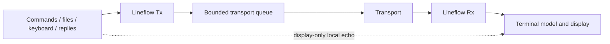

# Terminal processing

The group status bar and Terminal menu expose Buffered input, Send file and
Processing. Processing reveals one compact row: **Bypass** or **Lineflow**, a
single two-channel catalog selection and its editor button. Reusable 1x1 blocks
remain valid children inside either lane; they are not terminal modes.

The terminal's `settings/processing` stores `mode: bypass|lineflow`, one `lineflow`
selection and an `inplace/lineflow` definition map. Its local root ID is
`terminal.inplace.lineflow`, with two channels. Bypass retains the dormant diagram
and selection, without instantiating either. Only the current format is supported;
there is no reader or automatic conversion for removed terminal modes.

Catalog trees share the Lineflow origin/group layout, favorites and icon policy.
The terminal selector filters to 2x2 entries and adds its private Inplace entry.
Workspace favorites live under `state/processing/favorites`; Inplace never becomes
a shared favorite or workspace publication. Unknown favorite IDs remain saved.

The side properties table expands the selected composition into stable occurrence
paths, including initial/final endpoint settings. Generated controls keep local
terminal overrides separate from saved definition defaults. Apply/Revert are
explicit. No-op Apply preserves runtime state. An active change validates and
prepares a new whole graph, saves atomically, then cancels and replaces the prior
graph. Separate buffering state is not retained across active graph edits.

## Shared duplex selection

One graph instance handles both lanes. Children share its processing thread, with
packet boundaries and each port's FIFO preserved. Cross-port protocol output is
supported. A graph failure stops further graph processing on both lanes but leaves
the transport and requested connection intact. Faulted data is never silently
passed through. Explicit replacement or Bypass recovers processing. Pending file
and periodic producers stop on Tx failure; accepted transport bytes may drain.

## Terminal-local Inplace diagrams

An Inplace diagram belongs to exactly one terminal. Editing it uses an isolated
registry scope that retains provider leases. It is never published as a workspace
processor. Apply preflights schema/topology, occurrence overrides, bounded expansion
and concurrent session edits before persistence and runtime replacement. Node
renames rewrite valid occurrence paths; removal prunes only affected overrides.
Unknown unrelated settings survive. The root must retain two-channel topology.

## Packet execution

Each invocation owns one complete byte packet, including NUL and empty packets.
No implicit decoder accumulation or packet splitting occurs. Framers, Pacer and
explicitly configured decoder options own these behaviors. Keyboard, paste, mouse,
focus and protocol replies remain distinct from display-only local echo. Replies
never acquire command terminators. File and periodic producers honor graph and
transport backpressure. Output enqueue is not proof of delivery to a device.

## Recording

Fixed endpoint nodes offer opt-in packet recording. The actual terminal's final
endpoint additionally supports rendered-line recording after escape processing.
Rows are delayed until they leave the mutable primary screen for history; soft
wraps join logical lines. Remaining screen text can optionally be flushed at stop.
See [boundaries and observation branches](lineflow-boundaries.md) for file formats,
limits, cancellation and Tap branch semantics. Raw contents are not routine logs.

## Verification

Release integration coverage includes routing in both directions, graph faults
without disconnect, bounded queues and Stop, provider retirement, reentrant worker
factories, no-op Apply, private diagram isolation, node removal/rename, concurrent
save rejection, session restoration and shutdown. Synthetic transports are used by
default; verification does not send commands to hardware or external endpoints.

## Deferred terminal property editors

The terminal processing selector bar and properties container retain their existing
lifetimes. Property schemas, settings drafts and custom field editors are prepared
only when the properties container is shown. Hidden configuration and clean catalog
updates invalidate preparation without constructing editors. Hiding an already
prepared panel retains its draft; showing it again preserves unsaved edits. Editor
release remains synchronous before plugin factory removal.

Terminal configuration projection reads one merged overlay snapshot per projection,
then resolves schema fields from that snapshot. Application, terminal creation and
connection paths reuse an effective projection within their operation. These
snapshots are local to the operation, so subsequent application/workspace/session
changes are read afresh. Unknown values stay in the merged configuration. Connection
schemas remain owned by the registered terminal type, while the built-in appearance
schema is retained by the controller.

The isolated Qt 6.12.0 / MSVC2022 x64 Debug build and TerminalProcessingTests
passed on 2026-11-10 (14 active cases; two opt-in capture cases skipped by CTest).
Coverage includes hidden preparation, latest configuration, hide/show draft
retention, unknown override preservation, synchronous editor release and failed
Apply diagnostics. The native Windows visual capture passed separately and was
inspected for selector/property alignment and retained reset controls. The integrated
Release AppTests, LineflowEditorTests and TerminalProcessingTests also passed.
One copied real-workspace quick run measured session reopen at 174.62 ms, clean
App save at 4.31 ms and disconnected terminal addition at 30.88 ms; these are
exploratory single-cycle figures, not statistical performance guarantees. Raw
records are under `docs/benchmarks/application-profile/after-settings/`.

## Bulk terminal presentation updates

Session replacement, restoration and closing all terminal views use a nested
controller batch. Backend creation/teardown and each terminal's lifecycle/status
updates still run normally. The batch defers action predicates, controller
selection notifications and terminal-area show/focus work until its outer boundary.
Tab-widget signals and repaints are suspended during intermediate tab mutations;
their prior blocked/enabled states are restored exactly. Restoration selects the
last successfully materialized terminal, matching the existing ordered restore.
One final controller selection notification reports changed views; closing an
already empty collection emits none. Single-terminal creation and closure retain
their existing presentation path.

On 2026-11-11 the isolated Qt 6.12.0 / MSVC2022 x64 Release AppTests build
and full CTest run passed (46 passes including setup/cleanup, 22.54 seconds). The
four-terminal fixture checks one final selection/action refresh, no intermediate
tab signals, retained tab-widget signal/repaint flags, no notification for an
empty close, and a final selection observer reentering closeAll. The native Windows
fixture also passed; its capture was inspected for four disconnected tabs, final
selection, aligned tab controls and intact terminal/status presentation. Scoped
restoration and QPointer guards protect batch finalization across GUI callbacks.
Changed C++ files were clang-formatted and `git diff --check` passed. Tests used
synthetic disconnected backends; no real device or external endpoint was opened.

The integrated Release AppTests run also passed after combining the catalog,
regex, persistence and shutdown changes (22.59 seconds).
