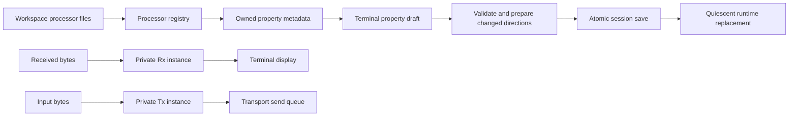

# Terminal processing

Each terminal has independent Rx and Tx selectors beneath its input area. A selection
can reference a native processor, a workspace composition or bypass. Saved definitions
remain shared; private values are stored under the session terminal object's
`settings/processing` map. Unavailable selections stay visible with their identifier.

The properties button opens a side table. Receive and transmit drafts are independent.
Leaf headings follow expanded Lineflow traversal, including the complete occurrence
path for repeated nested blocks. Controls come from descriptor `x-widget` factories.
Reset removes the terminal override and restores the effective inherited value.
Changing a shared block is a separate operation in the Lineflow editor.

Apply validates and prepares fresh instances before saving the session atomically.
Failed preparation or persistence leaves the active configuration unchanged. Only
changed directions are replaced. Rx-only edits preserve Tx buffering and producers;
Tx edits stop pending producers and replace their processing state. Unchanged Apply
performs no replacement. Shared definition updates take effect on the next
terminal restart or changed selection; running instances retain their prepared snapshot. Old callbacks are invalidated while cancellation completes;
new input remains bounded until the replacement is ready.

Metadata inspection does not construct processors or invoke source providers. It
returns owned schema/configuration snapshots with bounded depth and occurrence count.
Plugin editors are destroyed synchronously before their factories are unregistered.
Invalid drafts prevent editor release with a concrete error rather than being discarded.
Closing the terminal destroys property widgets before retiring the router they borrow.

Diagnostics show bypass, ready, busy, cancelling or failed state and bounded queue
sizes. Tooltips include saturating accepted/forwarded byte counts and failure counts.
Forwarded counts mean acceptance by the next sink, including the transport queue;
they do not establish delivery to a remote device. No payloads are recorded.

Workspace definitions use individual YAML files. Multi-document edits share a bounded
recoverable transaction with session rename refactoring. Python/Codeflow execution
remains outside this stage.

## Visual acceptance

The native Windows capture uses the production terminal display and processing panel
with synthetic text and real native processor instances, at a fixed 1100 by 650 logical
size. The same capture passed at device scales 1 and 2; reset button height matches
its adjacent combo box. Instances are explicitly cancelled and drained before the
fixture exits.

## Verification

The Desktop Qt 6.12.0 MSVC2022 64-bit Debug build passed. All 44 configured CTest
executables passed in 89.05 seconds. Native visual acceptance passed separately
at scales 1 and 2 (three QtTest passes per run, no skips). Default-suite optional
capture/SDK and unavailable host symlink cases retain their explicit skip conditions.
The independent SDK consumer and Release were not rebuilt for this stage.

Coverage includes nested metadata precedence without executing factories/providers,
independent Rx/Tx state and private resets, no-op Apply, Rx-only edits preserving
Tx nibble buffering, failed persistence retaining drafts, concurrent settings and
Revert, closing during Apply, synchronous plugin editor release, bounded diagnostics,
node-path errors and deferred cancellation. External storage checks cover exact
unchanged bytes, unknown/literal keys, create/edit/delete, inventory conflicts,
borrowed cache adoption and interrupted recovery. Restart fixtures explicitly reload
independent child-process saves before making additional parent edits.

Checks use synthetic streams, local fixtures and existing loopback transports;
no real serial device, external network or elevation acceptance was performed.
Changed C++ files were clang-formatted; documentation links and diff checks passed.
