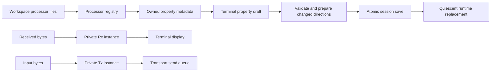
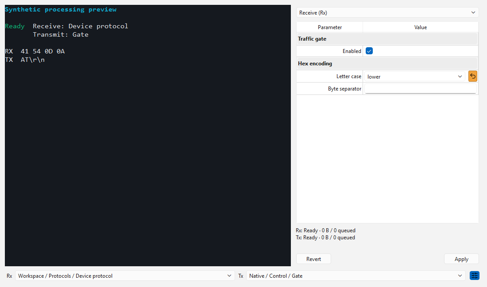
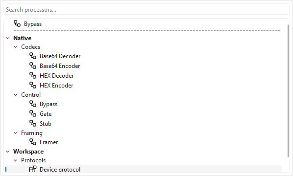
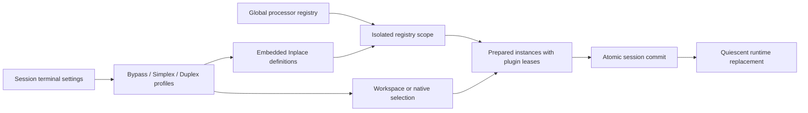

# Terminal processing

The status bar exposes Buffered input, Send file and Processing commands, also
available in the Terminal menu. Interactive idle input has no permanent command
strip. Buffered input reveals the multiline draft and its terminator/history/tools;
active file or periodic sending retains accessible status and Stop controls.
Processing shows an additional row with explicit Bypass, Simplex and Duplex modes.
Simplex selects independent 1x1 Rx/Tx processors; Duplex selects one shared 2x2
processor; Bypass instantiates neither. Mode and selections are stored under each
session terminal object's `settings/processing` map. Inactive selections and diagrams
remain stored, including unavailable references. Only the active mode is prepared.
Mode/selection changes atomically prepare, persist and replace processing; property
edits retain their explicit Apply/Revert workflow.

Selectors open searchable catalog trees matching Lineflow's origin/subgroup
presentation and icon contrast. An unnamed favorites section comes first, separated
from Native and Workspace by a dashed line. Bypass and Stub remain ordinary Native
Control nodes. New workspaces persist Bypass as their initial favorite under
`content/state/processing/favorites`; each workspace keeps its own list. Context
menus add/remove entries and move them up/down. Changes refresh Lineflow and both
terminal selectors without changing processor selections or runtime configuration.
Unavailable favorite IDs remain saved. A terminal-local Inplace entry is always
first in terminal selectors and never enters workspace favorites. Empty workspace
favorites leave that local entry visible.
Headings and the divider cannot be selected. Mouse or Enter chooses a leaf; Escape
or outside click cancels. The closed control displays only the chosen title.
Empty saved selection still means the direct bypass path; explicitly selecting
Bypass chooses `native.bypass`.

The properties button opens a side pane beside the terminal display and input.
It leaves the compact command bar in place; history and sending tools use popups.
The pane contains the property table and its explicit Apply/Revert controls. Receive and transmit drafts are independent.
Leaf headings follow expanded Lineflow traversal, including the complete occurrence
path for repeated nested blocks. Controls come from descriptor `x-widget` factories.
Reset removes the terminal override and restores the effective inherited value.
Changing a shared block is a separate operation in the Lineflow editor.

Apply validates and prepares fresh instances before saving the session atomically.
Failed preparation or persistence leaves the active configuration unchanged. Only
changed directions are replaced. Rx-only edits preserve Tx buffering and producers;
Tx edits stop pending producers and replace their processing state. Unchanged Apply
performs no replacement. Shared definition updates take effect on the next
terminal restart or changed selection; running instances retain their prepared snapshot. Old callbacks are invalidated while cancellation completes;
new input remains bounded until the replacement is ready.

Metadata inspection does not construct processors or invoke source providers. It
returns owned schema/configuration snapshots with bounded depth and occurrence count.
Plugin editors are destroyed synchronously before their factories are unregistered.
Invalid drafts prevent editor release with a concrete error rather than being discarded.
Closing the terminal destroys property widgets before retiring the router they borrow.

Diagnostics show bypass, ready, busy, cancelling or failed state and bounded queue
sizes. Tooltips include saturating accepted/forwarded byte counts and failure counts.
Forwarded counts mean acceptance by the next sink, including the transport queue;
they do not establish delivery to a remote device. No payloads are recorded.

Processor errors stop the affected processing lane without closing the transport
or clearing the requested connection state. A simplex fault leaves the opposite
lane running; a shared duplex processor fault stops both lanes. Faulted data is
never silently passed through. Subsequent input to a failed lane is rejected until
processing is explicitly replaced, edited or switched to Bypass. Receive admission
overflow also fails the processing lane while preserving the connection. Tx faults
cancel file/periodic producers without restarting the faulty processor; bytes
already accepted by the transport queue may still drain.

Workspace definitions use individual YAML files. Multi-document edits share a bounded
recoverable transaction with session rename refactoring. Python/Codeflow execution
remains outside this stage.

## Visual acceptance

The native Windows capture uses the production terminal display and processing panel
with synthetic text and real native processor instances, at a fixed 1100 by 650 logical
size. The same capture passed at device scales 1 and 2; reset button height matches
its adjacent combo box. Instances are explicitly cancelled and drained before the
fixture exits.

## Verification

The Desktop Qt 6.12.0 MSVC2022 64-bit Debug build passed. All 44 configured CTest
executables passed in 89.05 seconds. Native visual acceptance passed separately
at scales 1 and 2 (three QtTest passes per run, no skips). Default-suite optional
capture/SDK and unavailable host symlink cases retain their explicit skip conditions.
The independent SDK consumer and Release were not rebuilt for this stage.

Coverage includes nested metadata precedence without executing factories/providers,
independent Rx/Tx state and private resets, no-op Apply, Rx-only edits preserving
Tx nibble buffering, failed persistence retaining drafts, concurrent settings and
Revert, closing during Apply, synchronous plugin editor release, bounded diagnostics,
node-path errors and deferred cancellation. External storage checks cover exact
unchanged bytes, unknown/literal keys, create/edit/delete, inventory conflicts,
borrowed cache adoption and interrupted recovery. Restart fixtures explicitly reload
independent child-process saves before making additional parent edits.

Checks use synthetic streams, local fixtures and existing loopback transports;
no real serial device, external network or elevation acceptance was performed.
Changed C++ files were clang-formatted; documentation links and diff checks passed.

## Catalog and favorites acceptance

The grouped popup and Lineflow use the same ProcessorCatalogTree, selection contrast
and separator delegate. Context-menu favorites edits are persisted through the
workspace owner and update all connected catalog views. Creation persists the Bypass
favorite; explicit empty lists, missing IDs and unknown surrounding preferences
survive round trips. A two-workspace App fixture verifies isolation and on-disk
persistence, with no global application preference written.

The Qt 6.12.0 MSVC2022 Debug application and bundled plugins built. All 45 configured
CTest executables passed in 91.76 seconds. Native Windows popup keyboard, mouse,
context-menu/shared-model and capture acceptance passed at device scales 1 and 2
(five QtTest passes per run, no skips). Node checks cover binary NUL, empty packets,
zero-output Stub completion and cancellation. No real serial device or external
network was used; Release and the separate SDK consumer were not rebuilt.

## FLOW-7 acceptance

Qt 6.12.0 / MSVC2022 x64 Debug application and bundled modules built successfully.
All 46 configured CTest executables passed in 100.56 seconds. Native Windows
buffered-input capture fixtures passed at scales 1 and 2 (three QtTest passes,
no skips per run), using the same 1100 by 760 logical client size. The capture
window has a fixed position to avoid unrelated multi-monitor placement differences.
Tools popups are rendered from the actual widgets over the main-window capture.
Buffered and interactive layouts and tools were inspected at both scales; the
compact editor also passes a 640-pixel-width fixture. No real serial device or
external endpoint was used. Release and the separate SDK consumer were not rebuilt.

Pacer checks cover split binary endings, byte/line spacing, rate/burst scheduling,
packet atomicity, resource limits, reentrant callbacks and cancellation. Saved
Lineflow checks verify output before upstream completion, busy-stage ordering,
1200 emissions within a four-chunk resident queue and cancellation during output.
The timing assertions test processor emission, not physical device delivery.

- [Buffered input](images/terminal-processing/Buffered.png)
- [Sending tools](images/terminal-processing/Advanced.png)
- [Interactive input](images/terminal-processing/Interactive.png)
- [Sending tools at scale 2](images/terminal-processing/2x/Advanced.png)

## Shared duplex selection

The mode selector switches between independent Rx/Tx processors and a shared
2x2 processor selector. Catalog entries are filtered by port shape. Session
`settings/processing/duplex` stores the same `type`, `configuration` and `overrides`
selection map as independent directions, retained alongside inactive `rx`/`tx`. Private property
forms and node occurrence paths work for a shared selection as well.

The controller prepares one 2x2 instance before atomic persistence and assigns it
to both directions. Port 0 routes to the screen; port 1 routes to the device send
queue, including responses produced by incoming traffic and timer outputs. Cross-
direction/generated traffic never inherits manual disconnected-data retention.
Replacement waits for both old directions to become quiescent before any queued
new input executes. Cancelling a shared selection stops both directions once;
reconnect or explicit reset prepares a fresh shared instance. Backpressure and
byte/chunk limits remain independent at each terminal boundary. No real protocol
implementation or additional terminal backend is introduced by this feature.

Known favorite entries incompatible with the selected port shape are omitted from
that selector without changing the workspace favorite list. Genuinely unavailable
favorite IDs remain visible. Bypass mode disables processing without removing any
saved profile or instantiating a unary processor as a 2x2 flow.

## Terminal-local Inplace diagrams

The pencil beside each selector opens the existing Lineflow editor for that
direction. Inplace diagrams are embedded definition maps in
`settings/processing/inplace/rx`, `tx` and `duplex`; their stable roots are
`terminal.inplace.rx`, `terminal.inplace.tx` and `terminal.inplace.duplex`.
The Simplex roots remain 1x1, and the Duplex root remains 2x2. Root removal or a
topology change is rejected on Apply. Empty roots are usable passthrough diagrams.
The special selector ID `@inplace` resolves the matching local root. Each terminal
can use the same local IDs without sharing state, source or private overrides.

An editor draft can include additional local definitions and references to shared
workspace/native processors. Apply persists the complete local map and selects
Inplace through the terminal's normal atomic save callback. Cancel discards unapplied
diagram edits. Local occurrence edits reuse bounded refactoring for private paths.
Removing a node or replacing its processor target prunes that occurrence's valid
private overrides while preserving unrelated selections and settings. Original
paths are fully validated before pruning, so a stale descendant cannot disappear
silently with a deleted ancestor. Applying an active diagram prepares the replacement,
commits the session and swaps the runtime without closing or reopening the transport.
Preparation or persistence failure retains the saved settings and running graph;
the editor draft remains available for retry.
Workspace occurrence refactoring also visits all embedded graphs, including dormant
profiles, with an isolated scope per terminal. Combined workspace/local refactoring
validation retains the existing 1024-definition bound.

Runtime preparation and property inspection use `ProcessorRegistry::scoped()`:
local entries never publish into or emit change notifications on the global registry.
The scope shares original entries/providers so prepared instances keep the real
plugin ownership leases. A live scope also pins its copied factories/providers
until destruction, including before preparation, so unloading cannot invalidate
retained callbacks. Existing byte/queue/depth/instance bounds, cancellation
and quiescent replacement remain in force. No extra files or temporary catalogs
are written. All local definitions belong to the existing session document.

Changes to dormant profiles only persist metadata; they do not prepare new factories
or replace the active pipeline. This also permits retaining unavailable dormant
selections and preserves partially accumulated frames/codecs on the active mode.
Callbacks that close a terminal or commit a competing processing draft during
factory preparation are revalidated before persistence and runtime replacement.

- [Simplex controls](images/terminal-processing/Inplace/Simplex.png)
- [Buffered input](images/terminal-processing/Inplace/Buffer.png)
- [Duplex controls](images/terminal-processing/Inplace/Duplex.png)
- [Inplace editor](images/terminal-processing/Inplace/InplaceEditor.png)

## FLOW-11 verification

Qt 6.12.0 / MSVC2022 x64 Debug built the application, modules and tests. All 47
configured CTest executables passed in 120.41 seconds. After the final dormant-state
and scope-lease refinements, the affected App, ProcessorCatalog, ProcessorRefactoring
and TerminalProcessing suites passed again in 42.16 seconds. Native Windows App
and standalone processing fixtures at scales 1 and 2 each passed three QtTest
checks without skips. Captures use 1100 by 760 logical application/editor client
areas and 1100 by 650 for the standalone property-table fixture; the controls,
buffered draft, shared mode and local editor were visually inspected.

Coverage includes per-workspace restoration, disconnected terminal reconstruction,
explicit session closure, unavailable/corrupt restoration targets, exact-topology
selectors and palette filtering, Inplace save/cancel/retry, independent terminal
sources, retained inactive profiles, partial Base64 state across dormant edits,
atomic failure on external writes, callback-driven terminal destruction/competing
commits, embedded occurrence refactoring and owner pinning before/after preparation.
The current format has explicit processing mode; an absent mode defaults to Bypass.
No compatibility reader or migration was added. Changed C++ files were clang-formatted;
SVG/document links and `git diff --check` passed. Release was not rebuilt. No real
serial device, external endpoint or elevation was used.

APP-14 verification covers independent Rx/Tx failures with synthetic devices,
continued opposite-lane traffic, rejection after failure, recovery through Bypass
and absence of reconnect attempts. Debug AppTests, AdvancedSenderTests and
ProcessingRoutingTests passed. Local echo selection state and controls were also
checked on native Windows at 100% and 200% scale. No hardware traffic or elevated
shell was used; Release was not built.

## Packet execution

Every incoming transport callback or Tx submission enters as one complete byte
packet. Router and Lineflow preserve it without implicit segmentation. Native
codecs finalize each packet independently; HEX pair accumulation is opt-in.
Framer is the explicit buffering stage for assembling transport pieces into
protocol frames. Transport atomic-write constraints remain separate from logical
processing packets. Native hosted modules require a rebuild for HostedPlugin IID 11.

## FLOW-22 live node removal verification

On 2026-11-10 the Qt 6.12.0 / MSVC2022 x64 Debug application, bundled modules and
configured tests built successfully. The affected App, ProcessorRefactoring,
LineflowPersistence and TerminalProcessing CTest suites passed (4/4, 64.32 seconds).
The active-terminal fixture removes a configured HEX Encoder and renames the
remaining Gate while a synthetic transport stays open. It checks persisted private
overrides and unknown settings, changed receive output, continued transmit traffic,
and unchanged open/close counters. An external session-file edit rejects Apply,
retains the original runtime and saved settings, and permits retry after the
external conflict is resolved.

Core fixtures cover simultaneous removal, replacement and nested renaming,
definition defaults, linked-instance configuration, removed definitions, opaque
missing-provider suffixes and stale descendants beneath removed/replaced nodes.
Native Windows runs of the active-terminal fixture passed at display scales 1 and 2;
both captures show the retained Gate and successful Apply and were visually inspected.
Changed C++ files were clang-formatted; local documentation links and
`git diff --check` passed. The full CTest suite and Release were not rerun. No real
serial device, external endpoint or elevation was used.

## Deferred terminal property editors

The terminal processing selector bar and properties container retain their existing
lifetimes. Property schemas, settings drafts and custom field editors are prepared
only when the properties container is shown. Hidden configuration and clean catalog
updates invalidate preparation without constructing editors. Hiding an already
prepared panel retains its draft; showing it again preserves unsaved edits. Editor
release remains synchronous before plugin factory removal.

Terminal configuration projection reads one merged overlay snapshot per projection,
then resolves schema fields from that snapshot. Application, terminal creation and
connection paths reuse an effective projection within their operation. These
snapshots are local to the operation, so subsequent application/workspace/session
changes are read afresh. Unknown values stay in the merged configuration. Connection
schemas remain owned by the registered terminal type, while the built-in appearance
schema is retained by the controller.

The isolated Qt 6.12.0 / MSVC2022 x64 Debug build and TerminalProcessingTests
passed on 2026-11-10 (14 active cases; two opt-in capture cases skipped by CTest).
Coverage includes hidden preparation, latest configuration, hide/show draft
retention, unknown override preservation, synchronous editor release and failed
Apply diagnostics. The native Windows visual capture passed separately and was
inspected for selector/property alignment and retained reset controls. The integrated
Release AppTests, LineflowEditorTests and TerminalProcessingTests also passed.
One copied real-workspace quick run measured session reopen at 174.62 ms, clean
App save at 4.31 ms and disconnected terminal addition at 30.88 ms; these are
exploratory single-cycle figures, not statistical performance guarantees. Raw
records are under `docs/benchmarks/application-profile/after-settings/`.
