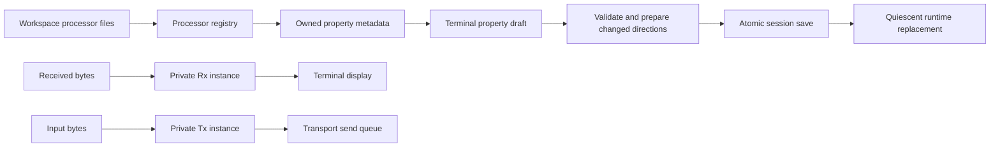

# Terminal processing

Each terminal has independent Rx and Tx selectors beneath its input area. A selection
can reference a native processor, a workspace composition or bypass. Saved definitions
remain shared; private values are stored under the session terminal object's
`settings/processing` map. Unavailable selections stay visible with their identifier.

Selectors open searchable catalog trees matching Lineflow's origin/subgroup
presentation and icon contrast. An unnamed favorites section comes first, separated
from Native and Workspace by a dashed line. Bypass and Stub remain ordinary Native
Control nodes. New workspaces persist Bypass as their initial favorite under
`content/state/processing/favorites`; each workspace keeps its own list. Context
menus add/remove entries and move them up/down. Changes refresh Lineflow and both
terminal selectors without changing processor selections or runtime configuration.
Unavailable favorite IDs remain saved. Empty favorites hide the leading section.
Headings and the divider cannot be selected. Mouse or Enter chooses a leaf; Escape
or outside click cancels. The closed control displays only the chosen title.
Empty saved selection still means the direct bypass path; explicitly selecting
Bypass chooses `native.bypass`.

The properties button opens a side pane beside the terminal display and input.
It leaves the compact command bar in place; history and sending tools use popups.
The pane contains the property table and its explicit Apply/Revert controls. Receive and transmit drafts are independent.
Leaf headings follow expanded Lineflow traversal, including the complete occurrence
path for repeated nested blocks. Controls come from descriptor `x-widget` factories.
Reset removes the terminal override and restores the effective inherited value.
Changing a shared block is a separate operation in the Lineflow editor.

Apply validates and prepares fresh instances before saving the session atomically.
Failed preparation or persistence leaves the active configuration unchanged. Only
changed directions are replaced. Rx-only edits preserve Tx buffering and producers;
Tx edits stop pending producers and replace their processing state. Unchanged Apply
performs no replacement. Shared definition updates take effect on the next
terminal restart or changed selection; running instances retain their prepared snapshot. Old callbacks are invalidated while cancellation completes;
new input remains bounded until the replacement is ready.

Metadata inspection does not construct processors or invoke source providers. It
returns owned schema/configuration snapshots with bounded depth and occurrence count.
Plugin editors are destroyed synchronously before their factories are unregistered.
Invalid drafts prevent editor release with a concrete error rather than being discarded.
Closing the terminal destroys property widgets before retiring the router they borrow.

Diagnostics show bypass, ready, busy, cancelling or failed state and bounded queue
sizes. Tooltips include saturating accepted/forwarded byte counts and failure counts.
Forwarded counts mean acceptance by the next sink, including the transport queue;
they do not establish delivery to a remote device. No payloads are recorded.

Workspace definitions use individual YAML files. Multi-document edits share a bounded
recoverable transaction with session rename refactoring. Python/Codeflow execution
remains outside this stage.

## Visual acceptance

The native Windows capture uses the production terminal display and processing panel
with synthetic text and real native processor instances, at a fixed 1100 by 650 logical
size. The same capture passed at device scales 1 and 2; reset button height matches
its adjacent combo box. Instances are explicitly cancelled and drained before the
fixture exits.

## Verification

The Desktop Qt 6.12.0 MSVC2022 64-bit Debug build passed. All 44 configured CTest
executables passed in 89.05 seconds. Native visual acceptance passed separately
at scales 1 and 2 (three QtTest passes per run, no skips). Default-suite optional
capture/SDK and unavailable host symlink cases retain their explicit skip conditions.
The independent SDK consumer and Release were not rebuilt for this stage.

Coverage includes nested metadata precedence without executing factories/providers,
independent Rx/Tx state and private resets, no-op Apply, Rx-only edits preserving
Tx nibble buffering, failed persistence retaining drafts, concurrent settings and
Revert, closing during Apply, synchronous plugin editor release, bounded diagnostics,
node-path errors and deferred cancellation. External storage checks cover exact
unchanged bytes, unknown/literal keys, create/edit/delete, inventory conflicts,
borrowed cache adoption and interrupted recovery. Restart fixtures explicitly reload
independent child-process saves before making additional parent edits.

Checks use synthetic streams, local fixtures and existing loopback transports;
no real serial device, external network or elevation acceptance was performed.
Changed C++ files were clang-formatted; documentation links and diff checks passed.

## Catalog and favorites acceptance

The grouped popup and Lineflow use the same ProcessorCatalogTree, selection contrast
and separator delegate. Context-menu favorites edits are persisted through the
workspace owner and update all connected catalog views. Creation persists the Bypass
favorite; explicit empty lists, missing IDs and unknown surrounding preferences
survive round trips. A two-workspace App fixture verifies isolation and on-disk
persistence, with no global application preference written.

The Qt 6.12.0 MSVC2022 Debug application and bundled plugins built. All 45 configured
CTest executables passed in 91.76 seconds. Native Windows popup keyboard, mouse,
context-menu/shared-model and capture acceptance passed at device scales 1 and 2
(five QtTest passes per run, no skips). Node checks cover binary NUL, empty packets,
zero-output Stub completion and cancellation. No real serial device or external
network was used; Release and the separate SDK consumer were not rebuilt.

## FLOW-7 acceptance

Qt 6.12.0 / MSVC2022 x64 Debug application and bundled modules built successfully.
All 46 configured CTest executables passed in 100.56 seconds. Native Windows
buffered-input capture fixtures passed at scales 1 and 2 (three QtTest passes,
no skips per run), using the same 1100 by 760 logical client size. The capture
window has a fixed position to avoid unrelated multi-monitor placement differences.
Tools popups are rendered from the actual widgets over the main-window capture.
Buffered and interactive layouts and tools were inspected at both scales; the
compact editor also passes a 640-pixel-width fixture. No real serial device or
external endpoint was used. Release and the separate SDK consumer were not rebuilt.

Pacer checks cover split binary endings, byte/line spacing, rate/burst scheduling,
packet atomicity, resource limits, reentrant callbacks and cancellation. Saved
Lineflow checks verify output before upstream completion, busy-stage ordering,
1200 emissions within a four-chunk resident queue and cancellation during output.
The timing assertions test processor emission, not physical device delivery.

- [Buffered input](images/terminal-processing/Buffered.png)
- [Sending tools](images/terminal-processing/Advanced.png)
- [Interactive input](images/terminal-processing/Interactive.png)
- [Sending tools at scale 2](images/terminal-processing/2x/Advanced.png)
