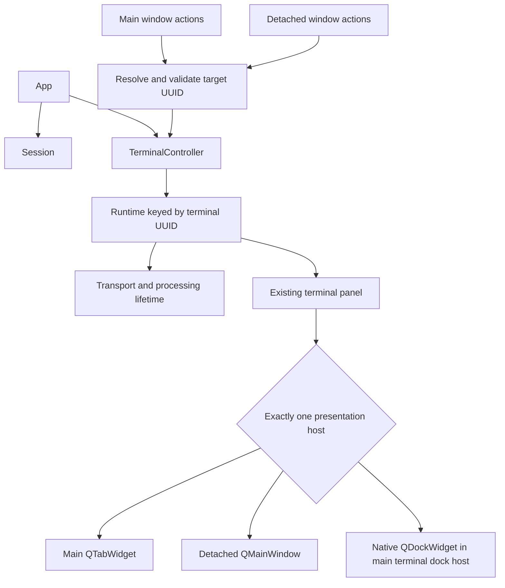

# Detached terminal windows

## Delivered scope

Implemented in APP-17. Each detached window hosts one terminal and keeps the
approved main tab strip and the existing single process, workspace, session,
transport and processing model.

## Window contents and interactions

A standard QMainWindow contains the existing complete terminal panel: display,
buffered input/file sending and processing controls/properties. Its title identifies
the terminal type, endpoint, human-readable name and session without exposing shell
arguments or environment variables. The window has its own compact terminal toolbar
and status bar. Menus expose Terminal, Edit and View commands; workspace/session
catalog management stays in the main window.

This is a complete terminal window with its own interactive controls, rather than
an unadorned floating display. Its menus contain:

- Terminal: applicable start/connect, stop/disconnect, reconnect/restart, terminal
  settings, clear, explicit terminal closure and Return to main window.
- Edit: copy, paste and select all, resolved against that window's terminal/editor.
- View: visual wrapping, this window's toolbar/status-bar visibility and fullscreen.

The icon-only toolbar reuses the applicable connection, reconnect, clear,
local-echo, wrap and settings commands, plus Return to main window. Its status bar
includes the existing buffered-input toggle, file-send button and processing
panel toggle, with their checked/enabled states. Opening those controls exposes
the same editor, file actions and processing settings as in the main window.
The status bar shows the actual connection state. Expanded controls retain the
existing queue/processing diagnostics; acceptance into a send queue is not delivery. Menus, toolbar and
status-bar buttons all resolve the terminal UUID belonging to their own window,
including when a different terminal is selected in the main window.

Detach is available in the Terminal menu and tab context menu. A tab stays attached
within a sticky band around the strip. Dragging beyond that band transfers the
existing panel to a complete secondary window while the button remains held;
Qt's system move continues the same gesture. A fast release before queued delivery
uses the ordinary detach fallback. Original panel identity is validated before
changing hosts, so a queued gesture cannot affect a replacement session.

On Windows, moving a secondary window over the main terminal area shows a
transparent placement guide and a short destination label. Release at an outer
edge to dock, over a dock edge to split it, over its center to tabify, or over the
central area to return to ordinary tabs. The window's Return to main window action
and close button remain available. Native QTabWidget/QDockWidget layouts and OS
window movement are retained; production code does not synthesize pointer input.

The detached window's X returns the terminal to the main window,
with its connection, history, selection, input draft and processing instance intact.
Closing the terminal remains a separate explicit Terminal command. Return restores
the terminal's slot in the session's global order, selects it and activates the main
window. Closing the main application still saves once and exits all terminal hosts.
Explicit terminal closure removes its runtime view while retaining its session
object definition.

## Ownership and command targets



TerminalController keeps runtime ownership. A small GUI-thread host record maps a
terminal UUID to its current window/presentation location. Moving reparents the
existing panel; it does not recreate a device, parser, screen or processor graph.
The panel belongs to exactly one QWidget parent. Reparenting/layout must be batched
so backend resizing observes valid final dimensions, without transient tiny grids.
Native DPI/font notifications then update the existing display caches. Toolbars/status widgets are
separate widgets per host and share command definitions, rather than widget parents.

Command dispatch resolves the host's terminal at trigger time and revalidates
its capabilities. Active terminal dialogs resolve through their parent host. Each window creates its own QAction presentations
with the existing command/shortcut metadata and WindowShortcut scope. Main-window
actions target its selected tab; detached actions target that window's UUID. Check
states and settings dialogs belong to the same target, including plugin actions.

Qt provides the required ownership operations:
[QTabWidget::removeTab](https://doc.qt.io/qt-6/qtabwidget.html#removeTab) removes a tab
without deleting its page. The old QMainWindow layout releases its item before the panel is reparented with
Qt::Widget. This avoids an intermediate parentless native window and retained
window flags during adoption by a new host. Headers are recreated through the
current native layout factory; the runtime panel and its source state are retained.

## Session state and lifecycle

`presentation.tabOrder` remains the global ordered list of terminal object UUIDs.
Detached terminals retain their slots; the main strip filters this order to its
attached terminals. The `presentation.detachedWindows` map is keyed by terminal UUID and records
canonical Base64 native geometry plus `toolbarVisible` and `statusBarVisible`. A second independent tab
ordering list is unnecessary for one-terminal windows.

Use QWidget::saveGeometry/restoreGeometry for the native geometry blob, stored as
encoded bytes in YAML, and preserve unknown presentation fields. Qt's
[restoreGeometry](https://doc.qt.io/qt-6/qwidget.html#restoreGeometry) adjusts geometry
outside available screens. Restore the main and detached views after factories
are ready, with all transports disconnected, following the current session contract.
Do not interpret restoring a window as permission to reconnect a device.

Session/workspace replacement and application exit first save presentation and
veto replacement on failure. Then stop new moves/commands, close borrowed settings
forms, cancel/drain runtime work, destroy panels/hosts and unload factories. Host
closure during shutdown or provider removal must suppress the normal X-to-reattach
path. Removing a provider releases its windows and runtime while retaining object
configuration and order for later recovery.

## Why QMainWindow rather than converting to docks

[QDockWidget](https://doc.qt.io/qt-6/qdockwidget.html#floating-prop) already supports
native floating/docking and is suitable if terminals become a general dock layout.
The application keeps its central QTabWidget and additionally supports native docked
terminal panes. A standard QMainWindow plus QWidget transfer preserves complete
secondary-window controls and host-aware command dispatch.

## Verification and limits

Automated coverage exercises preserved panel/display/processing identity, input
state, independently targeted commands, return order, explicit closure, save-failure
veto, provider unload/recovery, disconnected restoration and application shutdown.
Session tests validate bounded canonical geometry data, field types and atomic
failure behavior while preserving unknown metadata.

Host moves suppress intermediate display resize signals and explicitly resize the
backend to the resulting grid. Native Qt layouts, font/DPI handling and geometry
recovery remain responsible for window sizing. Physical monitor removal and mixed
DPI monitor transfers require interactive hardware acceptance; they are not
established by synthetic tests. Windows contain one terminal each; tabbed detached
windows and transfers directly between secondary windows are outside this version.

Verification on Windows 11 with Qt 6.12.0 / MSVC 2022:

- Debug and Release application builds completed.
- Full AppTests passed in both configurations (54 cases), including drag-out,
  an open synthetic connection retained across moves, independent window actions,
  reentrant session closure during backend resize and detached-process shutdown.
- SessionTests passed in both configurations; two existing symlink-confinement
  checks were skipped because symlink creation is unavailable to the current user.
- Eight adjacent Debug suites passed: action containers, commands, icons, command
  editor, settings forms, terminal display, processing routing and terminal processing.
- Native detached/returned window captures and gesture/identity checks passed at
  100%, 125% and 200% scale. Visibility assertions cover the transferred panel,
  display and buffered input, preventing a hidden removed-tab page regression.

All transport continuity checks used synthetic devices; no physical serial device
or external connection was opened for this feature verification.

## Detached resize cost (PERF-18)

Native move/resize/toolbar/status events no longer mutate session settings.
The live QWidget owns geometry until explicit presentation capture at save or
placement/lifecycle transitions. Provider unload captures before synchronizing.
Previously each event cloned and serialized the full session YAML, including
unchanged unrelated metadata, potentially multiple times per frame.

A bounded Release synthetic test performs 40 visible resize/move iterations and
asserts zero presentation changes before capture. It took 56.7 ms for the small
session and 63.8 ms with 256 KiB of unknown metadata on the verification host.
These are offscreen loop wall times, not native input latency or a before/after
speedup claim. Detached identity, persistence and reentrant closure checks passed.

## Internal terminal docking (APP-18)

Terminal > Dock terminal moves the same terminal panel into a native QDockWidget.
The command is also available in a central tab's context menu and in a detached
window. Drag the dock title bar to another edge to split the main area, or onto
another dock to form tabs. Native separators resize adjacent panels. Clicking a
dock title, its tab or a terminal/editor chooses that terminal for the main
window's menu, toolbar and status controls. The ordinary central tab selection
remains independent of the focused dock.

Dock title context menus offer Detach terminal and Return to terminal tabs.
The dock close button also returns the panel to its global tab-order slot.
Detaching uses the existing complete secondary window. Native bare floating docks
are temporary during native dragging. After release outside the root, a floating
terminal becomes a complete secondary window with menus, toolbar and status bar.

A dedicated child QMainWindow hosts terminal docks and the original central tab
stack. Its saveState(1) contains terminal layout only, separate from application
menu/toolbar/status preferences. When no central tabs remain, the central stack
hides and dock panels occupy the whole terminal area. Dock animation is disabled.
No transport, screen, parser or processing object is recreated for a host change.

Session presentation stores dockedTerminals (safe unique object IDs) and dockLayout
(canonical bounded Base64 native state). Detached and docked IDs are disjoint.
Explicit capture at save/lifecycle boundaries retains unavailable-provider IDs,
unknown metadata and native missing-dock placeholders. Factories reconstruct views
disconnected; restoring docking never opens a transport. Native layout restoration
failure leaves a usable default arrangement and reports the concrete failure.
Geometry and splitter movement do not write session YAML on each event.

APP-18 verification (Windows 11, Qt 6.12.0, MSVC 2022):

- Debug/Release application builds and full AppTests, SessionTests,
  CommandEditorTests and TerminalDisplayTests passed. Two pre-existing symlink
  checks remain unavailable without symlink privileges.
- Final targeted checks cover both host types closing their session from a
  backend resize callback, saved left-side dock placement after provider reload
  and session reopen, live synthetic transport continuity and process shutdown.
- Native title-click targeting, title-bar drag from the right to the left area,
  tabification, split and visible native tab-bar captures passed at 100%, 125%
  and 200% scale. Drag completion waits for Qt's asynchronous plug operation.
- Fresh sessions reset the native dock host to its initial empty state, keeping
  missing-provider layout placeholders local to their original session.
- No physical device or external network connection was used. Mixed physical
  monitor DPI transfers were not exercised. APP-19 extends the original command-only
  return with native title-bar dragging on Windows.

## Sticky tab transfer and drop guides (APP-19)

The sticky band uses the larger of twice the platform drag distance and half the
tab-strip height. Reordering within it stays native. A queued tear-off validates
the original page and gesture generation, transfers it once and calls
QWindow::startSystemMove. No device, display, input editor or processor is replaced.

Windows native move messages provide preview updates and a queued finish after
the OS move loop. Resizing, programmatic placement, cancelled moves, minimized
roots, modal dialogs and a foreign window covering the target do not trigger a
drop. Targets are recomputed at release and validated against the original session,
terminal, source window and target dock. Input-transparent top-level QRubberBand
and QLabel guides do not activate a window or intercept the gesture.

Native dock tabs are individually draggable. Temporary Qt floating containers are
observed until the mouse is released and two quiet timer samples allow asynchronous
plugging to finish. An unaccepted float transfers the same panel into a complete
secondary window. Native splitters and tabification remain responsible for layout.
Closing or replacing a session cancels pending transfer and preview state.

Geometry preview does not write session YAML. Existing explicit presentation
capture persists the resulting ordinary-tab, dock or secondary-window placement.
The native OS-title bridge is Windows-specific; other platforms retain explicit
host commands and the tab-release fallback. Mixed physical monitor DPI transfers
and grouping several terminals in one secondary window remain outside verification.

### Headless verification platform

Qt 6.12's offscreen plugin can retain conflicting window-ID entries across native
widget reparenting. Its backing-store `clearHash()` dereferences a hash end iterator
when a previously removed ID is missing; a subsequent root resize then crashes
inside qoffscreen.dll. The installed Windows DLL fault instruction was matched to
[this Qt implementation](https://github.com/qt/qtbase/blob/6.12/src/plugins/platforms/offscreen/qoffscreencommon.cpp).
The same lifecycle sequence passes with the Windows platform plugin. The minimal
headless plugin does not satisfy the suite's window-activation contract. The
[isolated AppTests runner](../tools/tests/App/RunIsolatedAppTests.py) enumerates all
slots and runs each in a fresh offscreen process, preserving complete within-slot
lifecycle assertions while avoiding cross-test window-ID contamination. Native
Windows acceptance separately exercises the actual gesture, preview and system
move. The monolithic offscreen suite remains affected by the upstream defect;
no bundled Qt code or installed DLL is patched.

Run the complete isolated headless suite with:

```powershell
python tools/tests/App/RunIsolatedAppTests.py build/Desktop_Qt_6_12_0_MSVC2022_64bit-Debug/AppTests.exe
```

The runner uses per-slot timeouts, treats missing results or nonzero exits as
failures and explicitly disables inherited native pointer injection. Native
acceptance is opt-in through `TERMASTER_STICKY_DRAG_GESTURE=1` on the Windows
platform plugin. Its fixture temporarily makes only its own root topmost, checks
physical hit targets before injection and restores the root's normal Z-order.

### APP-19 acceptance

Windows 11, Qt 6.12.0 and MSVC 2022 acceptance covers:

- Real held mouse gestures at 100%, 125% and 200%: sticky central-tab tear-off,
  native secondary-window title return and unaccepted native dock tear-out.
- Visible, input-transparent placement guides, labeled destinations, native split
  and tabbed layouts. Visual captures preserve readable panels and input controls.
- Same panel/display/editor/processing identities, buffered draft and open
  synthetic transport across transfers; no reconnect or implicit device open.
- Quick-release fallback, sticky-band retention, stale queued-page rejection,
  cancelled drops, provider recovery, save failure and reentrant session closure.
- Session, command-editor and terminal-display suites in Debug and Release.
  Two existing session symlink-confinement checks require unavailable privileges.

Debug and Release application builds complete. All 48 AppTests slots pass in
both configurations through isolated offscreen processes as explained above. No physical serial device or external network connection is
used. Physical mixed-DPI monitor transfers remain unverified.
