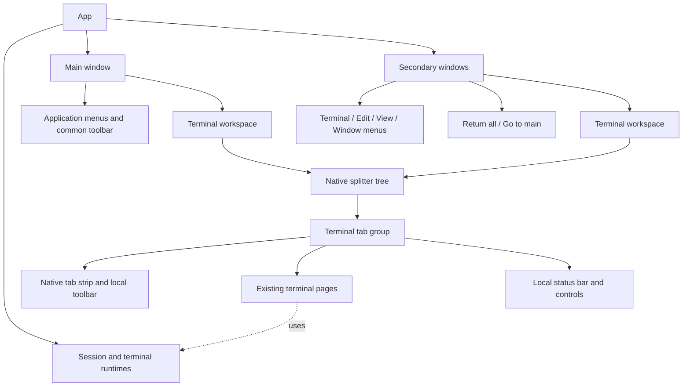

# Terminal groups and windows

## Ownership and interaction

APP-20 replaces single-terminal dock panels with a uniform group-of-tabs layout.
The application retains one workspace, one active session and the same GUI-thread
terminal runtime owners. Hosting never recreates a transport, parser, screen,
processing graph, input draft or terminal page.

A TerminalWorkspace owns a bounded tree of QSplitters and TerminalTabGroups.
A group owns its QTabWidget, corner toolbar and status bar. Each tab is the
presentation of one existing terminal page. The controller retains authoritative
runtime ownership; a page belongs to exactly one group's native stacked layout.

Dragging a tab past the platform threshold starts standard QDrag with a 65%-opaque
copy of the tab and the original pointer hotspot, including reordering within its
own strip. The platform moves that image. The page stays in its original group
until a drop completes. Dropping on a strip inserts
at the indicated position; dropping centrally joins the group; dropping at an
edge creates a split. The same gesture works across main and secondary windows.
Only in-process drags from the same live host tree and exact page are accepted.
QDrag is the single gesture owner; QTabBar's separate movable interaction is
disabled. Same-group drops use QTabBar.moveTab, preserving header/layout objects
and avoiding transport resize. Transfers between groups reparent the existing page.
Esc cancels; an unaccepted release outside all terminal areas creates a secondary
window. On Windows, the held primary button is queried after OLE returns because
Qt resets its cached mouse state on cancellation as well as release. Production code does not synthesize pointer input or move a window on
every mouse event.

Empty groups disappear and one-child splitters collapse. An empty main area keeps
one usable drop group. Empty secondary windows close. Groups retaining unavailable
provider placements remain present until those definitions can be materialized.

## Commands and naming

Each group's toolbar and status buttons address its current terminal, independently
of other groups. Main-window commands address the focused main group; secondary
menus address that window's focused group. Execution revalidates the registered
command, terminal UUID, panel identity and current host. Window shortcuts belong
to the window menu presentations; local button presentations do not duplicate
window-wide shortcut activation.

Secondary windows have restricted Terminal, Edit, View and Window menus. Their
small navigation toolbar contains panel-top **Return all tabs to main window** and
**Go to main window**. These controls belong to the window. The terminal toolbar,
status text and buffered-input/file/processing buttons belong to each group.
Returning all grafts the existing splitter subtree into the main area, preserving
group IDs, pages and local state. X performs the same return; explicit terminal
closure remains a separate command. Closing the main application saves once and
closes all hosts and runtime resources.

Main titles use workspace name, session name and application name. Secondary
titles use the active terminal name, session name, workspace name and application
name, omitting empty components. Tabs show the terminal's user-visible name;
connection parameters remain secondary text and tooltip details.

## Configurable action placement

The existing interface settings page exposes four flat YAML-list fields:

| Setting path under ui/terminalGroups | Surface |
| --- | --- |
| embedded/toolbar | Main-window group toolbar |
| embedded/status | Main-window group status controls |
| secondary/toolbar | Secondary-window group toolbar |
| secondary/status | Secondary-window group status controls |

Lists contain ordered `group:connection` or `command:Terminal.LocalEcho` selectors.
Group selectors collect registered terminal action groups; command selectors select
one registered command. Duplicate matches are shown once. Explicit empty lists
hide the corresponding controls. Unknown selectors remain in settings for late
plugin registration. Each list is bounded to 64 strings of at most 128 characters.
ToolbarActionContainer borrows the actual QToolBar, including the small toolbar
inside the native QStatusBar. Placement does not grant command eligibility.

Default toolbars include connection commands, Local echo, Wrap lines and settings.
Default status controls include Buffered input, Send file and Processing. Those
three are excluded from broad group selectors unless explicitly requested, keeping
the two surfaces compact. Application settings provide defaults and workspace
overlays may override the lists. Changes apply through the existing settings owner.

## Session presentation

Current-format `presentation.terminalLayout` contains `main`, `windows` and optional
`activeGroup`. Each window stores a stable UUID, bounded canonical Base64
QWidget.saveGeometry and its own tree. Group nodes store their UUID, ordered
terminal object IDs, current selection and local toolbar/status visibility. Split
nodes store orientation, native
sizes and children. `tabOrder` remains the global ordering of object definitions,
including unavailable providers. Obsolete per-terminal dock/window readers and
native QMainWindow dock-state blobs are removed; there are no legacy migrations.

Core validates before acceptance: depth at most 16, at most 256 groups and 64
secondary windows, unique canonical nonnil UUIDs, safe unique terminal IDs, bounded
geometry and nonnegative splitter sizes. A terminal can occur only once across all
windows. Unknown presentation metadata remains attached to surviving nodes.
Factories restore terminals disconnected; restoring layout never opens a device.
Unavailable-provider placement survives capture and provider recovery.

Geometry, splitter motion and drag previews do not serialize session documents.
Live widgets own geometry until explicit save/capture/lifecycle boundaries. Host
transfer suppresses intermediate display-resize callbacks and reports the stable
final terminal grid to its backend. Save failures retain the live layout.

## Verification

Verification uses bounded synthetic devices and streams. No physical device or
external network connection is required. Native pointer acceptance is opt-in and
must verify the physical target before input injection. Mixed physical-monitor
DPI transfers require separate hardware acceptance.

Acceptance on Windows 11, Qt 6.12.0 and MSVC 2022:

- Debug and Release application builds complete. Standard CTest runs pass AppTests,
  SessionTests, CommandEditorTests and TerminalDisplayTests in both configurations.
- AppTests includes 55 passing results and one default native-input skip; session
  tests include 12 passing results and two existing symlink-privilege skips.
- Synthetic connections, page/display/editor/processing identity, selected terminal,
  input drafts, local action isolation, stale context-menu safety, shutdown and
  reentrant session closure are covered.
- Provider unload/save/recovery and full session reopen retain group identities,
  split trees, unavailable terminal positions, selection and local panel visibility.
- Opt-in native mouse acceptance at 100%, 125% and 200% covers in-strip reorder, edge split, transfer between secondary windows, release
  outside terminal areas and Escape cancellation.
  The actual QDrag pixmap is checked for nonopaque alpha; captured previews and
  final window layouts are visually inspected. OS screen grabs can omit the drag
  image itself, so that asset is captured from QDrag directly.

The native fixture temporarily raises only its own windows, verifies physical
start/drop targets before input, then restores their prior topmost flags. All
transport checks use synthetic devices. Physical devices, external connections
and mixed physical-monitor DPI transfers are not established by these checks.

## Feedback collection

Feedback is recorded for later design review; interface changes are deferred while
observations are being collected.

- The per-group toolbars at the right end of each tab strip are unexpected and
  their purpose is unclear. They repeat terminal controls from the main toolbar
  and occupy tab-strip space. Review their visibility, placement and distinction
  from the common terminal controls. No replacement layout has been selected.

- Overflow navigation in a crowded tab strip needs a faster direct selection path.
  Provide a drop-down listing tabs hidden by insufficient strip width, allowing
  selection without repeatedly using the left/right scroll arrows. Implementation
  remains deferred during feedback collection.

- Clarification of toolbar ownership and placement: terminal controls belong to
  their tab group and should be visually attached to that group's tab widget.
  Multiple visible groups each need a local toolbar within their own scope.
  Show only commands applicable to that group's active terminal; avoid redundant
  terminal controls in a detached common toolbar. Keep genuinely window-wide
  commands separate. This clarifies the earlier concern about unexpected toolbars;
  removing all group-local controls is not the intended outcome. Record only;
  implementation remains deferred during feedback collection.
