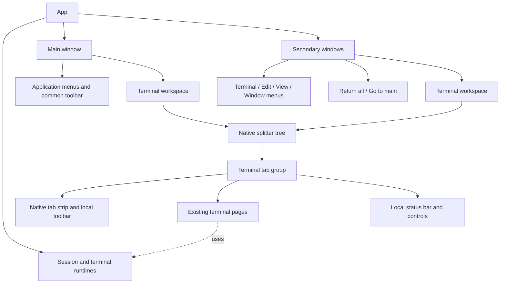

# Terminal groups and windows

## Group-only status surfaces

Window hosts have no separate status bar. Each terminal group owns its status text
and control buttons. View / Status bar controls the selected group; visibility is
retained in the existing group presentation configuration. The obsolete application
visibility option is no longer exposed or applied.

Application diagnostics are displayed in the active main-window group. With no
visible terminal group they use the workspace page's message label, preserving the
workspace/session context and controls. Menu status-tip events do not create another
window-wide bar or overwrite a terminal diagnostic.

Release AppTests, SettingsSchemaTests and SettingsFormTests pass. Native Windows
captures at [100%](images/performance/TerminalGroupsStatusOnly100.png) and
[200%](images/performance/TerminalGroupsStatusOnly200.png) were inspected; the group
frame reaches the bottom of the window without an additional status strip.
The Debug application and bundled plugins were rebuilt separately.

## Ownership and interaction

APP-20 replaces single-terminal dock panels with a uniform group-of-tabs layout.
The application retains one workspace, one active session and the same GUI-thread
terminal runtime owners. Hosting never recreates a transport, parser, screen,
processing graph, input draft or terminal page.

A TerminalWorkspace owns a bounded tree of QSplitters and TerminalTabGroups.
A framed group owns its QTabWidget, compact toolbar row and status bar. Each tab is the
presentation of one existing terminal page. The controller retains authoritative
runtime ownership; a page belongs to exactly one group's native stacked layout.

Dragging a tab past the platform threshold starts standard QDrag with a 65%-opaque
copy of the tab and the original pointer hotspot, including reordering within its
own strip. The platform moves that image. The page stays in its original group
until a drop completes. Dropping on a strip inserts
at the indicated position; dropping centrally joins the group; dropping at an
edge creates a split. The same gesture works across main and secondary windows.
Only in-process drags from the same live host tree and exact page are accepted.
QDrag is the single gesture owner; QTabBar's separate movable interaction is
disabled. Same-group drops use QTabBar.moveTab, preserving header/layout objects
and avoiding transport resize. Transfers between groups reparent the existing page.
Esc cancels; an unaccepted release outside all terminal areas creates a secondary
window. On Windows, the held primary button is queried after OLE returns because
Qt resets its cached mouse state on cancellation as well as release. Production code does not synthesize pointer input or move a window on
every mouse event.

Empty groups disappear and one-child splitters collapse. An empty main area keeps
one usable drop group. Empty secondary windows close. Groups retaining unavailable
provider placements remain present until those definitions can be materialized.

## Commands and naming

Each group's toolbar and status buttons address its current terminal, independently
of other groups. Main-window commands address the focused main group; secondary
menus address that window's focused group. Execution revalidates the registered
command, terminal UUID, panel identity and current host. Window shortcuts belong
to the window menu presentations; local button presentations do not duplicate
window-wide shortcut activation.

Secondary windows have restricted Terminal, Edit, View and Window menus. Their
small navigation toolbar contains panel-top **Return all tabs to main window** and
**Go to main window**. These controls belong to the window. The terminal toolbar,
status text and buffered-input/file/processing buttons belong to each group.
Returning all grafts the existing splitter subtree into the main area, preserving
group IDs, pages and local state. X performs the same return; explicit terminal
closure remains a separate command. Closing the main application saves once and
closes all hosts and runtime resources.

Main titles use `workspace / session`. Secondary titles use
`workspace / session / number`, without an application-name suffix or active
terminal name. Empty components are omitted; the application name is the fallback
when no context is available. Additional windows receive unique numbers starting
at 2. Existing window numbers remain stable across tab/group transfers and are
saved as integer `number` metadata in each session window entry. Unspecified
numbers are allocated from the unused values; explicit numbers are reserved first.

Tabs show concise plugin-provided type labels: Serial, TCP/UDP and configured
console executable names such as PowerShell or CMD. Automatic consoles use Console.
Connection parameters remain on the second line. Saved object names and identities
are unchanged and remain available in tooltips and accessible descriptions.

## Configurable action placement

The existing interface settings page exposes four flat YAML-list fields:

| Setting path under ui/terminalGroups | Surface |
| --- | --- |
| embedded/toolbar | Main-window group toolbar |
| embedded/status | Main-window group status controls |
| secondary/toolbar | Secondary-window group toolbar |
| secondary/status | Secondary-window group status controls |

Lists contain ordered `group:connection` or `command:Terminal.LocalEcho` selectors.
Group selectors collect primary registered terminal actions in semantic role order;
command selectors select one registered command, including auxiliary commands.
Duplicate matches are shown once. Explicit empty lists
hide the corresponding controls. Unknown selectors remain in settings for late
plugin registration. Each list is bounded to 64 strings of at most 128 characters.
ToolbarActionContainer borrows the actual QToolBar, including the small toolbar
inside the native QStatusBar. Placement does not grant command eligibility.

Default toolbars include connection commands, Local echo, Wrap lines and settings.
Default status controls include Buffered input, Send file and Processing.
Auxiliary commands, including environment refresh and those three status commands, require explicit command selectors instead of broad groups,
keeping the two surfaces compact. Application settings provide defaults and workspace
overlays may override the lists. Changes apply through the existing settings owner.

## Session presentation

Current-format `presentation.terminalLayout` contains `main`, `windows` and optional
`activeGroup`. Each window stores a stable UUID, bounded canonical Base64
QWidget.saveGeometry and its own tree. Group nodes store their UUID, ordered
terminal object IDs, current selection and local toolbar/status visibility. Split
nodes store orientation, native
sizes and children. `tabOrder` remains the global ordering of object definitions,
including unavailable providers. Obsolete per-terminal dock/window readers and
native QMainWindow dock-state blobs are removed; there are no legacy migrations.

Core validates before acceptance: depth at most 16, at most 256 groups and 64
secondary windows, unique canonical nonnil UUIDs, safe unique terminal IDs, bounded
geometry and nonnegative splitter sizes. A terminal can occur only once across all
windows. Unknown presentation metadata remains attached to surviving nodes.
Factories restore terminals disconnected; restoring layout never opens a device.
Unavailable-provider placement survives capture and provider recovery.

Geometry, splitter motion and drag previews do not serialize session documents.
Live widgets own geometry until explicit save/capture/lifecycle boundaries. Host
transfer suppresses intermediate display-resize callbacks and reports the stable
final terminal grid to its backend. Save failures retain the live layout.

## Verification

Verification uses bounded synthetic devices and streams. No physical device or
external network connection is required. Native pointer acceptance is opt-in and
must verify the physical target before input injection. Mixed physical-monitor
DPI transfers require separate hardware acceptance.

Acceptance on Windows 11, Qt 6.12.0 and MSVC 2022:

- Debug and Release application builds complete. Standard CTest runs pass AppTests,
  SessionTests, CommandEditorTests and TerminalDisplayTests in both configurations.
- AppTests includes 58 passing results and one default native-input skip; session
  tests include 12 passing results and two existing symlink-privilege skips.
- Synthetic connections, page/display/editor/processing identity, selected terminal,
  input drafts, local action isolation, stale context-menu safety, shutdown and
  reentrant session closure are covered.
- Provider unload/save/recovery and full session reopen retain group identities,
  split trees, unavailable terminal positions, selection and local panel visibility.
- Opt-in native mouse acceptance at 100%, 125% and 200% covers in-strip reorder, edge split, transfer between secondary windows, release
  outside terminal areas and Escape cancellation.
  The actual QDrag pixmap is checked for nonopaque alpha; captured previews and
  final window layouts are visually inspected. OS screen grabs can omit the drag
  image itself, so that asset is captured from QDrag directly.

The native fixture temporarily raises only its own windows, verifies physical
start/drop targets before input, then restores their prior topmost flags. All
transport checks use synthetic devices. Physical devices, external connections
and mixed physical-monitor DPI transfers are not established by these checks.

## Group surface clarity (APP-21)

Each group is one framed container enclosing its compact toolbar, tab strip,
terminal panel and status bar. A two-pixel palette-based frame marks the complete
scope with the same neutral border for every group. Focus and clicks do not add
an accent outline; selected tabs retain their normal selection presentation.

Terminal controls use a separate compact row above the tabs, with 16-pixel icons.
Only applicable commands target that group's selected terminal. The main toolbar
contains terminal creation commands; terminal menus and shortcuts remain available
without repeating terminal controls in the common toolbar. Existing workspace
surface selectors continue to configure local commands and visibility.

The tab strip has a drop-down for direct selection of fully or partly obscured
tabs. Entries include the terminal name and endpoint. Selection resolves the
original page at invocation, so reordering does not change the target and a removed
page cannot select another terminal. When every tab fits, the menu reports that
all tabs are visible. The corner button keeps a stable footprint across resizes.

Acceptance completed with Qt 6.12/MSVC 2022 on Windows:

- Debug and Release application builds complete; AppTests, SessionTests,
  CommandEditorTests and TerminalDisplayTests pass in both configurations.
- Group tests cover frame containment, neutral frame consistency across focused groups,
  focused-group command scope, compact applicable commands and overflow selection
  after reordering, removal and destruction of a page.
- Native drag tests pass at 100%, 125% and 200%, including reorder, edge split,
  cross-window transfer, outside release and Escape cancellation. Visual captures
  confirm complete neutral group boundaries, compact controls and a
  palette-aware overflow icon in light/dark schemes.
- Final focused tests pass after the overflow icon refinement. Windows may clamp
  oversized test-window geometry to the physical monitor; mixed-monitor DPI
  transfers remain outside this acceptance. All devices are synthetic or unused
  disconnected endpoints; no physical device receives traffic.

## Whole-group movement and overflow controls (APP-22)

The group header includes a small panels handle to the left of the terminal
toolbar. Dragging this handle or empty toolbar space moves the complete group.
Individual tab headers retain their existing single-terminal gesture. Both use
standard QDrag with a translucent preview; the scroll buttons themselves have
solid palette-based backgrounds and visible borders. Native buttons remain
readable when they cover a partially visible tab.

Wheel input over an overflowing tab strip operates its native scroll buttons in
both directions without changing the active terminal. Wheel input in the terminal
body keeps its existing terminal scrolling behavior. The hidden-tab menu remains
available for direct selection.

Group drops choose the nearest edge of the destination and insert a separate
group beside it. They never merge the group's tabs into another group. Releasing
outside terminal workspaces creates a secondary window; Escape cancels. Returning
to an empty main area replaces its placeholder group.

The original TerminalTabGroup, QTabWidget, toolbar, status bar, pages and tab
headers move together. Group UUID, order, selected page, drafts, processing and
live connections are retained. Native splitter removal collapses the source
layout and preserves unaffected sizing and metadata. Layout ownership, duplicate
IDs and depth/group limits are checked before mutation. Runtime hosts are
published before final backend resize callbacks, and affected visible siblings
receive their final grid sizes as well. The existing session layout format stores
the resulting group placement; no additional persistence format is introduced.

Acceptance with Qt 6.12/MSVC 2022 on Windows:

- Debug and Release application builds complete. AppTests, SessionTests,
  CommandEditorTests and TerminalDisplayTests pass in both configurations.
- Added checks cover wheel scrolling without selection, exact group/control/page
  identity, connected synthetic transport lifetime, cross-window movement, session
  reopen and reentrant session closure from a backend resize during group detach.
- Native pointer tests cover whole-group split/transfer, outside detach, return
  and cancellation alongside existing single-tab gestures at 100%, 125% and 200%.
  The Windows-native wheel check also passes after accounting for style-specific
  scroll-button arrow implementations. Overflow controls, menu and drag previews
  were visually inspected.
- Physical-device traffic and mixed-monitor DPI transfers remain outside these
  synthetic acceptance checks. Oversized fixture geometry can be clamped by Windows.

## Naming and tab-strip button acceptance (APP-24)

The hidden-tab menu button uses native corner layout with a half-width size hint tied
to the tab bar. Its full height follows the two-line strip and font/DPI changes.
No timer-based geometry adjustment is used.

Verification covers stable window numbers through save/reopen and vacant-number
allocation, invalid/duplicate numeric metadata, real plugin labels and live shell/
protocol settings changes, full-height half-width corner geometry after font changes,
and native group/tab gestures. Debug and Release application builds and the four
affected CTest suites pass. AppTests reports 58 passes with one default native-input
skip; opt-in native acceptance passes at 100%, 125% and 200%. Visual captures confirm
labels and full-height corner alignment. The offscreen Fusion style reserves a
one-pixel tab-base line outside its corner slot; native Windows checks require
exact height, half-width proportions and top alignment. Hosted plugins use ABI 12 and
all built-in modules are rebuilt. Mixed-monitor DPI and physical traffic remain
outside these checks.

## Main toolbar availability

The common creation toolbar is temporarily disabled by
`MainWindow::MainToolbarEnabled = false`. Its View command and native toggle are
unavailable; applying stored visibility settings does not restore it or rewrite
those preferences. Terminal creation remains available from the menu. Group-local
ToolbarActionContainers and status controls remain active.

## Default connection shortcuts (APP-28)

| Command | Default | Scope |
| --- | --- | --- |
| `Terminal.Start` | Ctrl+Shift+S | Active terminal |
| `Terminal.Stop` | Ctrl+Shift+X | Active terminal |
| `Terminal.Restart` | Ctrl+Shift+R | Active terminal |
| `Terminal.StartAll` | Ctrl+Alt+Shift+S | All session terminals |
| `Terminal.StopAll` | Ctrl+Alt+Shift+X | All session terminals |

The three active-terminal commands resolve the current backend's registered Connect,
Disconnect or Restart action by semantic role. They revalidate its visibility,
eligibility and exact terminal/window identity before execution. These commands are
the menu presentations, so their active shortcuts are displayed by Qt. Backend
role actions remain the local toolbar controls. Bulk actions are also available in
secondary windows' Terminal menu.

App's terminal controller lets Qt resolve application shortcuts before terminal byte
encoding. Plain Ctrl+C/S/X/R retain terminal control-byte behavior. An unbound key still
reaches terminal input, and a consumed shortcut command key's release is withheld from enhanced
keyboard reporting. Core's standalone display does not acquire application commands.
Settings can rebind or explicitly disable the defaults; saved assignments take priority
when a new implicit default conflicts with an existing custom binding.

Verification on Qt 6.12/MSVC 2022: Debug and Release application builds and the
AppTests, CommandTests, TerminalDisplayTests and TerminalInputTests suites pass.
Native Windows checks exercise focused main/secondary groups, start/stop/reconnect,
bulk commands, plain control bytes, command-key release suppression with enhanced
keyboard reporting, persisted rebinding and explicit clearing. The native shortcut
settings page was visually inspected. Group-transfer checks compare meaningful
selected fixture text because viewport-only trailing blank rows change with resizing.
Transport checks use synthetic devices; physical hardware and external traffic are
not part of this acceptance.

## Shortcut and action-layout usability (APP-29)

Connection menus use the shared Terminal.Start/Stop/Restart commands rather than
separate backend actions without bindings. Window shortcuts activate once; tab
context menus display the same binding without registering another accelerator.
App routes enabled window commands before terminal encoding, including Alt-based
editing bindings, while plain Ctrl control bytes continue to reach terminal input.

Editing defaults are Alt+C (copy), Alt+V (paste), Alt+X (cut), Ctrl+Shift+A
(select all), Ctrl+Shift+Z (undo) and Ctrl+Shift+Y (redo). Workspace commands use
Ctrl+Shift+N/O/W for new/open/close and Ctrl+Shift+F2 for save. The save key avoids
the active-terminal start and session-wide start-all bindings. Exit uses Ctrl+Shift+Q;
application settings use Ctrl+Shift+Comma. Explicit saved assignments remain unchanged.

The Interface page selects `actionLayout` editors through schema descriptors.
Each embedded/secondary toolbar/status list shows readable labels and supports
adding, removing and moving selectors. Unknown plugin selectors retain their
original IDs; an explicit empty list remains empty. Editors only change form drafts;
Cancel discards them and Apply uses the existing atomic settings owner. YAML syntax
and explicit scalar tags are not exposed by these list controls.

The disabled common toolbar has no Interface toggle; its stored visibility preference
is retained for future use. View menu mnemonics avoid Alt+V so paste is unambiguous.
Qt 6.12/MSVC 2022 native acceptance covers displayed menu shortcuts, Alt copy/paste,
ordinary Ctrl bytes, action-layout reorder/add/remove, unknown selectors, explicit
empty lists, Cancel and Apply. The affected menus and Interface page were visually
inspected. Debug and Release AppTests, CommandTests, TerminalDisplayTests, TerminalInputTests
and CodecProcessorTests suites pass; device traffic is synthetic.

## Input toggle shortcuts (APP-31)

`Terminal.BufferedInput` defaults to Ctrl+Shift+B and `Terminal.LocalEcho` to
Ctrl+Shift+E. Both toggle the focused terminal in its main or secondary window,
including toggling buffered mode back from its editor. Menu/status/toolbar checked
states follow the terminal settings. Explicit saved assignments keep priority.

Debug application build and native Windows shortcut/settings tests pass. Acceptance
covers both directions of each toggle in main and secondary groups, retained other
group state, zero terminal byte leakage and persisted assignment editing.
