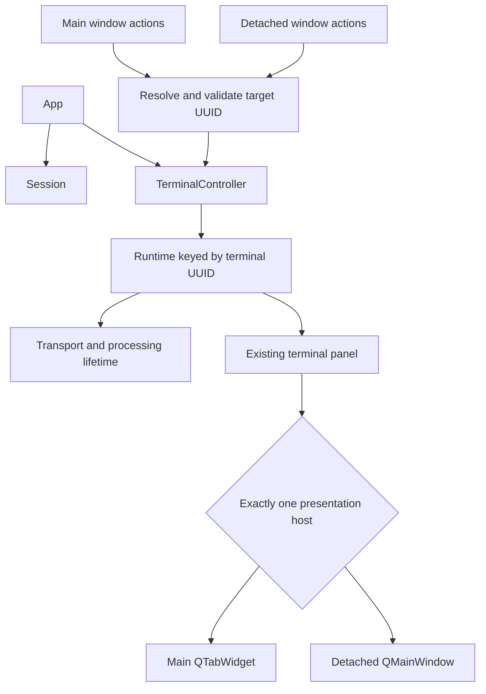

# Detached terminal windows

## Status and intended scope

Design proposal; detaching is not implemented. The first version hosts one terminal
per detached window. It keeps the approved main tab strip and the existing single
process, workspace, session, transport and processing model.

## Window contents and interactions

A standard QMainWindow contains the existing complete terminal panel: display,
buffered input/file sending and processing controls/properties. Its title identifies
the terminal type, endpoint, human-readable name and session without exposing shell
arguments or environment variables. The window has its own compact terminal toolbar
and status bar. Menus expose Terminal, Edit and View commands; workspace/session
catalog management stays in the main window.

This is a complete terminal window with its own interactive controls, rather than
an unadorned floating display. Its menus contain:

- Terminal: applicable start/connect, stop/disconnect, reconnect/restart, terminal
  settings, clear, explicit terminal closure and Return to main window.
- Edit: copy, paste and select all, resolved against that window's terminal/editor.
- View: visual wrapping, this window's toolbar/status-bar visibility and fullscreen.

The icon-only toolbar reuses the applicable connection, reconnect, clear,
local-echo, wrap and settings commands, plus Return to main window. Its status bar
includes the existing buffered-input toggle, file-send button and processing
panel toggle, with their checked/enabled states. Opening those controls exposes
the same editor, file actions and processing settings as in the main window.
Status also shows the actual connection state and existing queue/processing
diagnostics; acceptance into a send queue is not delivery. Menus, toolbar and
status-bar buttons all resolve the terminal UUID belonging to their own window,
including when a different terminal is selected in the main window.

Detach starts with a tab context-menu command. Dragging outside the main strip can
be added using standard QDrag/QMimeData and the platform drag threshold; returning
uses the same validated session/terminal UUID transfer. Foreign session IDs,
unknown terminals and unavailable providers are rejected before changing parents.
No custom window moving, painting or simulated pointer handling is required.

The recommended default for the detached window's X is **return to the main window**,
with its connection, history, selection, input draft and processing instance intact.
Closing the terminal remains a separate explicit Terminal command. Return restores
the terminal's slot in the session's global order, selects it and activates the main
window. Closing the main application still saves once and exits all terminal hosts.
This close behavior is a proposed UX choice, not delivered behavior.

## Ownership and command targets

TerminalController keeps runtime ownership. A small GUI-thread host record maps a
terminal UUID to its current window/presentation location. Moving reparents the
existing panel; it does not recreate a device, parser, screen or processor graph.
The panel belongs to exactly one QWidget parent. Reparenting/layout must be batched
so backend resizing observes valid final dimensions, without transient tiny grids.
Native DPI/font notifications then update the existing display caches. Toolbars/status widgets are
separate widgets per host and share command definitions, rather than widget parents.

The current `_current()` and `_activeWindow()` assumptions are main-window-only.
Before detaching, command dispatch must resolve the host's terminal at trigger time
and revalidate its capabilities. Each window creates its own QAction presentations
with the existing command/shortcut metadata and WindowShortcut scope. Main-window
actions target its selected tab; detached actions target that window's UUID. Check
states and settings dialogs belong to the same target, including plugin actions.

Qt provides the required ownership operations:
[QTabWidget::removeTab](https://doc.qt.io/qt-6/qtabwidget.html#removeTab) removes a tab
without deleting its page, while
[QMainWindow::takeCentralWidget](https://doc.qt.io/qt-6/qmainwindow.html#takeCentralWidget)
returns ownership when reattaching. Headers are recreated through the current
native layout factory; the runtime panel and its source state are retained.

## Session state and lifecycle

`presentation.tabOrder` remains the global ordered list of terminal object UUIDs.
Detached terminals retain their slots; the main strip filters this order to its
attached terminals. A proposed `presentation.detachedWindows` map records only the
terminal UUID, native window geometry and window state. A second independent tab
ordering list is unnecessary for one-terminal windows.

Use QWidget::saveGeometry/restoreGeometry for the native geometry blob, stored as
encoded bytes in YAML, and preserve unknown presentation fields. Qt's
[restoreGeometry](https://doc.qt.io/qt-6/qwidget.html#restoreGeometry) adjusts geometry
outside available screens. Restore the main and detached views after factories
are ready, with all transports disconnected, following the current session contract.
Do not interpret restoring a window as permission to reconnect a device.

Session/workspace replacement and application exit first save presentation and
veto replacement on failure. Then stop new moves/commands, close borrowed settings
forms, cancel/drain runtime work, destroy panels/hosts and unload factories. Host
closure during shutdown or provider removal must suppress the normal X-to-reattach
path. Removing a provider releases its windows and runtime while retaining object
configuration and order for later recovery.

## Why QMainWindow rather than converting to docks

[QDockWidget](https://doc.qt.io/qt-6/qdockwidget.html#floating-prop) already supports
native floating/docking and is suitable if terminals become a general dock layout.
The current application uses a central QTabWidget, not docked terminal panes.
Converting all terminal tabs to docks would broaden the change to the established
layout and persistence model. A standard QMainWindow plus QWidget transfer keeps
the present layout and allows host-aware commands to be delivered independently.

## Suggested delivery and acceptance

1. Make command targets and status/settings presentation host-aware, without
   changing terminal ownership or connection lifecycle.
2. Add context-menu detach/return with native windows and preserve the same panel
   and runtime instance. Add the X-to-return policy and explicit close command.
3. Persist detached placement/geometry, restore disconnected, and handle missing
   screens, provider unload and failed saves before enabling cross-window dragging.
4. Add standard Qt drag/drop transfers with UUID validation and atomic host changes.

Acceptance must verify unchanged device/parser/processor identity, pending output
and cancellation, selection/drafts/history, per-window shortcuts/check states,
correct close targets, DPI changes, monitor removal, failed-save veto, plugin
unload and complete application shutdown with detached windows still open.
