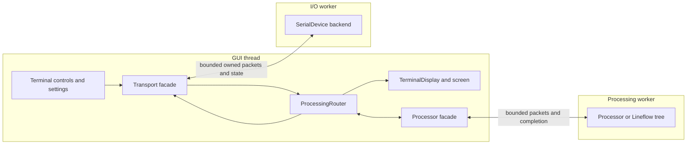

# Terminal worker execution

## Ownership

TerminalController, settings overlays, terminal groups, input controls and screen
rendering remain on the application GUI thread. Each materialized terminal owns
a transport facade. The facade constructs its backend on an I/O event-loop thread;
the backend's sockets, serial port, timers and callbacks belong to that thread.
Console transports retain their existing native pipe workers behind this boundary.

Processing preparation resolves catalog entries and configuration on the registry
owner thread. Each selected Lineflow diagram is instantiated on one processing
event-loop thread. All of its native nodes, nested Lineflow instances and their
timers share that thread: constructing a child does not create another execution
thread. An elementary processor selected directly uses the same root facade.
Processors may implement their own asynchronous or worker-backed functionality;
the Processor interface itself does not mandate an execution strategy.
A GUI-owned Processor facade forwards whole owned byte packets
and returns output and completion to the existing ProcessingRouter. Duplex ports
share one processor instance and its state. Independent selections have independent
instances. Heavy processing does not share the transport event loop.

## Contracts

Public facade methods execute on their GUI owner. Backends and nodes execute only
on their own owner thread. A plugin factory must construct its device or processor
on the calling thread and must not access widgets, host methods or mutable GUI
settings from the factory or runtime callbacks. GUI panel factories remain on the
GUI thread.

An open request is asynchronous: acceptance enters Opening; Open or Failed arrives
later. A write reports admission to a bounded queue, not delivery to the peer.
Transport errors remain separate from processing errors. Processing failures do
not disconnect the transport. Close invalidates pending publication from the old
connection before a subsequent open can publish new data.

Stop/reset discards unsent packets from both the GUI send queue and the transport
facade without closing the connection. An output epoch prevents an older in-flight
write from restoring a cancelled remainder or removing a newer packet. Native
progress consumes native/in-flight credits independently of new facade admission.
Bytes already accepted by the native transport cannot be recalled.

Worker messages carry owned QByteArray packets. Embedded NUL and empty datagrams
are retained. Stream writes may advance through partial acceptance; datagrams
remain atomic. Buffering, framing and aggregation remain explicit node behavior.
Queues account for both bytes and packet count so empty packets cannot bypass
limits. GUI delivery is budgeted and rescheduled instead of posting one unbounded
event per byte or packet.

Cancellation stops publication and acknowledges only after worker-owned callbacks
and objects are quiescent. Backend destruction completes before terminal factory
unregistration can unload its module. Prepared processor definitions and instances
retain provider leases through cancellation and deferred destruction. No per-packet
blocking call or GUI event-loop pumping is needed for worker execution.

Catalog factories and final preparation captures retire on the registry owner's
thread through a context that outlives temporary registry scopes. A root execution
reservation spans native retirement, complete worker-thread join (including
thread-local cleanup), and final preparation retirement on the owner thread.
Registry shutdown drains native instances, executions and queued catalog
retirements before returning. This prevents a zero-counter window from allowing
shutdown or plugin removal while worker-owned executable captures still exist.

Factory bootstrap waits for worker construction so configuration/factory failures
can reject materialization before installing a runtime. Factories must remain
short. A currently executing synchronous plugin call cannot be forcibly interrupted;
teardown must wait for that call to return. Processing cancellation is asynchronous,
with the existing registry shutdown deadline retaining provider pins on failure.
The GUI still owns terminal emulation, screen state and painting; this change moves
transport and configured processing, not screen mutation, away from the GUI.

On Windows, retain a native join handle captured before invoking plugin factories.
Qt 6.12's late `QThread::wait()` can return once its state is Finished, while the
native entry point has not yet returned and C++ thread-local teardown can still
run. The retained native handle closes that gap before factory leases are released.
This narrow platform guard complements Qt event-loop ownership; it does not affect
packet execution. Sources: [Qt wait implementation](https://github.com/qt/qtbase/blob/6.12/src/corelib/thread/qthread.cpp),
[Windows thread finish](https://github.com/qt/qtbase/blob/6.12/src/corelib/thread/qthread_win.cpp).

## Verification

All 61 configured Release test suites pass. Dedicated worker tests cover native
thread-local cleanup before provider release, immediate shutdown, owner-thread
factory retirement, borrowed configuration/output/error storage, bounded queues,
partial/atomic writes and cancellation during a write. A nested duplex Lineflow
test verifies that primitive children and nested diagrams share one worker for
construction, processing and timer callbacks. A deliberately slow processor leaves
the owner event loop responsive.

Native Windows tab/group dragging, cancellation, split, detach and return pass.
Widget captures and transfers are checked at 100% and 200%. Source workspace hashes
remain unchanged across isolated profiling runs. See the
[acceptance record](benchmarks/worker-execution/Acceptance.json),
[Release suites](benchmarks/worker-execution/ReleaseTests.txt), and
[performance comparison](application-performance.md#perf-21-default-worker-execution).
Debug is built after Release verification; no Debug test or benchmark is run.
