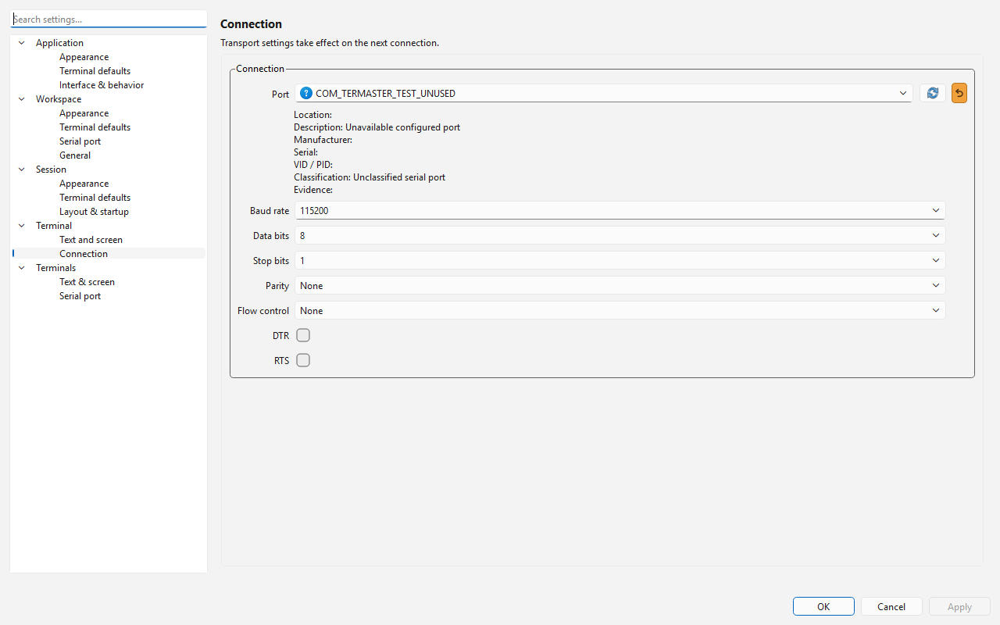

# Terminals and serial ports

## Ownership and plugin contract

Core exposes the header-only `SerialDevice`, `PluginHost` and optional
`HostedPlugin` interfaces. The existing Plugin lifecycle remains unchanged.
PluginManager supplies its borrowed host before startup. All device and host
operations execute on the GUI thread; transport callbacks carry bytes, never
pre-decoded text. Factories return exclusively owned devices.

App's TerminalController owns runtime devices, terminal tabs, selected-target
routing and layered settings. Core's TerminalScreen owns decoded screen state;
TerminalDisplay draws cached QTextLayout lines and handles selection and input.
The SerialTerminal SHARED plugin owns QSerialPort transport, the port selector,
its presentation model, connection descriptor, panel and action registrations.
It links Qt and the packaged PluginApi, without linking another static Core.
The public SDK and plugin headers are copied into their isolated build folders.
The selected MSVC build uses auto-export, without per-function export macros.

A plugin first unregisters its terminal type during shutdown. The host saves the
active session, closes settings and creation forms, clears callbacks and destroys
its devices and panels before releasing factories. Only then are commands and
custom editors unregistered. Save failure prevents unloading and retains live
resources. Registration failure unwinds successfully registered contributions.
PluginManager remains responsible for dependencies and reverse-order shutdown.

## Sessions and terminal settings

Each session object has a stable UUID, mutable human-readable name, terminal type,
plugin ID and settings map. Empty creation names use the existing adjective/noun
generator. Unknown or unavailable object types remain persisted and inactive.
Loading a session or enabling its plugin reconstructs recognized terminals in a
**disconnected** state. Connecting requires an explicit action. Closing a tab
releases runtime resources and retains its saved definition for session reopening.
Session/workspace replacement releases runtime objects before their settings owners.

Effective settings are borrowed live overlays:

1. In-memory application defaults.
2. Application configuration.
3. Workspace settings.
4. Session settings.
5. Terminal object settings.

Only the highest selected scope receives edits. Overlay fields remain editable;
editing establishes an override. A compact reset button on the right removes it
and exposes the inherited value or descriptor default. Its tooltip shows that
fallback. The orange vertical reset button appears only for local overrides;
inherited and local values use the same text color. An explicit equal value
still establishes an override. Descriptor defaults are displayed and
validated without silently copying them into persistence. Font family, size,
foreground, background, scrollback and local echo have real terminal bindings.
Appearance applies live; connection parameters apply on the next explicit connect.
Settings pages use the approved two-level navigation and search. Existing preview
pages remain isolated and explicitly identified as previews.

The Terminal menu provides create, connection, management, output and settings
groups. Serial actions are New, Connect, Disconnect, Close, Clear and Settings.
Menu and toolbar share icon-bearing actions. Visibility and eligibility depend
on the active window, session, selected terminal type and connection state;
execution resolves and validates the current target again.

## Serial transport

SerialByteDevice validates configuration before opening. States are Closed,
Opening, Open, Closing and Failed. Reads remain QByteArray chunks, including NUL.
The read buffer is bounded at 256 KiB; output acceptance is bounded at 1 MiB,
including the native pending buffer. Partial and zero writes retain queued bytes;
bytesWritten reports native progress separately from acceptance. Closing cancels
pending output, and asynchronous transport failures close the port and expose a
concrete cause. Default tests inject a QIODevice and never open physical ports.

The descriptor binds fields under `transport/`: portName, baudRate, dataBits,
stopBits, parity, flowControl, dtr and rts. Hardware flow control owns RTS.
Local echo is separate from received data and applies only to accepted input.
A successful write-buffer enqueue does not establish delivery to a device.

## Port classification

QSerialPortInfo supplies port inventory and optional descriptive metadata. It has
no universal physical/virtual flag. In particular, VID/PID and serial-number
presence do not establish port origin. See the
[Qt inventory API](https://doc.qt.io/qt-6/qserialportinfo.html).

On Windows, SetupAPI matches the device registry PortName and Configuration
Manager reads bounded parent chains, hardware IDs, service, enumerator and
[reported bus GUID](https://learn.microsoft.com/en-us/windows-hardware/drivers/install/devpkey-device-bustypeguid).
No port is opened and no device setting is modified. Metadata for all visible
ports is collected in one device-tree scan per inventory refresh.

An open port selector polls every second on a background thread and supports
manual refresh. At most one scan runs at a time. Only the GUI thread changes the
presentation model. Unchanged snapshots do not reset the model, and unavailable
configured or typed names remain selectable. The combo is editable: an arbitrary
nonempty port name may be saved while absent, and later arrival updates its
details without replacing the value, caret or selection. Inventory presence is
not configuration validation; opening reports transport errors separately. Selector destruction stops polling,
disconnects result delivery and waits for the scan thread before plugin unload.

Classification separates the reported bus (USB, PCI, Bluetooth, legacy UART,
other, unknown) from origin (hardware, software, unknown). Explicit SWD metadata
or matching com0com service and hardware IDs establishes software origin. A ROOT
enumerator alone establishes neither software nor hardware origin. Generic
children do not become hardware merely because an ancestor is a PCI controller.
FTDIBUS can follow its USB parent; PNP0500/PNP0501 identifies a legacy UART.
Conflicting or missing evidence remains unknown. Every category has a distinct
icon, and tooltips/details expose the classification evidence. USB virtual COM
adapters remain USB; software-only virtual port pairs are a separate category.

This describes operating-system and driver metadata, not proof of electrical
hardware. Arbitrary third-party drivers cannot be classified universally. On
other platforms the initial implementation returns unknown rather than guessing.
The current backend is Windows-first; Linux sysfs/udev and macOS IOKit classifiers
are future platform-specific work.

## Rendering and emulation

The common TerminalDisplay now uses the project-owned VT parser, screen model,
input encoder and Sixel/Kitty graphics decoder. QTextLayout remains the selected
renderer with a bounded visible-row cache. The widget is an independent processing
endpoint and separates user input, local echo and terminal replies. No ready-made
terminal engine is linked. See [terminal emulation](terminal-emulation.md) for the
compatibility matrix, limits, demo and verification.

Full VT-family conformance and every Unix terminal extension are not claimed.
History remains bounded in RAM; disk-backed unlimited history, graph execution,
terminal rename GUI and reconnect policy are separate work. No SSH, network or
local-console backend is implied by the view's protocol support.

## Verification

Enable `TERMASTER_BUILD_TERMINAL_TESTS` and `TERMASTER_BUILD_APP_TESTS` for the
screen/display, serial transport, plugin, classification and application checks.
Tests use synthetic streams, metadata and transport fixtures. App integration
loads the production plugin DLL and exercises disconnected terminal creation,
settings inheritance, action routing, unload and saved-definition restoration.
No default test opens a real serial port or sends device commands.

Verified on 2026-11-08 with Windows x64, Qt 6.12.0, MSVC 19.44 and Ninja Debug.
The application and production plugin built; all 15 CTest suites passed. The
existing optional action capture and three unavailable symlink cases were skipped.
Affected application, form and serial suites were rerun after the final changes.
Native application lifecycle and terminal rendering checks passed; the terminal
capture includes RGB/indexed colors, euro, emoji and Japanese text. This does not
establish wide-cell VT conformance. The production factory appears in the MSVC
DLL export table without an explicit export declaration. Release was not rebuilt.

Read-only inspection of the host COM1 matched Legacy UART through PNP0501. USB,
PCI, FTDI ancestry, Bluetooth, software, ROOT, conflicting and absent metadata were
checked with synthetic fixtures; those categories have no real-device acceptance
on this host. The background fixture verifies one in-flight scan, GUI event-loop
responsiveness, polling additions/removals, stable arbitrary names and caret
selection, unchanged snapshots and draining before destruction.

Native serial settings checks also passed at scale factors 1 and 2 with no
geometry warnings. The initial dialog is fitted using native frame margins;
wrapped page headings cannot force the outer window beyond the available screen.
At scale 2 the final RTS control remains reachable through scrolling while dialog
buttons remain visible. A fixed 1280 by 800 scale-1 reference is stored in
[Serial terminal settings](images/preferences/SerialTerminal.png).

## Baud rate suggestions

The serial plugin registers an editable `serialBaudRateSelector` field editor.
Its sorted, unique suggestions combine `QSerialPortInfo::standardBaudRates()`
with effective workspace settings at `serial/baudRates`. The current integer
value is retained even when absent from the list. Manual entry accepts baud
rates from 1 through 2147483647; device support is checked when connecting.
Typing a rate does not modify the suggestion list.

The real Workspace / Serial port page edits the custom list as YAML, validates
unique positive 32-bit integers and allows up to 256 entries. Apply uses the
existing workspace settings owner and atomic persistence. New forms read the
current workspace; session and individual terminal settings do not replace this
workspace-wide suggestion list. Invalid loaded suggestions are skipped with a
concrete diagnostic and never rewritten by the editor. Example workspace payload:

```yaml
content:
  settings:
    serial:
      baudRates: [250000, 500000, 1000000]
```

Terminal tabs use the connection-status glyph geometry and colors from the local
Flowgate `src/gui/qml/ConnectionStatus.qml` component (Drawngate naming). Standalone
SVG resources under `src/App/Res/Status` represent closed, open, transitional and
failed states. Tab text is the terminal name; the accessible tab name includes
the connection state. The transitional arc is static in this Widgets integration.
No QML dependency or additional transport backend is introduced.

Verified with MSVC 19.44 / Qt 6.12.0 Debug: the application and production plugin
built; serial plugin/device, application, schema and form suites passed. Native
Windows application acceptance covered workspace list validation/persistence,
manual entry, inheritance reset and plugin unload. No device was opened.


