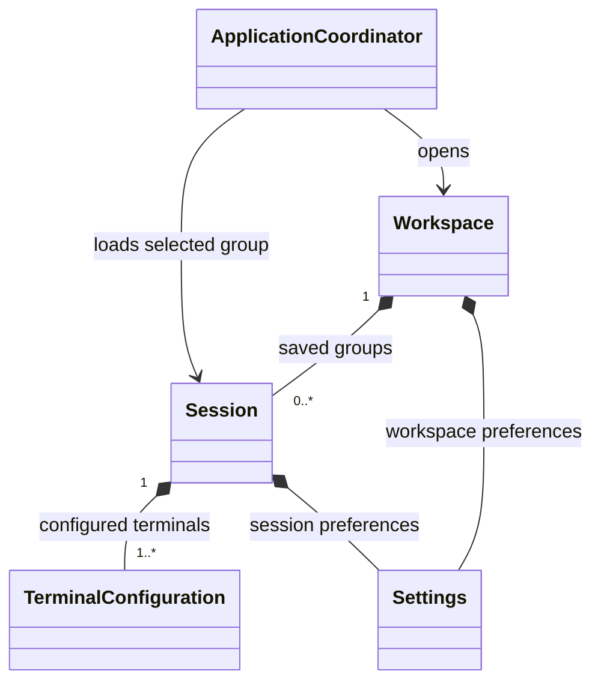

# Workspaces and sessions

## Requirements

Termaster opens a workspace. The workspace owns its general settings, session
settings and saved sessions. A session is a group of configured terminals, not
an individual terminal connection. Once a workspace is open, application menus
provide access to its sessions and loading a session opens that configured group.

These names describe responsibilities; they do not imply that the domain classes
or persistence schema have already been implemented.

## Ownership and boundaries

Workspace is the owner of workspace-specific state and paths. It provides the
session catalog and resolves paths for its own settings and sessions. Session
records contain terminal configurations plus session-specific settings. A saved
record and the running terminals created from it have separate lifetimes:
closing a running group does not delete its saved session.

ApplicationPaths resolves application-owned data, configuration, logging and
plugin locations. It does not own a global sessions directory. Paths and settings
of sessions are scoped to the workspace from which those sessions were selected;
future workspace support must not rely on a process-wide mutable current path.

Settings is the reusable YAML document owner. Its scoped Node views allow code to
work with a subtree without repeating its prefix. Settings does not create
terminal backends, own widgets, choose sessions or interpret terminal data.
Workspace/session owners apply domain validation after reading values.

The application coordinator sequences opening a workspace and loading a session.
The session menu presents the active workspace catalog and issues load commands;
menu widgets and YAML persistence do not orchestrate terminals. Rendering/input,
terminal emulation/screen state and byte transport retain their separate owners.
No backend becomes implemented merely because its name is stored in a session.

## Loading flow

1. Open the selected workspace and validate its settings and session catalog.
2. Present that workspace's saved sessions through application menus.
3. Load the selected session's terminal configurations and session settings.
4. Prepare the configured terminal group and its presentation through the
   application coordinator and responsible terminal components.
5. On closure or workspace replacement, stop owned operations before destroying
   the state and views they use. Saved definitions remain in their workspace.

A concrete workspace file/directory layout, identifier scheme, session switching
policy and connection activation policy remain to be designed. No automatic
connection to physical devices is implied by this architecture record.

## Implementation status

The requirements above are recorded for the next domain-design stages. Core's
reusable Settings, scoped views, ApplicationPaths, plugin lifecycle and action
containers are implemented independently. Workspace opening, a session catalog,
session menus and configured terminal-group loading are not implemented yet.
The current application executable is a Core plugin-management harness; legacy
terminal/session code outside Core is unbuilt reference material.
